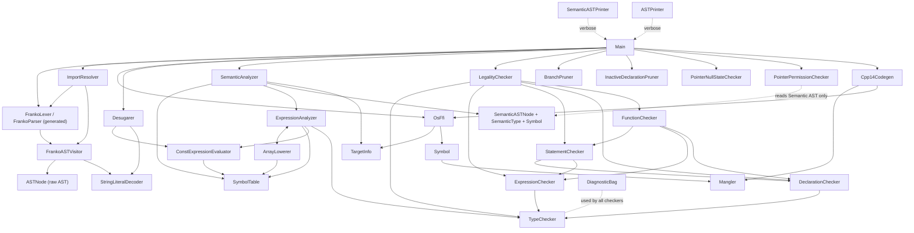

# Franko Compiler Internals

This document describes the architecture of the Franko compiler: how the phases
connect (call graph), what each Java source file does, and the cross-cutting
design rules that were historically kept as comments inside the source files.
From now on please do not add comments in the Java source files. All comments
about the compiler design should reside here.

- **Language**: Franko (`.fr`) — a small statically-typed language with fluid
  integer constants, dynamic/static arrays, a capability-based pointer system
  (`ptr`/`mview`/`view`), structs with methods, namespaces, and imports.
- **Compiler**: ~28 hand-written Java files at the repo root, plus an ANTLR4
  grammar (`Franko.g4`). The compiler is a **transpiler to C++14**: it emits one
  C++ translation unit, splices it into a program template, and the resulting
  `.cpp` is compiled with the host C++ toolchain.
- **Runtime**: `include/FrankoRuntime.hpp` (arrays, `franko_unsafe_cast`,
  the `borrowed` marker that keeps compiler-synthesized view-decay headers
  from freeing their storage),
  optional jemalloc (`third_party/`).

---

## 1. Pipeline overview

The driver is `Main.java`. A program flows through these phases:

```
source .fr
   │  FrankoLexer / FrankoParser (ANTLR, generated from Franko.g4)
   ▼
ParseTree
   │  FrankoASTVisitor  (parse tree → raw AST of ASTNode classes)
   ▼
Raw AST (ProgramNode)
   │  ImportResolver    (recursively parses imported .fr files, splices their
   │                     top-level items in place of ImportNodes → one flat AST)
   │  OsFfi.applyTargetConstants (if "franko/os" imported: rewrites the five
   │                     os::IS_* placeholder globals to 0/1 for the target)
   ▼
Import-resolved AST
   │  Desugarer         (lowers syntactic sugar to a small core AST,
   │                     folds every constExpr slot, collects diagnostics)
   ▼
Desugared AST
   │  SemanticAnalyzer  (builds the typed, symbol-resolved Semantic AST;
   │                     uses SymbolTable, ExpressionAnalyzer, ArrayLowerer,
   │                     ConstExpressionEvaluator)
   ▼
Semantic AST (SemanticProgramNode)
   │  LegalityChecker   (orchestrates TypeChecker, ExpressionChecker,
   │                     DeclarationChecker, StatementChecker, FunctionChecker)
   │  BranchPruner       (truth-table-based conditional/loop pruning on the
   │                     Semantic AST; removes dead branches and dead loops)
   │  InactiveDeclarationPruner (zero-reference pruning: structs, functions,
   │                     and variables never used in surviving code are
   │                     removed from the Semantic AST)
   │  PointerNullStateChecker (intra-procedural pointer null dataflow)
   │  PointerPermissionChecker (capability linter: unused-permission
   │                            warnings for ptr/mview variables)
   ▼
checked Semantic AST
   │  OsFfi.verifyBridge (if franko/os imported: every used intrinsic must have
   │                     its mangled definition in os.ffi.cpp)
   │  Cpp14Codegen      (emits the C++ body: structs, globals, functions)
   ▼
generated C++ body
   │  template splice   (ProgramTemplate.cpp or ProgramTemplateWithRawCArgs.cpp,
   │                     selected by sema.entryKind(); the body replaces
   │                     __FRANKO_PROGRAM__)
   ▼
output .cpp  (then compiled with the host C++ compiler)
```

Non-fatal warnings (semantic warnings, pointer maybe-null warnings) are printed
between phases; errors abort with a `RuntimeException` carrying the formatted
`DiagnosticBag` contents.

---

## 2. Call graph

### 2.1 Phase driver graph



### 2.2 ASCII call-edge matrix

`caller → callee` edges (instance calls unless noted):

| Caller | Calls into |
|---|---|
| `Main` | `FrankoLexer/Parser`, `FrankoASTVisitor`, `ImportResolver`, `OsFfi`, `Desugarer`, `SemanticAnalyzer`, `LegalityChecker`, `BranchPruner`, `InactiveDeclarationPruner`, `PointerNullStateChecker`, `PointerPermissionChecker`, `Cpp14Codegen`, `TargetInfo`, `ASTPrinter`, `SemanticASTPrinter` |
| `ImportResolver` | `FrankoLexer/Parser`, `FrankoASTVisitor`, `ASTNode` |
| `Desugarer` | `ConstExpressionEvaluator`, `StringLiteralDecoder`, `DiagnosticBag`, `ASTNode` |
| `SemanticAnalyzer` | `SymbolTable`, `ExpressionAnalyzer`, `ArrayLowerer`, `ConstExpressionEvaluator`, `OsFfi`, `TargetInfo` |
| `ExpressionAnalyzer` | `SymbolTable`, `ConstExpressionEvaluator`, `ArrayLowerer` (mutually with), `TypeChecker` (static: `isValuePreservingIntegerWidening`) |
| `ArrayLowerer` | `ExpressionAnalyzer`, `SymbolTable` |
| `ConstExpressionEvaluator` | `SymbolTable` (diagnostics only) |
| `LegalityChecker` | `FunctionChecker`, `DeclarationChecker`, `StatementChecker`, `ExpressionChecker` |
| `BranchPruner` | reads/writes `SemanticASTNode` trees only (called by `Main`); no other compiler classes |
| `InactiveDeclarationPruner` | reads/writes `SemanticASTNode` trees only (called by `Main`); no other compiler classes |
| `FunctionChecker` | `StatementChecker`, `ExpressionChecker`, `DeclarationChecker`, `TypeChecker` |
| `StatementChecker` | `DeclarationChecker`, `ExpressionChecker`, `TypeChecker` |
| `DeclarationChecker` | `TypeChecker` (incl. static `fitsBigIntegerToPrimitive`) |
| `ExpressionChecker` | `TypeChecker` |
| `PointerNullStateChecker` | `DiagnosticBag` only (deliberately standalone) |
| `PointerPermissionChecker` | `DiagnosticBag`, `PointerPermissions` (deliberately standalone) |
| `Cpp14Codegen` | `OsFfi`, `TargetInfo`, `Symbol`/`Mangler` (mangled names), `SymbolTable.splitNamespacePath` (static) |
| `SymbolTable` | `DiagnosticBag`, `Symbol`, `SemanticType` |
| `Symbol` | `SemanticType`, `Mangler` (static `hashHex`) |
| `OsFfi` | `TargetInfo`, `Symbol`/semantic node classes |
| `TypeChecker`, `DiagnosticBag` | leaf utilities (JDK only) |

Called-by is the inverse of the table above (e.g. `TypeChecker` is called by
every checker plus `ExpressionAnalyzer`/`DeclarationChecker` statically).

### 2.3 Data model ownership

- `ASTNode.java` — raw AST data model, produced by `FrankoASTVisitor`,
  rewritten by `Desugarer`/`ImportResolver`/`OsFfi`, read by `ASTPrinter` and
  `ConstExpressionEvaluator`.
- `SemanticASTNode.java` — lowered typed AST, produced by
  `SemanticAnalyzer`/`ExpressionAnalyzer`/`ArrayLowerer`, consumed by every
  checker, `PointerNullStateChecker`, `PointerPermissionChecker`,
  `Cpp14Codegen`, `OsFfi`, `SemanticASTPrinter`.
- `SemanticType.java` — structural type system (overload resolution, mangling
  keys). Also hosts `PtrPermission` (OWNER/MUTABLE/READ_ONLY), the permission
  lattice shared with the raw AST (`ASTNode.PtrTypeNode.kind`,
  `GetPtrNode.kind`) and every permission rule.
- `Symbol.java` — symbol hierarchy (variables, functions, methods, structs,
  fields, namespaces) plus the C++ mangling policy.

---

## 3. Per-file reference

### 3.1 Front end

#### `Franko.g4` (grammar, 1131 lines)
The single source of truth for Franko syntax: combined ANTLR4 lexer+parser
grammar. Generates (via `update_toolchain.py`) `FrankoLexer`, `FrankoParser`,
`FrankoBaseVisitor/Listener` and friends into `build/generated/`. Key rules:
`program`/`topLevelItem`, namespace/import/struct/function declarations, a
labeled-alternative `statement` rule, a full precedence-climbing expression
layer, a mirrored `constExpr` sub-grammar, and the `type` rule with
`array<T>` / `array<T, size>` / `ptr<T>` / `mview<T>` / `view<T>` and the `?`
inferred-size alternative. Pointer permissions are created by the intrinsic
forms `getptr(lvalue)` / `getmview(lvalue)` / `getview(lvalue)` and consumed
by `$(expr)` dereferences; conversions are `cast<T>(expr)` (integer widening
or pointer permission downgrade; the target is a full `type`) and
`unsafe_cast<T>(expr)` (checked integer conversions; target restricted to
`primitiveType` at parse time). Global initializers accept `constExpr`, a
string literal, a `getptr`/`getmview`/`getview` over a global, or `null`.
Notable lexer details: `int/byte/uint` keyword aliases for the sized integer
types, and a `groupingDepth` member on the lexer that suppresses NEWLINE
tokens inside `(` and `[` (braces are deliberately excluded so newlines stay
statement separators there).

#### `FrankoASTVisitor.java`
Parse-tree → raw-AST lowerer: the single `FrankoBaseVisitor<ASTNode>`
implementation. Runs first, once per source file (and once per imported file
via `ImportResolver`). Left-folds precedence levels into `BinOpNode` chains
(`foldSimpleBinaryRule`), reconstructs `<<`/`>>` from split `<` `<` / `>` `>`
tokens, builds access/call/postfix chains from `lvalueSuffix` rules, joins
`a::b` namespace headers into one name string, and dispatches declarations,
statements, types, and the `constExpr` sub-grammar to their node classes.
Called by `Main` (root) and `ImportResolver.collectFile` (imports); calls
`StringLiteralDecoder.decodeRawContent` for import-path strings.

#### `ASTNode.java`
All raw AST node classes in one file (package-private, constructors only):
`ProgramNode`, `BlockNode`, `ExprStmtNode`; statements (`AssignNode`,
`IncDecNode`, `IfNode`, `WhileNode` with its desugared-for update epilogue,
`BreakNode`/`ContinueNode` with optional const level, `ForNode`, `PrintNode`,
`ReturnNode`); declarations (`FunctionDeclNode`, `ParameterNode`,
`StructDeclNode`, `StructFieldDeclNode`, `GlobalVarDeclNode`, `VarDeclNode`,
`VarDeclInitNode`, `VarDeclArrayInitNode`, `ImportNode`, `NamespaceNode`,
`QualifiedNameNode`); types (`PrimitiveKind` enum, `PrimitiveTypeNode`,
`VoidTypeNode`, `DynamicArrayTypeNode`, `StaticArrayTypeNode`, `PtrTypeNode`
(carrying a `PtrPermission kind`: `ptr`/`mview`/`view`), `StructTypeNode`);
expressions (`VarNode`, `IntNode`, `InferredSizeNode`, `ArrayLiteralNode`,
`StringLiteralNode`, `UnaryOpNode`, `BinOpNode`, `ArrayAccessNode`,
`MemberAccessNode`, `CallNode`, `GetPtrNode` (kind: which of
`getptr`/`getmview`/`getview` was written), `DerefNode`, `CastNode` (a full
`TypeNode` target plus an `unsafe` flag distinguishing `cast` from
`unsafe_cast`), `NullNode`). `GlobalVarDeclNode.literalBytes` is non-null
only for string-literal globals hoisted by the Desugarer (§4.10): a
literal-backed `array<byte, N>` whose value is the decoded UTF-8 payload.
The field layout is the ABI between all phases.
Lifecycle rules that used to live as comments here:
- `ForNode`, `IncDecNode`, `VarDeclInitNode`, `VarDeclArrayInitNode`,
  `ImportNode`, `ArrayLiteralNode` are **pre-desugaring sugar**: none may reach
  `SemanticAnalyzer` (the Desugarer asserts this).
- `GlobalVarDeclNode` is deliberately distinct from `VarDeclNode` because the
  Desugarer keys top-level handling off node classes and global const
  initializers must never be rewritten into assignment statements.
- `WhileNode.update` exists only so desugared for-loops run their update
  epilogue on `continue` (see §4.1).

#### `ASTPrinter`
Debug pretty-printer for the raw AST (single class, all static). Used only
under `--verbose` by `Main` at three checkpoints: raw, import-resolved,
desugared. A giant `instanceof` dispatch over every `ASTNode` class; also
`typeToString` (renders types as Franko source spellings) and
`exprToInlineString` (compact one-line expressions for static array sizes).

#### `ImportResolver`
Resolves `import "…"` immediately after AST construction, before desugaring.
For each `ImportNode` it lexes/parses/visits the imported file with the same
front end and splices its top-level items into the root `ProgramNode`, so the
whole program becomes one flat AST. Path resolution: `.fr` extension is
mandatory; relative paths resolve against the importing file; unqualified
paths search the `-p` search dir (default `./import`) before the importing
file's directory; real-path canonicalization dedups diamonds; files are marked
processed *before* splicing so import cycles terminate. Records the import
graph (`importGraph()`), detects the canonical `franko/os` builtin module
(`importedBuiltinModules()`, `frankoOsModuleFile()`) which activates the FFI
and target-constant machinery in `Main`, and contains a testable
`translateWindowsAbsolutePath` helper. Also contains a
`CollectingErrorListener` that prefixes lexer/parser errors of imported files
with the file name.

#### `Desugarer`
The desugaring pass (after import resolution, before semantic analysis). Lowers
syntactic sugar to a small core AST: declaration initializers → decl +
assignment (or indexed assignments for array initializers), `x++/--` →
`x += 1`, `for` → block + `while` (update as while-epilogue so `continue` is
C-like), `?` array sizes → concrete constants via the rectangle rule (array
literals only), string literals → hoisted literal-backed globals plus a
`getview(<global>)` expression of type `view<array<byte, N>>` (§4.10), and
every `constExpr` slot → a canonical decimal `IntNode` via
`ConstExpressionEvaluator`. Global initializers pass through the statically
representable forms (`null`, `getptr`/`getmview`/`getview` over a global)
and reject everything else. Error-recovery style: it accumulates diagnostics in
a `DiagnosticBag` (placeholder values on failure) and `Main` checks
`hasErrors()`/`formatErrors()` right after the pass. Private control-flow
signal: `InferenceFailure` (a `RuntimeException`) for `?`-size failures,
converted to a diagnostic. Throws if an `ImportNode` ever reaches it.

#### `StringLiteralDecoder`
Static utility: decodes Franko string-literal escapes
(`\\ \" \a \b \f \n \r \t \v`; rejects `\u \x \0` and unknown/trailing escapes
with `RuntimeException`) and converts a `StringLiteralNode` into its UTF-8
byte payload (`toUtf8Bytes`, unsigned bytes, no null terminator) for the
hoisted string globals. Called by `Desugarer` (string hoisting) and
`FrankoASTVisitor` (import paths).

#### `TargetInfo`
Immutable compilation target (canonical `<os>-<arch>` pair). Single source of
truth behind the `os::IS_*` constants in `import/franko/os.fr`. Key API:
`detectHost()` (JVM `os.name`/`os.arch` normalization), `parse(spec)` (accepts
`x64/amd64/aarch64/darwin` aliases), `constantFor(name)` (the 0/1 value of one
`IS_*` constant), and predicates (`isWindows`, `isArm64`, …). Used by `Main`,
`OsFfi`, `SemanticAnalyzer` (constant stamping) and `Cpp14Codegen`
(target-allowed intrinsic checks).

#### `OsFfi`
Compiler side of the `import "franko/os"` foreign-function bridge. Five known
intrinsics (posix read/write; win32 GetStdHandle/ReadFile/WriteFile), each
recognized by namespace+name+exact signature (`kindOf`). Responsibilities:
- `applyTargetConstants` — rewrites the five `os::IS_*` placeholder globals in
  the raw AST to the target's 0/1 values before desugaring (only the canonical
  `franko/os` import activates this).
- `checkTargetAllowed` — rejects live calls to wrong-target intrinsics (posix
  on Windows, win32 off Windows); must run after constant-dead-branch pruning.
- `parseBlocks`/`buildBridge` — the bridge file `os.ffi.cpp` is split into
  `// @@franko-ffi:<name>` marker-delimited blocks; codegen prepends the
  `common` block plus one block per *used* intrinsic, in first-use order.
- `collectKinds`/`verifyBridge` — walks the semantic program, verifies each
  used intrinsic's emitted mangled name matches the pinned
  `expectedEmittedName`, and (in `Main`) that every used intrinsic has its
  definition present in the bridge text at Franko-compile time instead of C++
  link time. Known intrinsic names with drifted signatures are hard errors
  ("os.fr/ffi.cpp drift"); stubs must never compile silently.

#### `ConstExpressionEvaluator`
Compile-time integer constant folding for the `constExpr` subset
(integers, unary `-`/`!`, binary integer operators) over `BigInteger`.
Instance methods report diagnostics through `SymbolTable` (`parseIntegerLiteralSafe`,
`foldUnary`, `foldBinary`); static pure methods return `null` on failure
(`tryFold`, `tryFoldUnary`, `tryFoldBinary`, `parseIntegerLiteralPure`) or
throw `UnevaluableConstant` (`evaluatePure`, used by the Desugarer to
canonicalize const slots; the exception carries an optional ready-to-report
diagnostic, e.g. for division by zero). `%` uses `BigInteger.remainder` to match
C++14 truncated remainder semantics. Called by `Desugarer`, `SemanticAnalyzer`
(`break N` levels) and `ExpressionAnalyzer`.

### 3.2 Semantic core

#### `SemanticAnalyzer`
The lowering hub: converts the desugared raw AST into the typed,
symbol-resolved Semantic AST. It deliberately does **not** enforce full
language correctness (that is the legality cluster's job). Entry:
`analyze(ASTNode)` → `SemanticProgramNode`; throws `SemanticException` (static
nested class) when errors accumulated. Program analysis runs five internal
phases:
1. register struct names (placeholder symbols),
2. resolve struct fields, fold field defaults,
2b. register method signatures,
3. register global variables (fold const initializers; stamp `os::IS_*`
   compile-time constants),
4. register all function signatures (enables forward references/recursion),
5. lower items in source order (structs+methods, globals, function bodies).

Also determines `entryKind()` (`NONE`/`NO_ARGS`/`ARGS`) which selects the C++
program template in `Main`, collects non-fatal `warnings()`, and owns the
`ExpressionAnalyzer` (constructed with the shared `SymbolTable` +
`ConstExpressionEvaluator`; the `ArrayLowerer` is wired in via
`exprAnalyzer.setArrayLowerer(...)` and `analyzeNormalType` is wired in as
the cast-target type resolver via `exprAnalyzer.setTypeResolver(...)`).
Globals additionally accept the statically representable initializers
(`null`, `getptr`/`getmview`/`getview` over a global) and carry the UTF-8
payload of hoisted string-literal globals on `GlobalVariableSymbol`.
The entry-point signature must remain exactly `view<array<array<byte>>>`
(read-only) for the raw-args `main`; the template marshals argv behind a
const pointer, so the program cannot mutate its arguments.

#### `SemanticASTNode`
The lowered AST data model (pure data classes): program/namespace/block
nodes, `SemanticFunctionDeclNode` (symbol + parameter variables + body),
`SemanticStructDeclNode`, `SemanticVarDeclNode` (with folded const
initializer), statements (`SemanticAssignNode` with op text and
`isCompound()/baseOp()`, `SemanticIfNode`, `SemanticWhileNode` with the
desugared-for update epilogue, `SemanticBreakNode` with levels,
`SemanticContinueNode`, `SemanticPrintNode`, `SemanticReturnNode` carrying the
owning `FunctionSymbol`), the array-intrinsic vocabulary
(`SemanticArrayIntrinsicKind`: INIT, INIT_ZERO, RESIZE, UNINIT, MEMSET, MEMCPY,
MEMMOVE, LENGTH — with `returnType()`/`returnsVoid()`;
`SemanticArrayIntrinsicCallNode` with separate receiver + args and full/ranged
memset/memcpy predicates), and expressions (all carrying `type`,
`constantValue: BigInteger`, `isConstant()`; `isLValue()` abstract).
`SemanticGetPtrNode` covers all three creation intrinsics; the permission
created is `type`'s (`SemanticPtrType.permission`), which is exactly the
level the target region must grant. `SemanticCastExprNode` has a `checked`
flag: `false` → plain `static_cast` (`cast`), `true` → runtime-checked
`franko_unsafe_cast` (`unsafe_cast`). `SemanticVarDeclNode` carries either a
folded `BigInteger` initializer (primitive globals) or a `staticInitializer`
expression (pointer globals initialized with a statically representable
address).

#### `SemanticType`
The structural type system: `SemanticPrimitiveType` (8 kinds),
`SemanticVoidType` (return-type only), `SemanticDynamicArrayType`
(`array<E>`), `SemanticStaticArrayType` (`array<E,N>` — size stored as the
canonical folded decimal so `array<int32_t,5+5>` equals `array<int32_t,10>`),
`SemanticPtrType` (the pointer family; see below),
`SemanticNullType` (type of `null`; `mangleKey()` throws),
`SemanticStructType` (nominal identity via its `StructSymbol`),
`SemanticFunctionType` (with `signatureKey()` like
`fn(int32_t,ptr<std.X>)->void` for mangling). Two distinct text APIs:
`describe()` (diagnostic text, free to change) and `mangleKey()` (canonical
C++-spelling key embedded in generated names — must stay stable). Structural
`equals`/`hashCode` everywhere.

The pointer family is one class with a `PtrPermission` level (OWNER
`ptr<T>` → `T*`, MUTABLE `mview<T>` → `T*`, READ_ONLY `view<T>` → `T const*`),
exposed as the subclasses `SemanticPtrType`/`SemanticMViewType`/
`SemanticViewType` so every `instanceof SemanticPtrType` check covers all
three while type equality keeps them distinct (`getClass()` + referenced
type). `mangleKey()` spells them `ptr<…>`/`mview<…>`/`view<…>`, so owner
signatures (and every pinned mangling) are unchanged.
`PtrPermission.allows(other)` encodes the downgrade lattice: permissions
only ever downgrade (owner → mutable → read-only), so a stronger level
allows a weaker-or-equal one. `SemanticPtrType.withPermission` re-wraps a
referenced type at another level (used by `OsFfi` when matching expected
intrinsic signatures).

#### `Symbol`
The symbol hierarchy and mangling policy:
- `VariableSymbol` (+ optional namespace), `ParameterSymbol`,
  `GlobalVariableSymbol`.
- `FunctionSymbol` — parameters, namespace, `isBuiltin`; `mangledName()` =
  `FUNC_<name>_HASH_<8 hex>`; `emittedLocalName()` for codegen. Overload
  identity is name + ordered parameter types; **return type is intentionally
  not part of overload identity** (so `f(int32_t)->int32_t` and
  `f(int32_t)->uint32_t` conflict).
- `MethodSymbol` — adds `owner: StructSymbol`; emitted as
  `METH_<name>_OFSTRUCT_<Struct>_HASH_<hex>` free functions taking
  `STRUCT_X* VAR_self` (spelled `T*`/`T const*` per the self permission).
  **Method overload identity excludes the `self` parameter's type**: name +
  the remaining parameter types must be unique, so a struct may not carry
  both a `view<X> self` and an `mview<X> self` method with otherwise
  identical signatures.
- `GlobalVariableSymbol` — adds `compileTimeConstantValue` (os `IS_*`
  folding) and `literalBytes` (the UTF-8 payload of a hoisted string-literal
  global, §4.10).
- `FieldSymbol`, `StructSymbol` (ordered fields, per-name method overloads,
  field/method clash detection).
- `NamespaceSymbol` — parent/children tree with per-namespace tables for
  structs, functions, globals.

The hash in every mangled name is `Mangler.hashHex(signatureKey())` (FNV-1a
32-bit), so overloads emit distinct C++ names without relying on g++
overload resolution.

#### `SymbolTable`
Scope/symbol environment for semantic analysis (refactored out of an earlier
`SemanticAnalyzer.Context`). Owns: lexical variable scopes
(`pushScope/popScope/declare/resolve` with lexical → current-namespace globals
→ global-namespace globals lookup order); namespace declaration/resolution and
`setCurrentNamespace`; struct tables with namespace-chain fallback
(`resolveStruct`) vs strict (`resolveStructIn`); function/method overload
registration and resolution (`resolveFunction/resolveMethod` — arity +
type applicability, constant-fluid arguments may widen, nonconstants must
match exactly **or be a pointer conversion** (permission downgrade or
array-view decay), ambiguity is an
error; among applicable overloads exact permission matches win over
downgrading ones, then pure downgrades, then decays, then ambiguity —
the fewest-downgrades tally weights a decay twice a pure downgrade). Method overload
identity excludes `self`'s type: `resolveMethod` matches name + user
arguments only, and the caller synthesizes the hidden `self` argument with
`getptr`/`getmview`/`getview` matching the resolved method's declared self
type (an under-privileged receiver then fails the ordinary creation-intrinsic
permission rule); raw-decl→symbol registration maps;
name-clash warnings (struct names live in a separate namespace so clashing
with variables/functions is legal — the C++ backend's kind prefixes
`VAR_`/`FUNC_`/`STRUCT_` keep generated names unambiguous); and diagnostic
delegation to `DiagnosticBag`. `splitNamespacePath` is a static helper also
used by `Cpp14Codegen`.

#### `ExpressionAnalyzer`
Expression lowering *inside* the SemanticAnalyzer phase: raw `ASTNode`
expressions → `SemanticExprNode` trees with symbol resolution, overload
resolution, mechanical type inference, and folded `BigInteger` constants.
Explicitly does **not** validate assignment compatibility, operator legality,
or argument correctness. Notable behavior: array intrinsic calls are tried
first via `ArrayLowerer.tryLowerIntrinsicCall`; method calls lower to plain
calls whose hidden self argument is synthesized as
`getptr`/`getmview`/`getview(receiver)` **matching the method's declared self
type** (pointer receivers need explicit `$(p).method(...)`; the creation
intrinsic's permission rule is what rejects an under-qualified receiver);
`getptr`/`getmview`/`getview` lower to `SemanticGetPtrNode` with the
corresponding pointer permission; qualified `ns::name` references resolve
strictly against declared namespaces, and `os::IS_*` constants fold into
integer literals; `inferBinaryResultType` implements the fluid-constant rule
(when one operand is a folded constant, the result takes the other side's
type); same-type casts are returned unchanged (no cast node emitted);
`cast<T>()` lowers mechanically (target resolved through the wired type
resolver) and `unsafe_cast<T>()` always lowers as a checked cast; the
legality checkers decide whether a `cast` is a permitted widening,
permission downgrade, or array-view decay. Rejects leaked
`ArrayLiteralNode` as a "Desugarer
bug".

#### `ArrayLowerer`
Frontend lowering of array-intrinsic call syntax to
`SemanticArrayIntrinsicCallNode`s during semantic analysis: named member
intrinsics (`xs.init(n)`, `xs.init_zero()`, `xs.resize(n)`, `xs.uninit()`,
`xs.memset(v)`/`xs.memset(s,n,v)`, `xs.memcpy(src)`/`xs.memcpy(src,sr,dst,n)`,
`xs.memmove(src,n)`, `xs.length()`) plus the dynamic-array init shorthand
`xs(size)` → `xs.init(size)`. Type-directed dispatch: a struct-typed receiver
is a method call, never an intrinsic, even when a method name coincides with an
intrinsic name; `shouldSuppressCallDiagnostic` avoids misleading "no matching
overload" errors when fallthrough would be noise. The shorthand disambiguator
"peeks" at member-call receivers before full callee analysis to avoid spurious
errors alongside real method resolution. Mutually coupled with
`ExpressionAnalyzer` (analyzes intrinsic arguments through it).

### 3.3 Legality checkers

All five run under `LegalityChecker` on the already-lowered Semantic AST, each
reporting into a shared `DiagnosticBag`. `SemanticAnalyzer` deliberately
pre-establishes symbols/types so the checkers can focus on rules.

#### `LegalityChecker`
The orchestrator ("master checker"): constructs `TypeChecker`,
`ExpressionChecker`, `DeclarationChecker`, `StatementChecker`,
`FunctionChecker` in that dependency order, then `check(semaAST)` dispatches
each node (`checkFunction` / `checkStructDecl` / `checkStmt` / defensive
`checkExpr`) and throws `SemanticException` if the bag has errors. It is
invoked by `Main`, *not* by `SemanticAnalyzer`.

#### `FunctionChecker`
Function-level legality: valid return type, valid parameters (no duplicates,
assignable value types), method `self` shape (`ptr<X>`/`mview<X>`/`view<X>
self` must be the first parameter and no other parameter may be named
`self`), return statement rules
(`return;` only in void functions; `return expr;` must be assignable to the
return type, pointer conversions allowed), and **presence-based
missing-return detection**: a non-void
function must syntactically contain a return somewhere in its body (recursing
through blocks/ifs/whiles; the desugared for-update epilogue runs inside the
loop so returns there count). It does not prove full control-flow coverage.
Intercepts `SemanticReturnNode` itself and delegates other statements to
`StatementChecker`.

#### `DeclarationChecker`
Declaration-level legality: declared types must be legal Franko types
(primitive, array, ptr/mview/view, struct; void and arrays-as-values
rejected),
static array sizes must be constant, positive, and fit `uint32_t` (zero is
rejected — the backend emits `T data[N]`), struct field graphs must not have
infinite-size **by-value** cycles (cycle detection via `StructWalkState`;
the by-value path is intentionally reset when descending through dynamic array
elements because those live behind a pointer), method names must not collide
with field names, and folded const initializers/field defaults must fit their
primitive type. Pointer globals initialized with a statically representable
address (`getptr`/`getmview`/`getview` over a global) are validated here:
the initializer must be a pointer type match or pointer conversion
(permission downgrade or array-view decay).

#### `StatementChecker`
Statement-level legality: assignment targets must be storage-backed lvalues
(storage semantics: variables, derefs, and array/member accesses rooted at
storage — stronger than `SemanticExprNode.isLValue()`), non-void LHS, exact/
fitting RHS per `TypeChecker.ensureAssignable` (pointer conversions
allowed); assignment through an lvalue path requires **mutation rights** over
the target's storage region (§4.9 blocks writes through `view`); compound-assign
rules with
constant-zero-divisor rejection; `if`/`while` conditions must be non-void
integral expressions; `print` argument validity; and the void-value-context
rule: a void call may not appear where a value is required (`x = logDone();`,
`if (logDone()) {}`). Break/continue are no-ops here (already validated by
`SemanticAnalyzer`); a stray `SemanticReturnNode` triggers a defensive error
because `FunctionChecker` should have intercepted it.

#### `ExpressionChecker`
Expression *legality* on the already-inferred tree (it never infers types):
operator category rules (arithmetic/bitwise need same integral types or one
fitting constant; comparisons/logical allow mixed integrals with constant fit;
shifts need a non-negative constant or unsigned right operand), pointer/null
comparisons (only `==`/`!=`, matching pointer types), function-call argument
revalidation (constants must fit, non-constants match exactly or are a
pointer conversion — permission downgrade or array-view decay —, no
void/array arguments), array intrinsic
argument rules **and receiver permission rules** (lifecycle intrinsics
`init`/`init_zero`/`resize`/`uninit` need an OWNER region;
`memset`/`memcpy`/`memmove` targets need mutation rights; `length()` and
reads are always fine), constant static-array index bounds
(this is the rule rejecting over-long initializer lists), cast rules
(`cast` = value-preserving integer widening, pointer permission downgrade
over an identical referenced type, or the static-to-dynamic array view
decay — whose to-`ptr` form gets a dedicated "cannot decay ownership"
error; `unsafe_cast` = checked integer
conversion with compile-time constant range checks), creation-intrinsic
legality (`getptr`/`getmview`/`getview` need an equally strong storage
region, §4.9), deref legality, and void-in-value-context rules. Carries
the "fluid integer constants" model: folded constants stay fluid until a
context constrains them.

#### `TypeChecker`
The shared leaf utility: type predicates (`isVoidType`, `isIntegral`,
`isPointerType`, `isDynamicArrayType`, …), classification
(`isAssignableValueType`, `isValidFunctionReturnType`), `ensure*` helpers that
report diagnostics, assignment compatibility (`ensureAssignable`), operator
operand rules (`ensureSameIntegralTypeOrFit`,
`ensureMixedIntegralOperandsWithConstantFit`, `ensureValidShiftOperands`),
constant-fit machinery (`requireConstantFitsType`, static
`fitsBigIntegerToPrimitive`, `bitWidth`, `isSigned`,
`unsignedVariantOf`/`signedVariantOf`, static
`isValuePreservingIntegerWidening` — which also drives cast selection in
`ExpressionAnalyzer`), pointer conversions
(`isPermissionDowngrade`, `isStaticArrayViewDecay`, `isPointerConversion` —
delegating wrappers over
`PointerPermissions`), literal parsing (`parseIntegerLiteral`:
0b/0x/decimal), and memset/memcpy element rules (`isMemsetable`,
`isMemcpyable` — recursive with path-scoped cycle detection so diamond-shaped
field graphs stay fine while by-value cycles terminate). `ensureAssignable`
accepts the pointer conversions alongside exact matches and
also special-cases array targets fed a pointer-to-array source: the error
suggests `memcpy`, and names string literals explicitly only when the source
is a hoisted literal view (`getview(<global>)` over a `literalBytes` global).
It does not traverse the AST.

#### `PointerNullStateChecker`
Intra-procedural pointer null-state dataflow, run after legality checking and
deliberately independent of the checker cluster (only `DiagnosticBag`). It
is **strictly intra-procedural by design** — no facts cross function
boundaries (interprocedural nullability is an unsolved problem), and state is
reset at every function entry; the only cross-function assumptions are the
two documented entry seeds below. One
lattice fact per pointer-typed variable (`ptr`/`mview`/`view` are all
tracked): `POINTING` / `NULL` / `MAYBE_NULL`,
initialized to `MAYBE_NULL` at function entry (except method `self` and
`main`'s args param, seeded `POINTING`). Transfer rules: pointer decls are guaranteed NULL-initialized;
`p = getptr(x)` / `getmview(x)` / `getview(x)` → POINTING (the only
certifications); `p = null` → NULL; `p = q` copies state; anything else →
MAYBE_NULL. Guard refinement: `p == null` / `p != null` conditions refine
states on each path; exploration is path-sensitive up to
`MAX_BRANCH_DEPTH = 10`, with an insensitive fallback beyond the cap.
Loops track break/continue jump states via snapshot slots (`LoopFrame`,
preallocated `PointerState[][]` store), merge back-edge states, and compute
zero-trip exit states. Reports deref of definitely-NULL as error and
maybe-null as warning (each pointer warns at most once per check site).

#### `PointerPermissionChecker`
The capability linter: run after branch/declaration pruning (so only
surviving code counts) and before codegen, warnings-only. Per function it
tracks the **high-water mark** of permissions exercised by each local/parameter
of type `ptr<T>`/`mview<T>` and warns when the declared permission is never
used:
- *Allocation (ptr)*: lifecycle intrinsics, `getptr` over the variable's
  region, or any use where a `ptr<T>` is expected (argument, return value,
  assignment into a `ptr`-typed slot, method `self`).
- *Mutation (mview)*: assignment through the variable's region,
  `memset`/`memcpy`/`memmove`, or use where an `mview<T>` is expected.
- *Read (view)*: reads through the region, `length()`, or use where a
  `view<T>` is expected.

Attribution follows the pointer-boundary rule (§4.9): an operation through
`$(v)` credits `v` at the level its region is used, but once the access path
crosses another dereference the operation belongs to the extracted inner
pointer and `v` is credited read-only (so `$($(v)[0]).init()` exercises the
inner `ptr`, and `v` is correctly told to become a `view`).

Implementation notes:
- Only function-local variables and parameters are tracked. **Global
  variables are never linted**: their uses span functions, so a
  per-function high-water mark would recommend downgrades based on an
  arbitrary slice of the program.
- Rights are credited per use and the strongest level wins. A bare pointer
  variable consumed as a value is credited at the level the surrounding
  context requires (`requiredLevel`: a pointer-typed slot demands its own
  permission level); a storage path (deref, index, member access) only ever
  credits its region as read.
- The state map is cleared per function and at most one warning is emitted
  per variable: a variable that is only ever read is told to become a
  `view` even when declared `ptr`, a `ptr` exercised at most at the
  mutation level is told to become an `mview`, and a never-credited
  variable is left to `InactiveDeclarationPruner`.
- Warnings never fail the build (`check` reports into its own bag; `Main`
  prints them without an error check).

### 3.4 Branch pruning

#### `BranchPruner`
Runs on the Semantic AST **after** `LegalityChecker` and **before**
`PointerNullStateChecker` (invoked by `Main`; prints no phase header). It is a
functional, bottom-up rewrite pass: semantic AST nodes are immutable
(`public final` fields), so the pruner rebuilds changed nodes and returns the
original instances when nothing changed. It prunes conditionally dead code and
normalizes loop conditions using a **truth-table evaluation** of the
condition's boolean structure:

- **Connective structure**: `&&`, `||`, `!` nodes form the propositional
  skeleton of the formula.
- **Atoms**: effect-free `uint8_t`-typed leaves — comparisons
  (`== != < > <= >=`) over pure operands, and `uint8_t`-typed variable, member,
  deref, or array-access reads. Syntactically identical atoms (structural
  comparison with **symbol object identity** for variables/fields — never
  names, which may shadow) share one truth-table variable.
  `==`/`!=` pairs with identical operands are canonicalized to one variable
  and its negation, so classic null-guard patterns like
  `p == null || p != null` (tautology) and `p == null && p != null`
  (contradiction) are detected.
- **Effect rule**: any function call or array intrinsic call anywhere in the
  condition blocks pruning of that statement entirely — a pruned condition is
  *discarded* and never evaluated, so a call's side effects must survive.
- **Trap policy**: derefs (`$(p)`) and array indexing are allowed as atoms
  even though they can trap; when a condition is pruned, such a trap
  disappears with it (deliberate trade-off).
- **Enumeration**: at most `MAX_ATOMS = 10` variables (≤ 1024 rows); atoms are
  treated as independent propositional variables, which over-approximates
  reality — so "true on all rows" / "false on all rows" soundly implies the
  condition is a tautology / contradiction. More than 10 atoms → no pruning.
  Zero atoms recovers plain constant folding (a folded `constantValue`
  decides immediately).
- **Outcomes**: an always-true `if` keeps only its pruned then-branch; an
  always-false `if` keeps only its pruned else-branch, or disappears
  entirely when there is no else; an always-false `while` is removed with its
  body and update epilogue; an always-true `while` is normalized to
  `while (1)`; anything undecided is left in place with recursion into its
  branches/body/update.
- **Scoping rule**: a pruned branch is returned as-is (a block stays a block,
  a single statement stays a single statement) and is never flattened into the
  parent block — flattening could collide same-named locals (both emitted as
  `VAR_x`) in the generated C++. `checkEmittedNameCollisions` remains as the
  final safety net.
- **Effect on later phases**: `PointerNullStateChecker` and codegen see the
  pruned tree, so null-state warnings and code are never produced for dead
  branches, and dead loops vanish from the emitted C++.

### 3.5 Inactive declaration pruning

#### `InactiveDeclarationPruner`
Runs on the Semantic AST **immediately after `BranchPruner`** and before
`PointerNullStateChecker` (invoked by `Main`; prints nothing). It removes
declarations that nothing in the surviving code uses, so they are never
emitted into C++ at all. The rule is zero-reference pruning — no liveness or
dead-store analysis:

- **Functions**: kept iff reachable via the call graph from the entry point
  `main` (call closure over `SemanticFunctionCallNode` symbols — includes
  methods; recursion and overloads are resolved symbols so each is counted
  separately). `main` is always kept (its mangled name is pinned in the
  program templates). Call sites on the *target* of an assignment count
  (e.g. `xs[idx()] += 10` keeps `idx`).
- **Variables**: kept iff referenced anywhere in kept function bodies.
  Assignments count as uses (an initializing assignment keeps its variable),
  so the only variables pruned are declared-but-never-mentioned ones —
  including variables whose only uses disappeared with a BranchPruner cut.
  A kept global additionally keeps alive whatever its static address
  initializer references (e.g. hoisted string-literal globals), transitively.
- **Structs**: kept iff a `SemanticStructType` for them appears in surviving
  code: kept function signatures, kept variable declarations (globals and
  locals), expression types in kept bodies, or the receiver of a called
  method. Struct liveness is expanded transitively through the fields and
  kept methods of live structs (by-value composition). A kept struct prunes
  its never-called methods; a pruned struct takes all its methods with it.
- If pruning empties a namespace, the namespace node itself is dropped.
  Blocks are never flattened (same scoping rule as `BranchPruner`).
- If no `main` is found (cannot happen after successful analysis), the pass
  is a no-op.
- **Interaction with the os FFI bridge**: `OsFfi.verifyBridge` runs later and
  walks the surviving declarations, so unused os intrinsics pruned here no
  longer require a bridge block; used ones are kept and verified as before.

### 3.6 Backend

#### `Cpp14Codegen`
The C++14 backend: walks the checked Semantic AST and emits the translation
unit body that replaces `__FRANKO_PROGRAM__`. It performs **no** legality
checking — it trusts every prior phase. Emission order is dependency-safe:
struct forward declarations → struct definitions topologically sorted by
by-value field dependency (with NSDMI initializers for folded field defaults,
`= nullptr` for pointer fields) → global forward declarations (`extern`
per global, reopening each `NS_<segment>`) → global definitions → function
prototypes →
function definitions, all under mangled names and inside `NS_<segment>`
namespaces where applicable. The global forward declarations let a
pointer global's static address initializer reference a global declared
later in the source (or across namespaces); uninitialized pointer
variables (globals and locals alike) emit `= nullptr`, implementing the
guaranteed null-initialization rule. Statement lowering: `if` with constant-dead-
branch pruning, `while` with goto-based `L_brk_<id>`/`L_cont_<id>` labels plus
the desugared for-update epilogue (continue label placed *before* the
epilogue so `continue` runs the update and `break` skips it), `std::cout`
print. Expression lowering is structural (`ptr<T>`/`mview<T>`→`T*`,
`view<T>`→`T const*`, `getptr`/`getmview`/`getview(x)`→`(&x)`,
`$(p)`→`(*p)`, arrays → `Franko_Dynamic_Array<T>` /
`Franko_Static_Array<T,N>`, pre-folded constants emitted directly, contextual
`static_cast` via `emitExprAsType` to preserve Franko's constant typing and
already-chosen overloads, `franko_unsafe_cast` for `unsafe_cast`). A
static-to-dynamic array view decay (implicit at the `emitExprAsType`
positions, explicit in `emitCast`, and at global static initializers)
buffers a hidden borrowed-header declaration via statement lookback and
emits the header's address (§4.9). Literal-
backed string globals emit as `const Franko_Static_Array<uint8_t, N>
VAR__STR_<hash> = {{…}}` (constant initialization, so static-init order is
irrelevant), and pointer globals with static address initializers emit the
address directly. A
`checkEmittedNameCollisions` guard catches 32-bit hash collisions between
distinct signatures. When `franko/os` was imported, `generate()` prepends the
`OsFfi.buildBridge` splice (common block + one block per used intrinsic) and
suppresses the os.fr stub bodies; each intrinsic call site is also checked
with `OsFfi.checkTargetAllowed`.

#### `Mangler`
Stateless FNV-1a 32-bit hash utility: `hashHex(key)` → 8 lowercase hex digits
over the UTF-8 bytes of the canonical signature key. Deterministic across
runs/JVMs/platforms. Called only from `Symbol` (`FunctionSymbol.mangledName`,
`MethodSymbol.mangledName`), but its outputs are pinned in three places:
`OsFfi.expectedEmittedName`, both program templates
(`FUNC_main_HASH_d8625720` / `FUNC_main_HASH_db73581e`), and `Main`'s
entry-point sanity check.

#### `ProgramTemplate.cpp` / `ProgramTemplateWithRawCArgs.cpp`
The fixed program skeleton codegen deliberately does not emit: the
`#include "FrankoRuntime.hpp"`, the `__FRANKO_PROGRAM__` insertion point, and
the real C `main` wrapper that calls the mangled Franko `main`. The no-args
template calls `FUNC_main_HASH_d8625720()` directly; the raw-C-args template
marshals `argc`/`argv` byte-for-byte (no null terminators) into
`Franko_Dynamic_Array<Franko_Dynamic_Array<uint8_t>>` and calls
`FUNC_main_HASH_db73581e(&frankoArgs)`. `Main` sanity-checks that the chosen
template contains the expected entry call — a cheap guard against
template/mangling drift, mirroring `OsFfi.verifyBridge`. An explicit
`-t <template>` skips the check.

#### `SemanticASTPrinter` / `ASTPrinter`
Debug printers (`--verbose` only): `ASTPrinter` for the raw AST at three
checkpoints, `SemanticASTPrinter` for the final semantic AST (types,
constant values, lvalue flags, mangled names, symbol identity hashes).

### 3.7 Support

#### `DiagnosticBag`
Phase-agnostic error/warning accumulator with a configurable header and
numbered `formatErrors()`. Knows nothing about symbols, scopes, ASTs, or
types. Used by `SymbolTable` (semantic phase), `Desugarer`, `Main` (legality
and pointer-state bags), and every checker.

#### `Main`
The driver: CLI parsing (`-o`, `-t`, `-p`, `-v`, `--target`), the phase
sequence shown in §1, template selection by `sema.entryKind()`, template
sanity checks, and output writing. Its nested `LexErrorCollector` turns ANTLR
lexer "token recognition" errors into hard failures (the lexer would otherwise
silently skip unrecognizable characters, letting programs like `a % b` or
`~a` compile into a different program).

---

## 4. Cross-cutting design rules

### 4.1 Desugaring contracts (Desugarer)
- `for (init; cond; update) body` → `{ init; while (cond) { body; update; } }`
  where `update` is carried as the while node's epilogue so `continue` runs it
  and `break` skips it — exactly C-like semantics. Codegen places the continue
  label before the epilogue.
- `x++`/`x--` → `x += 1`/`x -= 1`.
- `T x = {a,b,c}` and `T x = [a,b,c]` → `x` decl plus `x[0]=a; x[1]=b; x[2]=c;`
  (recursive for nested arrays; strings become UTF-8 byte assignments).
- `array<T, ?>` size inference: initializer must be a perfect static rectangle
  (no partial fill, no jagged); inference failure is an error, with size-1
  placeholder recovery.
- Every `constExpr` slot (array sizes, global const initializers, field
  defaults, cast constants, break levels) is folded here to a canonical
  decimal `IntNode` — later phases see only integers.
- String literals are hoisted to literal-backed globals and replaced with
  `getview(<global>)` everywhere (§4.10). There is no array-initializer
  sugar for strings: assigning a string to an array is a checked error that
  suggests `memcpy`.

### 4.2 Fluid integer constants
Integer literals and folded constant expressions are **fluid**: a constant is
checked by its `BigInteger` value against the target type's range, not by the
type it would have in C++. Consequences:
- One operand of an arithmetic/comparison/compound-assign expression may be a
  fitting constant; then the result takes the other operand's type
  (`inferBinaryResultType`).
- Overflow of a constant in the target range is an error; runtime values are
  exact-type-checked.
- `cast<T>(...)` performs only value-preserving integer widening (plain
  `static_cast`); a conversion that can lose data must be written
  `unsafe_cast<T>(...)`, whose constants are range-checked at compile time
  (`ExpressionChecker.visitCast`) and whose runtime values emit the checked
  `franko_unsafe_cast`.

### 4.3 Name mangling
- `FUNC_<name>_HASH_<8hex>` / `METH_<name>_OFSTRUCT_<Struct>_HASH_<8hex>`,
  where the hash is FNV-1a 32-bit of the canonical `signatureKey()`.
- `STRUCT_<name>`, `VAR_<name>`, `NS_<segment>` prefixes/namespaces make
  kinds unambiguous, so struct names may legally clash with variable/function
  names.
- Overload identity = name + ordered parameter types (return type excluded).
- Pinned-hash drift guards: `Main` (template entry call), `OsFfi`
  (`expectedEmittedName`).

### 4.4 os FFI bridge
- Activation: only the canonical `import "franko/os"` (recorded by
  `ImportResolver`) turns on target constants, target gating, and bridge
  splicing; a user-defined `os` namespace without that import is untouched.
- `os.ffi.cpp` is a marker-structured file (`// @@franko-ffi:<name>` …
  `// @@franko-ffi:end`, plus `common`); codegen emits the used intrinsic
  bodies verbatim under their pinned mangled names and suppresses the Franko
  stub bodies.
- Signature drift on a known intrinsic name is a hard compile error; stubs
  must never silently compile.

### 4.5 Pointer null-state model (PointerNullStateChecker)
- Strictly intra-procedural: one analysis per function, state reset at every
  function entry, no facts cross function boundaries (interprocedural
  nullability is deliberately not attempted). Dangling pointers are not
  checked.
- `getptr(x)`/`getmview(x)`/`getview(x)` are the only certifications of
  POINTING; every other value source is MAYBE_NULL unless it is `null` (NULL)
  or a pointer copy.
- Deref of definitely-NULL = error; maybe-null deref = warning.
- Guards (`p == null`/`p != null`) refine per-path; branch exploration is
  path-sensitive to depth 10, then falls back to insensitive checking.
- Loops snapshot/merge states so breaks, continues, and zero-trip exits all
  get correct entry states.

### 4.6 Analyzer vs checker split
- `ExpressionAnalyzer` (SemanticAnalyzer phase) **infers**: it resolves
  symbols and overloads and decorates types/constants but validates nothing.
- `ExpressionChecker`/`StatementChecker`/`DeclarationChecker`/`FunctionChecker`
  (LegalityChecker cluster) **validate** the already-inferred tree; they never
  infer types.
- `TypeChecker` is the shared predicate/diagnostic library both sides use.

---

### 4.7 Conditional branch pruning (BranchPruner)
- A condition is pruned only when it is a **tautology or contradiction** under
  a truth table of at most 10 effect-free `uint8_t`-typed atoms; `==`/`!=`
  pairs over identical operands are the same variable and its negation.
- Pruning **discards** the condition, so conditions containing function or
  array-intrinsic calls are never pruned (effects must survive); derefs and
  array indexes may be atoms, meaning a trap in a pruned condition disappears
  (deliberate).
- `if`: true → then-branch only; false → else-branch only, or the statement
  disappears. `while`: false → loop removed entirely; true → condition
  normalized to `1`.
- Pruned branches are spliced as-is, never flattened into parent blocks
  (keeps `VAR_x` name scopes intact in the emitted C++).
- Runs after all checking and before pointer null-state analysis, so dead
  code receives no null-state diagnostics and never reaches codegen.

### 4.8 Inactive declaration pruning (InactiveDeclarationPruner)
- Runs right after branch pruning so declarations orphaned by branch cuts
  become prunable.
- Zero-reference rule, per kind: functions must be call-reachable from
  `main`; variables must be mentioned somewhere in kept bodies (assignments
  are mentions); structs must appear as a type in kept code (signatures,
  kept variable declarations, expression types, method receivers), expanded
  transitively through fields and kept methods.
- No dead-store elimination: a variable that is only written still counts as
  used. No unused-field pruning. Unused methods of kept structs are pruned.
- Pruning never flattens blocks and never touches `main`.

## 4.9 Pointer permissions (capability model)

Franko has one pointer family with three permission levels (`PtrPermission`,
strongest first): `ptr<T>` (OWNER, `T*`, read/write/alloc/free),
`mview<T>` (MUTABLE, `T*`, read/write), `view<T>` (READ_ONLY, `T const*`,
read only). Permissions are enforced entirely by the checkers; the C++
`const` on `view` is a backstop.

**The region rule.** Every storage-backed lvalue access path touches one
*storage region*. The region's permission is the permission of the operand
type of the innermost pointer boundary — the **last** `$(...)` dereference
reached on the way down from the root of the access path (the one nearest the
leaf). Index and member accesses stay inside the region created
above them; each dereference **resets** the region from the pointer's own
type. A bare variable's own storage is always owner-protected. Consequences:

* writes (assignment, compound assignment) and `memset`/`memcpy`/`memmove`
  targets need a region allowing MUTABLE;
* `init`/`init_zero`/`resize`/`uninit` (and the `xs(size)` shorthand) need an
  OWNER region;
* reads, `length()`, and memcpy *sources* are always fine;
* `getptr(l)` requires an OWNER region, `getmview(l)` a MUTABLE-or-stronger
  one, `getview(l)` anything — this is what makes `view` airtight (no
  laundering through `getptr($(v))`) while `$($(v)[0]).init()` still works
  when the extracted element is itself a `ptr` (Rule 2).

**Nested propagation.** Permissions propagate transitively through value
types (arrays, structs) and stop at pointer boundaries: `view<array<array<T>>>`
locks the inner arrays too, while `view<array<ptr<array<T>>>>` locks only the
stored pointers (they cannot be overwritten) — the memory behind them follows
each pointer's own type. Lifecycle intrinsics need an OWNER region at *every*
level: `$(m)[0].init(...)` through an `mview` is blocked exactly like
`$(m).init(...)`; only an extracted `ptr` (Rule 2) restores allocation
rights. `PointerPermissions` is the single home of the permission rules:
`regionPermission` (the region rule above), `isPermissionDowngrade` (the
identical-referenced-type downgrade), `isStaticArrayViewDecay` (the
outermost-dimension static-to-dynamic array decay), `isPointerConversion`
(their union: the full implicit-conversion predicate), and
`creationIntrinsic` (which of
`getptr`/`getmview`/`getview` creates a given permission level, used in
diagnostics); the checkers, `SymbolTable`, `TypeChecker`
(whose three conversion predicates are delegating wrappers), and
`PointerPermissionChecker` all share it.

**Conversions.** The **only** implicit conversions in all of Franko are
pointer conversions, allowed in assignments, returns, and argument
passing (overload resolution prefers exact matches, then pure permission
downgrades, then decays — see below):
- a pointer permission downgrade over an identical referenced type
  (`ptr→mview`, `ptr→view`, `mview→view`);
- the **static-to-dynamic array pointer view decay**: `mview<array<T,N>>`/
  `view<array<T,N>>` (source `mview`/`view`, or a `ptr` source combined
  with a downgrade) convert to `mview<array<T>>`/`view<array<T>>`. Only
  the outermost dimension decays (`T` must match exactly, and `T` may
  itself be a static or dynamic array), the direction is unidirectional,
  and the target is never `ptr` (ownership could free the borrowed
  storage). Explicit form: `cast<mview<array<T>>>(m)`.

Everything else is exact. Explicit downgrades may be
written `cast<view<T>>(p)`; casting upwards or across pointee types is an
error. Integer `cast` is value-preserving widening only; `unsafe_cast`
carries the checked conversions (`franko_unsafe_cast`).

**Decay implementation.** A decayed value is a hidden
`Franko_Dynamic_Array<T>` header (`{count = N, data = the static array's
storage, borrowed = true}`) synthesized at the conversion site.
`Cpp14Codegen` uses statement lookback: while a statement's expressions
are emitted, each decay buffers a header declaration, and the buffered
declarations are emitted as C++ statements immediately before the
statement — `Franko_Dynamic_Array<T> _TMP_VIEW_k = {N,
const_cast<T*>(src->data), true};` with the conversion becoming
`(&_TMP_VIEW_k)`. The header lives in the enclosing scope, so it stays
valid for the whole statement and everything the callees do with it; a
converted view must not outlive that scope — past it, it is the ordinary
untracked dangling-pointer case (returning one is the same class as
returning `getview` of a local). A loop condition containing a decay is
rewritten to the goto form (`L_top` / declarations / `if (!(cond)) goto
L_brk` / body / update / `goto L_top` / `L_brk`) so the header is rebuilt
on every iteration. The `borrowed` flag on `Franko_Dynamic_Array` makes
its destructor skip `destroy_elements`/`je_free` for these headers, so
borrowed storage is never freed — including at the end of each loop
iteration. Lifecycle intrinsics stay blocked on the result (the region
rule), and `ptr` never decays.

**Method `self`.** `self` may be `ptr<X> self`, `mview<X> self`, or
`view<X> self`. The hidden self argument at a call site is synthesized as
`getptr`/`getmview`/`getview(receiver)` matching the declared self type, so
an under-qualified receiver is rejected by the creation-intrinsic rule above.
Method overload identity excludes `self`'s type.

## 4.10 String literal hoisting (Desugarer)

A string literal is **not** byte-array sugar: it is a value of type
`view<array<byte, N>>` (N = UTF-8 byte length) over a hoisted, literal-backed
global `array<byte, N>` named `VAR__STR_<content-hash>`. Identical literals
share one global; empty literals are rejected (`N >= 1`). The C++ emission is
a `const Franko_Static_Array<uint8_t, N> = {{…}}` (constant initialization),
so declaration order and static-init order never matter.

Consequences of strings being views:
* `s = "text"` / `array<byte, N> s = "text"` / string elements of array
  initializers targeting arrays are compile errors suggesting
  `dst.memcpy("text")` — the literal is a valid memcpy source;
* `?` size inference accepts array literals only;
* pointer-typed globals may be initialized with `null` or a
  `getptr`/`getmview`/`getview` over a global, enabling
  `view<array<byte, 5>> G = "hello";`;
* `print("hi")` prints the global's address (print is unchanged pending the
  io class).

## 4.11 Runtime array and allocation semantics

The generated code allocates through bundled jemalloc (`je_malloc`,
`je_calloc`, `je_realloc`, `je_free`).

Dynamic array element buffers are allocated by the array runtime methods
and freed by `uninit()` or by the array object's destructor (never for
`borrowed` headers, §4.9).

Element construction follows the C++ type of the elements: buffers for
trivially default-constructible element types keep raw storage, while any
other element type is default-constructed (placement new) when the buffer
is allocated. `uninit()` and the array destructor destroy constructed
elements before freeing the buffer. Trivially destructible element types
skip destruction entirely. Element lifetime in the dynamic array runtime:

- `init(n)` and `init_zero(n)` default-construct all `n` elements when the
  element type needs construction; trivially constructible element types
  keep raw (`init`) or zeroed (`init_zero`) storage with no per-element
  work.
- `resize(n)` default-constructs the grown tail when growing and destroys
  the dropped tail when shrinking; trivial element types skip both.
- `uninit()` and the array destructor destroy all `count` elements before
  freeing the buffer; trivially destructible element types skip
  destruction.
- `je_realloc` byte-moves the existing elements on `resize`, which is fine
  for the runtime's trivially-relocatable element types.

Array `memcpy` is designed to support the combinations
`Static<T,N>.memcpy(Static<T,M>)`, `Static<T,N>.memcpy(Dynamic<T>)`,
`Dynamic<T>.memcpy(Dynamic<T>)`, `Dynamic<T>.memcpy(Static<T,M>)`.
Static array sizes must be greater than zero because generated C++ uses
fixed-size arrays, and zero-length C++ arrays are not standard. Static and
dynamic arrays runtime-check indexes and intrinsics and raise
`std::runtime_error` (via `franko_panic`) on violations such as
out-of-bounds access, use of an uninitialized dynamic array, double
initialization, or zero-size allocation.

The dynamic array length is stored in a `count` field with a `length()`
accessor returning `uint32_t` (a field and method may not share a name in
C++). Reading `length()` on an uninitialized dynamic array returns `0`
and never aborts; every other uninitialized access still aborts. Static
arrays keep plain contiguous `T data[N]` storage with no length field or
method: `staticarr.length()` in Franko source is emitted as a constant,
never as a runtime call. Zero length and uninitialized coincide exactly:
`init(0)` and `resize(0)` abort, and `uninit()` restores
`data == nullptr, count == 0`, so `length() == 0` holds exactly when the
array is uninitialized — there is no initialized empty array.

## 4.12 Emission details

**Integer literals.** Large integer literals are emitted so that they
remain well-formed C++14: an unsuffixed decimal literal whose value
exceeds `LLONG_MAX` is emitted with a trailing `ULL` suffix, because
decimal literals in C++14 do not fall back to unsigned integer types.

**Print.** `print` arguments are emitted as `std::cout` insertions: plain
integer primitives are inserted directly; `int8_t`/`uint8_t` values are
promoted with unary `+` so a number is printed rather than a character;
pointers are cast to `const void*` to avoid accidental string printing.

**Mangling key spelling.** The 8-hex-digit suffix is the FNV-1a 32-bit
hash of the canonical signature key: declared parameter types in order
(including `self` for methods), then the return type, each exactly as
written in source (`int32_t`, `uint64_t`, `void`, `array<T>`,
`array<T,N>` with canonical folded decimal size and no space, `ptr<T>`,
qualified struct names such as `a::b::X`), joined as
`fn(P1,P2,...)->R` (§4.3). When a variable or function shares its name
with a declared struct, semantic analysis emits a warning (the program
still compiles):

```text
==== Warnings ====
  - Variable 'X' shares its name with struct 'X'; generated C++ uses VAR_X for the variable and STRUCT_X for the struct type
```

Struct definitions are emitted after a forward-declaration block
(`struct STRUCT_X;` for every declared struct), so `ptr<X>` fields and
pointer references may name structs declared later in source order.

**Entry-point wrapper and argv.** The generated C++ entry point is not the
Franko `main` itself: the Franko `main` emits its mangled name like every
other function, and a small wrapper in the program template owns the real
C++ `int main` (§3.6). The argv conversion follows these rules:
`args.length()` equals `argc`, with `args[0]` holding the program name;
each argument is its raw bytes with **no** NUL terminator appended
(consistent with string literals, which also append no terminator); each
inner array is default-constructed by the runtime `init` into the
uninitialized Franko state (`length()` `0`), so an empty argument simply
stays uninitialized; after the Franko `main` returns, the outer array's
destructor destroys the converted inner arrays and frees both levels —
inner and outer arrays the program already released with `uninit()` are
skipped safely.

**Break / continue lowering.** `break` and `continue` lower to `goto`
statements targeting per-loop labels, so multi-level `break N` works
uniformly and the same scheme serves `while` and desugared `for` loops.
Each loop receives a unique label id, and labels are only generated for
loops that are actually targeted:

- `continue` emits `goto L_cont_<id>;` where `L_cont_<id>: ;` sits at the
  end of the loop body, immediately before the loop's epilogue (the
  desugared `for` update), so the label runs the epilogue, matching C's
  `for` semantics.
- `break` emits `goto L_brk_<id>;` where `L_brk_<id>: ;` is placed
  immediately after the loop, so the epilogue is skipped.
- `break N` targets the label of the Nth enclosing loop; `continue` always
  targets the innermost loop.

When a `continue` targets a loop, the body is emitted inside an inner
block with the label after it:

```cpp
while (cond)
{
    {
        /* body */
    }
    L_cont_0: ;
    /* update */
}
```

The inner block keeps the label out of the scope of the body's
declarations: a C++ `goto` may not jump forward past a variable's
initialization within the same scope. Loops with no `break` or `continue`
targeting them emit exactly the code they did before the feature existed:
no labels, no `goto`, no extra blocks.

## 5. Build & test quick reference

```bash
# Build the toolchain (ANTLR generation + javac) — required after any .java edit:
uv run python update_toolchain.py
# The exact steps (scripts/franko_tools.py::build_toolchain):
#   java -cp .:lib/antlr-4.13.2-complete.jar org.antlr.v4.Tool -visitor -o build/generated Franko.g4
#   javac --release 25 -cp .:lib/antlr-4.13.2-complete.jar:build/generated \
#         -d build/classes <root *.java> <build/generated/*.java>

# Compile a Franko program to C++:
uv run python compile.py path/to/test.fr          # wraps java -cp build/classes Main ...

# Test suites (same order as CI):
uv run python programs/run_programs.py
uv run python language_tests/run_language_tests.py
uv run python library_tests/run_library_tests.py
```

- Success fixtures: compiled binary must exit 0 and stdout must exactly match
  `main.expected` (optional `main.warnings` substring checks and
  `main.forbidden` anti-substring checks against the compiler output).
- Failure fixtures: compiler must exit non-zero; optional `.errors` substrings
  must appear.
- Runtime fixtures: compiler succeeds, binary exits non-zero.
- `build/` and `.antlr/` are generated and gitignored; never edit them.

## 6. Adding a new phase or check — where things go

| You want to… | Put it in |
|---|---|
| Add syntax | `Franko.g4` + `FrankoASTVisitor` + a node in `ASTNode.java` |
| Remove/rename syntax sugar | `Desugarer` |
| Simplify or remove dead branches/loops | `BranchPruner` |
| Remove unused structs/functions/variables | `InactiveDeclarationPruner` |
| Resolve a new kind of name | `ExpressionAnalyzer` + `SymbolTable` |
| Add a type rule shared by checks | `TypeChecker` |
| Add a language-level legality error | the relevant checker under `LegalityChecker` |
| Track new dataflow facts | `PointerNullStateChecker` (or a new standalone checker invoked from `Main`) |
| Emit new C++ constructs | `Cpp14Codegen` (+ `SemanticASTNode`/`SemanticType` as needed) |
| Add a runtime intrinsic | runtime header + `ArrayLowerer`/`SemanticArrayIntrinsicKind` + `ExpressionChecker` validation + `Cpp14Codegen` emission |
| Add an os FFI call | `import/franko/os.fr` + `os.ffi.cpp` block + `OsFfi` signatures |
| Add/adjust a pointer permission rule | the region rule lives in `PointerPermissions`; enforce it in the relevant checker (`ExpressionChecker`/`StatementChecker`) and teach use-site attribution to `PointerPermissionChecker` (§4.9) |
| Change how string literals are represented | `Desugarer` (hoisting, §4.10) + `StringLiteralDecoder` + `GlobalVariableSymbol.literalBytes` + `Cpp14Codegen.emitVarDecl` |
