# Franko Compiler Internals

This document describes the architecture of the Franko compiler: how the phases
connect (call graph), what each Java source file does, and the cross-cutting
design rules that were historically kept as comments inside the source files.
From now on please do not add comments in the Java source files. All comments
about the compiler design should reside here.

- **Language**: Franko (`.fr`) — a small statically-typed language with fluid
  integer constants, dynamic/static arrays, tuples, a capability-based pointer system
  (`ptr`/`mview`/`view`), structs with methods, namespaces, and imports.
- **Compiler**: 68 hand-written Java files at the repo root, plus an ANTLR4
  grammar (`Franko.g4`). The compiler is a **transpiler to C++14**: it emits one
  C++ translation unit, splices it into a program template, and the resulting
  `.cpp` is compiled with the host C++ toolchain.
- **Runtime**: `include/FrankoRuntime.hpp`, one header for all build
  modes: `Franko_Dynamic_Array<T>` (owning dynamic arrays), raw C++ static
  arrays, `Franko_Fat_Pointer<T>` (pointers to arrays; scalar and struct
  pointers are raw `T*`), the byte intrinsics, and `franko_unsafe_cast`. Two C++ defines select the mode:
  `FRANKO_USE_JEMALLOC=1` links the bundled jemalloc (`third_party/`)
  instead of the system allocator, and `FRANKO_BOUNDS_UNCHECKED=1`
  strips bounds/range/bit/offset checks. Defaults (no defines) are the
  checked system-allocator ASan build.

---

## 1. Pipeline overview

The driver is `Main.java`. A program flows through these phases:

```
source .fr
   │  Frontend.parseFile   (FrankoLexer / FrankoParser / FrankoASTVisitor;
   │                        lexer+parser diagnostics become SourceSpans)
   ▼
raw AstDocument                         -> <base>.raw.ast.json
   │  Frontend.desugar    (one fresh Desugarer per file; ImportNode survives)
   ▼
desugared AstDocument                   -> <base>.desugared.ast.json
   │  ImportResolver      (recursively loads imports through
   │                       Frontend.loadDesugared, splices desugared items,
   │                       deduplicates hoisted STRLIT_ globals)
   ▼
import-resolved AstDocument             -> <base>.imports.ast.json
   │  SemanticAnalyzer    (the only AST document -> SAST document boundary)
   ▼
semantic SastDocument                   -> <base>.semantic.sast.json
   │  LegalityChecker                     -> <base>.legality.sast.json
   │  BranchPruner                        -> <base>.branch-pruned.sast.json
   │  InactiveDeclarationPruner           -> <base>.inactive-pruned.sast.json
   │  MemoryAnalysisContext.build         (dense IDs, call graph, shapes)
   │  PointerNullStateChecker             -> <base>.null-state.sast.json
   │  DanglingPointerChecker              -> <base>.dangling.sast.json
   │  DynamicArrayMemoryChecker           -> <base>.dyn-array.sast.json
   │  PointerPermissionChecker            -> <base>.permissions.sast.json
   │  PrivateIdentifierLinter             -> <base>.private-id.sast.json
   │  FfiHandler.verify (if modules)      -> <base>.ffi-verified.sast.json
   ▼
checked SastDocument                    -> <base>.checked.sast.json
   │  Cpp14Codegen
   ▼
generated C++ body
   │  template splice   (ProgramTemplate.cpp or ProgramTemplateWithRawCArgs.cpp,
   │                     selected by the SastDocument entryKind)
   ▼
output .cpp  (then compiled with the host C++ compiler)
```

Every AST/SAST boundary is represented by `AstDocument` / `SastDocument`.
`--emit-json` writes a snapshot after every top-level pass next to the output
`.cpp`; read-only checker snapshots intentionally differ only in their
`phase` field. Without `--emit-json` the normal path is object-based and never
parses or serializes JSON.

After inactive-declaration pruning, `Main` builds one `MemoryAnalysisContext`
from the surviving SAST and passes it to all three memory checkers. The context
assigns dense IDs to functions, variables, call sites, and diagnostic sites,
builds the exact Franko call graph (including methods), caches recursive
struct/tuple memory shapes, records block-local declaration lists, and
estimates per-function snapshot demand. The context itself is not a SAST phase
and produces no JSON artifact.

Each of the three memory checkers now runs two phases internally: a
**direct-summary pass** with symbolic parameter states (no diagnostics) and a
**summary-aware check pass** that resolves call effects through a bounded
call-graph BFS. The pass order, `SastPhase` names, `PassResult` API, and JSON
artifacts are unchanged; summary data is internal analysis state. Intraprocedural
warnings from the old checkers are preserved, and interprocedural diagnostics
are additive.

Raw AST nodes and semantic AST nodes carry a `SourceSpan` (stable display
path + 1-based line/column range). `DiagnosticBag` stores structured
`Diagnostic` records; `Diagnostic.format()` yields `file:line:column: message`
when a span is available. `Main` is the only abort point: passes return diagnostics, `Main`
prints warnings, writes `<base>.diagnostic.json`, and aborts on errors.

Non-fatal warnings (semantic warnings, pointer maybe-null warnings,
dangling-pointer warnings, dynamic-array lifecycle warnings, pointer
permission warnings, and identifier visibility warnings) are printed between
phases; errors abort with a `RuntimeException` carrying the formatted
`DiagnosticBag` contents.

---

## 2. Call graph

### 2.1 Phase driver graph

```mermaid
flowchart TD
    Main --> Frontend
    Main --> JsonArtifacts
    Frontend --> FrankoLexer["FrankoLexer / FrankoParser (generated)"]
    FrankoLexer --> FrankoASTVisitor
    FrankoASTVisitor --> ASTNode["ASTNode + SourceSpan (raw AST)"]
    Frontend --> Desugarer
    Frontend --> ModuleRegistry
    Frontend --> ModuleValidator
    Frontend --> JsonArtifacts
    ASTSerializer --> Json
    Main --> ImportResolver
    ImportResolver --> Frontend
    Main --> SemanticAnalyzer
    SemanticAnalyzer --> DeclarationSelector
    DeclarationSelector --> SymbolTable
    DeclarationSelector --> ExpressionLowering
    DeclarationSelector --> TargetInfo
    Main --> FfiHandler
    FfiHandler --> ModuleRegistry
    FfiHandler --> FfiBridge
    SemanticAnalyzer --> SastDocument
    SemanticASTSerializer --> SastDocument
    SemanticASTSerializer --> Json
    SemanticAnalyzer --> SymbolTable
    SemanticAnalyzer --> ExpressionLowering
    ExpressionLowering --> SemanticTypeResolver
    ExpressionLowering --> ExpressionAnalyzer
    ExpressionLowering --> ArrayLowerer
    ExpressionLowering --> ArrayLiteralLowerer
    ExpressionAnalyzer <--> ArrayLowerer
    ExpressionAnalyzer <--> ArrayLiteralLowerer
    ArrayLiteralLowerer --> SemanticAnalyzer
    ExpressionAnalyzer --> SymbolTable
    ExpressionAnalyzer --> ConstExpressionEvaluator
    ExpressionAnalyzer --> TypeChecker
    ExpressionAnalyzer --> CompileTimeIntrinsics
    CompileTimeIntrinsics --> TypeChecker
    CompileTimeIntrinsics --> SymbolTable
    CompileTimeIntrinsics --> StringLiteralDecoder
    ArrayLowerer --> SymbolTable
    ConstExpressionEvaluator --> SymbolTable
    SemanticAnalyzer --> SemanticASTNode["SemanticASTNode + SemanticType + Symbol"]
    Main --> LegalityChecker
    LegalityChecker --> TypeChecker
    LegalityChecker --> ExpressionChecker
    LegalityChecker --> StatementChecker
    LegalityChecker --> DeclarationChecker
    LegalityChecker --> FunctionChecker
    FunctionChecker --> StatementChecker
    FunctionChecker --> ExpressionChecker
    FunctionChecker --> DeclarationChecker
    StatementChecker --> DeclarationChecker
    StatementChecker --> ExpressionChecker
    ExpressionChecker --> TypeChecker
    ExpressionChecker --> ArrayIntrinsicChecker
    ArrayIntrinsicChecker --> TypeChecker
    DeclarationChecker --> TypeChecker
    Main --> BranchPruner
    Main --> InactiveDeclarationPruner
    Main --> MemoryAnalysisContext
    Main --> PointerNullStateChecker
    PointerNullStateChecker --> MemoryShapeIndex
    PointerNullStateChecker --> MemoryCallGraph
    PointerNullStateChecker --> MemoryDataflowDriver
    PointerNullStateChecker --> MemorySummaryBfs
    PointerNullStateChecker --> PointerNullAnalysisState
    Main --> DanglingPointerChecker
    DanglingPointerChecker --> MemoryShapeIndex
    DanglingPointerChecker --> MemoryCallGraph
    DanglingPointerChecker --> MemoryDataflowDriver
    DanglingPointerChecker --> MemorySummaryBfs
    DanglingPointerChecker --> DanglingPointerState
    Main --> DynamicArrayMemoryChecker
    DynamicArrayMemoryChecker --> MemoryShapeIndex
    DynamicArrayMemoryChecker --> MemoryCallGraph
    DynamicArrayMemoryChecker --> MemoryDataflowDriver
    DynamicArrayMemoryChecker --> MemorySummaryBfs
    DynamicArrayMemoryChecker --> DynamicArrayAnalysisState
    Main --> PointerPermissionChecker
    PointerPermissionChecker -. reads Semantic AST only .-> SemanticASTNode
    Main --> PrivateIdentifierLinter
    PrivateIdentifierLinter -. reads Semantic AST only .-> SemanticASTNode
    Main --> Cpp14Codegen
    Cpp14Codegen --> Cpp14ExpressionEmitter
    Cpp14Codegen --> FfiHandler
    FfiHandler --> Symbol
    Symbol --> Mangler
    Desugarer --> ConstExpressionEvaluator
    Desugarer --> StringLiteralDecoder
    FrankoASTVisitor --> StringLiteralDecoder
    JsonArtifacts --> ASTSerializer
    JsonArtifacts --> SemanticASTSerializer
    DiagnosticBag -. used by all checkers .- TypeChecker
```



### 2.2 ASCII call-edge matrix

`caller → callee` edges (instance calls unless noted):

| Caller | Calls into |
|---|---|
| `Main` | `Frontend`, `ImportResolver`, `JsonArtifacts`, `DiagnosticLog`, `SemanticAnalyzer`, `LegalityChecker`, `BranchPruner`, `InactiveDeclarationPruner`, `MemoryAnalysisContext`, `PointerNullStateChecker`, `DanglingPointerChecker`, `DynamicArrayMemoryChecker`, `PointerPermissionChecker`, `PrivateIdentifierLinter`, `FfiHandler`, `Cpp14Codegen`, `TargetInfo` |
| `Frontend` | `FrankoLexer/Parser`, `FrankoASTVisitor`, `ModuleRegistry`, `ModuleValidator`, `Desugarer`, `JsonArtifacts` |
| `ImportResolver` | `Frontend`, `AstDocument`, `ASTNode` |
| `DeclarationSelector` | `SymbolTable`, `ExpressionLowering`, `SemanticTypeResolver`, `ExpressionAnalyzer`, `TargetInfo`, `ASTNode` |
| `ASTSerializer` | `ASTNode`, `AstDocument`, `SourceTable`, `Json`, `JsonAstSupport` |
| `JsonArtifacts` | `ASTSerializer`, `SemanticASTSerializer`, `Json`, `JsonAstSupport`, filesystem |
| `SemanticASTSerializer` | `SemanticASTNode`, `SastDocument`, `SymbolRegistry`, `SourceTable`, `Json` |
| `Desugarer` | `ConstExpressionEvaluator`, `StringLiteralDecoder`, `DiagnosticBag`, `ASTNode` |
| `SemanticAnalyzer` | `SymbolTable`, `ExpressionLowering`, `SemanticTypeResolver`, `ExpressionAnalyzer`, `ConstExpressionEvaluator`, `Mangler` (static-string global names) |
| `ExpressionLowering` | `ExpressionAnalyzer`, `SemanticTypeResolver`, `ArrayLowerer`, `ArrayLiteralLowerer`, `CompileTimeIntrinsics` |
| `ExpressionAnalyzer` | `SymbolTable`, `ConstExpressionEvaluator`, `CompileTimeIntrinsics`, `ArrayLowerer` (mutually with), `ArrayLiteralLowerer` (mutually with), `TypeChecker` (static helpers) |
| `CompileTimeIntrinsics` | `SymbolTable`, `TypeChecker`, `StringLiteralDecoder`, `SemanticASTNode`/`SemanticType` |
| `ArrayLowerer` | `ExpressionAnalyzer`, `SymbolTable` |
| `ArrayLiteralLowerer` | `ExpressionAnalyzer` (element lowering), `TypeChecker` (static `fitsBigIntegerToPrimitive`), `SemanticAnalyzer` (via `Hoister`) |
| `ConstExpressionEvaluator` | `SymbolTable` (diagnostics only) |
| `LegalityChecker` | `FunctionChecker`, `DeclarationChecker`, `StatementChecker`, `ExpressionChecker` |
| `BranchPruner` | reads/writes `SemanticASTNode` trees only (called by `Main`); no other compiler classes |
| `InactiveDeclarationPruner` | reads/writes `SemanticASTNode` trees only (called by `Main`); no other compiler classes |
| `FunctionChecker` | `StatementChecker`, `ExpressionChecker`, `DeclarationChecker`, `TypeChecker` |
| `StatementChecker` | `DeclarationChecker`, `ExpressionChecker`, `TypeChecker` |
| `DeclarationChecker` | `TypeChecker` (incl. static `fitsBigIntegerToPrimitive`) |
| `ExpressionChecker` | `TypeChecker`, `ArrayIntrinsicChecker` |
| `ArrayIntrinsicChecker` | `ExpressionChecker` (nested-expression checks), `TypeChecker` |
| `PointerNullStateChecker` | `DiagnosticBag`, `MemoryAnalysisContext`, `MemoryCallGraph`, `MemoryDataflowDriver`, `MemorySummaryBfs`, `MemoryTemplate`, `PointerNullAnalysisState` |
| `PointerNullAnalysisState` | `MemoryTemplateRegistry` and semantic AST value objects (no diagnostics) |
| `DanglingPointerChecker` | `DiagnosticBag`, `MemoryAnalysisContext`, `MemoryCallGraph`, `MemoryDataflowDriver`, `MemorySummaryBfs`, `MemoryTemplate`, `PointerPermissions`, `DanglingPointerState`, `OperatorMethods` |
| `DanglingPointerState` | `MemoryTemplateRegistry` and semantic AST value objects (no diagnostics) |
| `DynamicArrayMemoryChecker` | `DiagnosticBag`, `MemoryAnalysisContext`, `MemoryCallGraph`, `MemoryDataflowDriver`, `MemorySummaryBfs`, `MemoryTemplate`, `DynamicArrayAnalysisState` |
| `DynamicArrayAnalysisState` | `MemoryTemplateRegistry` and semantic AST value objects (no diagnostics) |
| `MemoryAnalysisContext` | `MemoryCallGraph`, `MemoryShapeIndex`, `MemoryTemplateRegistry`, semantic AST/symbols |
| `MemoryShapeIndex` | `SemanticType`, `StructSymbol`, `FieldSymbol` |
| `MemoryCallGraph` | `FunctionSymbol`, `SemanticFunctionCallNode`, `SemanticFunctionDeclNode` |
| `MemoryDataflowDriver` | `MemoryAnalysisContext`, `DiagnosticBag`, a `MemoryDataflowDriver.Domain` |
| `MemorySummaryBfs` | `MemoryAnalysisContext`, a `MemorySummaryBfs.NodeProcessor` |
| `MemoryTemplate` | `MemoryTemplateRegistry`/`MemoryTemplateSetPool` value data only |
| `PointerPermissionChecker` | `DiagnosticBag`, `PointerPermissions` (deliberately standalone) |
| `PrivateIdentifierLinter` | `DiagnosticBag` only (deliberately standalone) |
| `Cpp14Codegen` | `Cpp14ExpressionEmitter`, `FfiHandler`, `Symbol` (mangled names), `SymbolTable.splitNamespacePath` (static) |
| `Cpp14ExpressionEmitter` | `Cpp14Codegen` (type/name/symbol emission callback) |
| `ModuleRegistry` | `ModuleDescriptor`, `Json`, filesystem |
| `ModuleValidator` | `ModuleDescriptor`, `ASTNode` |
| `FfiHandler` | `ModuleRegistry`, `FfiBridge`, `SemanticFunctionDeclNode` |
| `SymbolTable` | `DiagnosticBag`, `Symbol`, `SemanticType`, `OverloadResolution`, `CallArg` |
| `OverloadResolution` | `CallArg`, `SemanticType`, `Symbol` (function/method/parameter), `PointerPermissions`, `TypeChecker` (static same-type/fits/bit helpers) |
| `Symbol` | `SemanticType`, `Mangler` (static `hashHex`) |
| `TypeChecker`, `DiagnosticBag` | leaf utilities over model objects (no checker dependencies) |

Called-by is the inverse of the table above (e.g. `TypeChecker` is called by
every checker plus `ExpressionAnalyzer`/`DeclarationChecker` statically).

### 2.3 Data model ownership

- `ASTNode.java` — raw AST data model with a `SourceSpan` on every node,
  produced by `FrankoASTVisitor`, rewritten by
  `Desugarer`/`ImportResolver`, read by `ASTSerializer`
  and `ConstExpressionEvaluator`.
- `SemanticASTNode.java` — lowered typed AST, produced by
  `SemanticAnalyzer`/`ExpressionAnalyzer`/`ArrayLowerer`/`ArrayLiteralLowerer`; every node also
carries the originating `SourceSpan`, consumed by every
  checker, `PointerNullStateChecker`, `DanglingPointerChecker`,
  `DynamicArrayMemoryChecker`, `PointerPermissionChecker`,
  `PrivateIdentifierLinter`, `Cpp14Codegen`, `FfiHandler`,
  `SemanticASTSerializer`.
- `SemanticType.java` — structural type system (overload resolution, mangling
  keys). Also hosts `PtrPermission` (OWNER/MUTABLE/READ_ONLY), the permission
  lattice shared with the raw AST (`ASTNode.PtrTypeNode.kind`,
  `GetPtrNode.kind`) and every permission rule.
- `Symbol.java` — symbol hierarchy (variables, functions, methods, structs,
  fields, namespaces) plus the C++ mangling policy.

---

## 3. Per-file reference

### 3.1 Front end

#### `Franko.g4` (grammar)
The single source of truth for Franko syntax: combined ANTLR4 lexer+parser
grammar. Generates (via `update_toolchain.py`) `FrankoLexer`, `FrankoParser`,
`FrankoBaseVisitor/Listener` and friends into `build/generated/`. Key rules:
`program`/`topLevelItem`, namespace/import/struct/function declarations,
declaration-level `compileTimeDeclIf` in top-level, namespace, and struct
member positions, a labeled-alternative `statement` rule (including the
`#if` statement form), `hashExpr` (`#name` and `#name(...)`) with
`hashArg: type | expr`, a full precedence-climbing expression
layer (including unary `-`, `!`, `~` and the compound assignments `+=`, `-=`,
`*=`, `/=`, `%=`, `&=`, `|=`, `^=`), a mirrored `constExpr` sub-grammar, and
the `type` rule with primitive types, struct names, tuple types,
`[T]` / `[T, size]` / `ptr<T>` / `mview<T>` / `view<T>` and the `?`
inferred-size alternative. Tuple types use
`LPAREN tupleTypeElement (COMMA tupleTypeElement)+ RPAREN`, where each
`tupleTypeElement` is `type IDENTIFIER?`; at least two elements are
required. There is deliberately no tuple-literal expression form. Pointer
permissions are created by the intrinsic
forms `getptr(lvalue)` / `getmview(lvalue)` / `getview(lvalue)` and consumed
by `$(expr)` dereferences; conversions are `cast<T>(expr)` (integer widening
or pointer permission downgrade; the target is a full `type`) and
`unsafe_cast<T>(expr)` (checked integer conversions; target restricted to
`primitiveType` at parse time). Array literals are ordinary `primary`
expressions (an array literal is a `view<[T, N]>` value, §4.13).
Global initializers accept `constExpr`, a
string literal, an array literal, a `getptr`/`getmview`/`getview` over a
global, or `null`. `varDecl` carries a parse-time guard that reports
`unexpected '(' after variable declaration` when the declarator is followed
by `(`; without it, the parser would split the suffix into a separate
parenthesized expression statement.
Notable lexer details: `int/byte/uint` keyword aliases for the sized integer
types, and a `groupingDepth` member on the lexer that suppresses NEWLINE
tokens inside `(` and `[` (braces are deliberately excluded so newlines stay
statement separators there).

#### `FrankoASTVisitor.java`
Parse-tree → raw-AST lowerer: the single `FrankoBaseVisitor<ASTNode>`
implementation. Runs once per source file inside `Frontend`, which passes the
stable display path used by every `SourceSpan`. Left-folds precedence levels into `BinOpNode` chains
(`foldSimpleBinaryRule`), reconstructs `<<`/`>>` from split `<` `<` / `>` `>`
tokens, builds access/call/postfix chains from `lvalueSuffix` rules, joins
`a::b` namespace headers into one name string, and dispatches declarations,
statements, types, and the `constExpr` sub-grammar to their node classes.
`visitTupleType` resolves each element's type and keeps its optional
declaration-site identifier (or `null` for an unnamed element).
Every rule/statement/declaration/type/literal construction attaches a
`SourceSpan`; postfix and lvalue suffix chains merge the base span with the
suffix span. Calls `StringLiteralDecoder.decodeRawContent` for import-path
strings.

#### `ASTNode.java`
All raw AST node classes in one file (package-private, constructors only):
`ProgramNode`, `BlockNode`, `ExprStmtNode`; statements (`AssignNode`,
`IncDecNode`, `IfNode`, `CompileTimeIfNode` (compile-time condition with
then/else raw statements), `WhileNode` with its desugared-for update epilogue,
`BreakNode`/`ContinueNode` with optional const level, `ForNode`,
`ReturnNode`); compile-time expressions (`CompileTimeCallNode`,
`CompileTimeNameNode`); declaration conditionals (`DeclIfNode`); declarations
(`FunctionDeclNode`, `ParameterNode`, `StructDeclNode` with ordered
`memberItems`, `StructFieldDeclNode`, `GlobalVarDeclNode`, `VarDeclNode`,
`VarDeclInitNode`, `ImportNode`, `NamespaceNode`, `QualifiedNameNode`);
types (`PrimitiveKind` enum, `PrimitiveTypeNode`,
`VoidTypeNode`, `DynamicArrayTypeNode`, `StaticArrayTypeNode`, `PtrTypeNode`
(carrying a `PtrPermission kind`: `ptr`/`mview`/`view`), `StructTypeNode`,
`TupleTypeNode` + `TupleTypeElementNode`);
expressions (`VarNode`, `IntNode`, `InferredSizeNode`, `ArrayLiteralNode`,
`StringLiteralNode`, `UnaryOpNode`, `BinOpNode`, `ArrayAccessNode`,
`MemberAccessNode`, `CallNode`, `GetPtrNode` (kind: which of
`getptr`/`getmview`/`getview` was written), `DerefNode`, `CastNode` (a full
`TypeNode` target plus an `unsafe` flag distinguishing `cast` from
`unsafe_cast`), `NullNode`). `GlobalVarDeclNode.literalBytes` is non-null
only for string-literal globals hoisted by the Desugarer (§4.10): a
literal-backed `[byte, N]` whose value is the decoded UTF-8 payload.
Array-literal globals hoisted during semantic analysis carry
`GlobalVariableSymbol.literalValues` (row-major flat) instead (§4.13);
nesting is derived from the declared static array shape.
The field layout is the ABI between all phases.
Lifecycle rules that used to live as comments here:
- `ForNode`, `IncDecNode`, `VarDeclInitNode` are **pre-desugaring sugar**:
  none may reach `SemanticAnalyzer`.
  `ImportNode` survives desugaring and is consumed by `ImportResolver` when
  it splices imported documents. `ArrayLiteralNode` is deliberately NOT
  sugar: it survives desugaring and is lowered during semantic analysis
  (§4.13), where its element type is inferred.
- `GlobalVarDeclNode` is deliberately distinct from `VarDeclNode` because the
  Desugarer keys top-level handling off node classes and global const
  initializers must never be rewritten into assignment statements.
- `WhileNode.update` exists only so desugared for-loops run their update
  epilogue on `continue` (see §4.1).
- `CompileTimeIfNode` is consumed by `SemanticAnalyzer`: the selected branch's
  statements are spliced into the enclosing statement list, so no semantic
  `#if` node exists. `DeclIfNode` is consumed earlier by
  `DeclarationSelector`; selected declarations are spliced into the enclosing
  declaration list (§4.18).

#### `ASTSerializer`
The raw-AST JSON serializer. Exhaustive
`instanceof` dispatch over every `ASTNode` / `TypeNode` class; writes
`franko-ast` documents (`format`, `version`, `phase`, `sources`, `root`) and
parses them back through `ASTSerializer.fromJson`. Shared envelope/source/
enum/big-integer JSON helpers live in `JsonAstSupport`. Node kinds are lowercase JSON
names independent of Java class names; enums are serialized by name; every
node carries `"node"` and `"span"`, and every type carries `"type"` and
`"span"`. Raw tuple types are serialized as `"type": "tuple"` with an
`elements` array, where each element carries its own span, optional `name`,
and `type`. Unknown node kinds are hard errors.

#### `AstDocument` / `SourceTable` / `SourceSpan` / `SourcePaths`
`AstDocument` is the pass-boundary raw-AST document (`phase`, `sources`,
`root`). `SourceTable` assigns stable source indices in encounter order and
preserves input order on deserialization. `SourceSpan` is the
`(source, startLine, startColumn, endLine, endColumn)` record stored on every
raw and semantic node; `SourceSpan.NONE` serializes as `null`.
`SourcePaths.display` normalizes paths for spans and JSON (relative to the
working directory when possible, `/` separators on every platform), and
`SourcePaths.canonicalKey` provides the canonical-path fallback used by
`ModuleRegistry` and `ImportResolver`.

#### `Frontend`
Owns the per-file front end: lexer, parser, `FrankoASTVisitor`, and a fresh
`Desugarer` per file. `parseFile` returns `Result<AstDocument>` and converts
lexer/parser failures into structured diagnostics (with `SourceSpan`) instead
of throwing, so `Main` stays the only abort point. After parsing, `Frontend`
asks `ModuleRegistry` for a sibling `<stem>.module.json` and runs
`ModuleValidator` before returning the raw document. `desugar` lowers one
raw document and has no module or FFI knowledge. `loadDesugared` parses,
desugars, and emits per-file `.raw.ast.json` / `.desugared.ast.json`
artifacts when `--emit-json` is enabled. Imported-file parse errors carry the
imported file path in their spans.

#### `ImportResolver`
Consumes an already-desugared `AstDocument`. For each surviving `ImportNode`
it asks `Frontend.loadDesugared` for the imported file's desugared document,
then splices that document's top-level items in source order into the merged
`ProgramNode`, so the whole program becomes one flat AST. Path resolution:
`.fr` is appended when the file name has no extension, and a present non-`.fr`
extension is rejected; relative paths resolve against the importing file;
unqualified paths search the `-p` search dir (default `./import`) before the
importing file's directory; real-path canonicalization dedups diamonds; files
are marked processed *before* loading so import cycles terminate. Hoisted
`STRLIT_` globals are deduplicated by name + bytes + type while splicing.
Returns an `ImportResult` with the merged document, import graph, and
accumulated diagnostics. There is no reserved import path and no special
module lookup: compile-time reflection is built directly into the grammar
and semantic analyzer (§4.18). FFI modules are ordinary modules
with sidecar descriptors.

#### `Desugarer`
The per-file desugaring pass (run by `Frontend` before import resolution).
`ImportNode` is preserved through desugaring and consumed later by
`ImportResolver`. Every synthetic node copies the originating source
construct's span (declarations/assignments from `n.span`, generated `1`
literals from the compound statement span, inferred `?` sizes from the
`InferredSizeNode` span, hoisted string globals and their replacement
`getview` from the literal span, canonicalized constants from the original
constant expression). Lowers
syntactic sugar to a small core AST: declaration initializers → decl +
assignment, `x++/--` →
`x += 1`, `for` → block + `while` (update as while-epilogue so `continue` is
C-like), `?` array sizes in `view<[...]>` declarations → concrete
constants via the rectangle rule (array
literals only), string literals → hoisted literal-backed globals plus a
`getview(<global>)` expression of type `view<[byte, N]>` (§4.10), and
every `constExpr` slot it owns (array sizes, global const initializers,
field defaults) → a canonical decimal `IntNode` via
`ConstExpressionEvaluator`; `break N` levels are folded later during
semantic analysis. Array literals are passed through untouched
(§4.13). `CompileTimeIfNode` is preserved: its condition is desugared
normally, braceless branches are grouped, and nested `#if` nodes survive for
semantic selection (§4.18). Declaration-level `DeclIfNode`s are preserved
and their branch declarations are desugared in place; `SemanticAnalyzer`
splices the selected branch before registration.
Tuple types are passed through with their element types recursively
desugared and their declaration-site names preserved; no tuple expression
syntax exists, so there is no tuple-specific expression desugaring.
String-literal arguments of any `#` call are deliberately **not**
hoisted, so `CompileTimeIntrinsics` can inspect the literal text; nested
compile-time producers such as `#what_type` stay evaluable as
compile-time values while analyzing the call. Global initializers pass
through the statically
representable forms (`null`, `getptr`/`getmview`/`getview` over a global,
an array literal) and reject everything else. Error-recovery style: it accumulates diagnostics in
a `DiagnosticBag` (placeholder values on failure); `Frontend`/`Main` check
the returned diagnostics. Private control-flow signal: `InferenceFailure`
(a `RuntimeException`) for `?`-size failures, converted to a diagnostic.

#### `StringLiteralDecoder`
Static utility: decodes Franko string-literal escapes
(`\\ \" \a \b \f \n \r \t \v`; rejects `\u \x \0` and unknown/trailing escapes
with `RuntimeException`) and converts a `StringLiteralNode` into its UTF-8
byte payload (`toUtf8Bytes`, unsigned bytes, no null terminator) for the
hoisted string globals. Called by `Desugarer` (string hoisting),
`CompileTimeIntrinsics` (compile-time string arguments), and `FrankoASTVisitor`
(import paths).

#### `TargetInfo`
Immutable compilation target (canonical `<os>-<arch>` pair). Key API:
`parse(spec)` (accepts `x64/amd64/aarch64/darwin` aliases) and predicates
(`isWindows`, `isArm64`, …). Used by `Main` and `CompileTimeIntrinsics` to
evaluate `#IS_*` constants. `Main` requires `--target`;
there is no host-detection fallback.

#### `ModuleDescriptor` / `ModuleRegistry`
A module sidecar named `<stem>.module.json` describes the module’s bridged
`functions`. It is plain data, not FFI-specific compiler code:

```json
{
  "format": "franko-module",
  "version": 1,
  "id": "franko/os",
  "source": "os.fr",
  "bridge": "os.ffi.cpp",
  "functions": [
    {"namespace": "os::posix", "name": "read"},
    {"namespace": "os::posix", "name": "write"},
    {"namespace": "os::win32", "name": "GetStdHandle"},
    {"namespace": "os::win32", "name": "ReadFile"},
    {"namespace": "os::win32", "name": "WriteFile"}
  ]
}
```

- `bridge` is the module-level bridge file. A function may override it with
  the optional `bridgeFile` entry.
- Every entry in `functions` is bridged; there is no per-function opt-out,
  and the descriptor carries no variables, structs, target filters, or
  target-dependent constants. Target selection is written in Franko with
  `#if` and the built-in `#IS_*` constants (§4.18).
- Descriptor paths are resolved relative to the manifest. `ModuleRegistry`
  discovers the sidecar next to every parsed `.fr` file, caches descriptors by
  canonical source path, and exposes `all()` plus `hasFfiEntities()`.
- `ModuleValidator` checks each listed function exists in the parsed module
  AST (including both branches of declaration-level `#if`s), and rejects
  duplicate descriptor entries.

#### `FfiHandler` / `FfiBridge`
`FfiHandler` provides the generic descriptor-based FFI layer:

- `matchFunction(FunctionSymbol)` matches declarations by qualified name
  against descriptor `functions`; no signatures are duplicated in the
  manifest.
- `verify(SastDocument)` walks the surviving semantic function declarations,
  locates each bridge file, parses its blocks, and checks that the block
  contains the function’s computed emitted name. It returns a `PassResult`
  with the `ffi-verified` phase and diagnostics with declaration spans.
  Unselected `#if` branches never reach this pass, so off-target
  functions need no bridge block.
- `buildBridge(used)` groups used matches by bridge file and emits the
  `common` block plus one block per used declaration, in first-use order.
- `FfiBridge` parses the fixed bridge format: `// @@<qualified-name>`,
  `// @@end`, and the reserved `common` block. The block name is the Franko
  qualified name (`os::posix::read`, `os::win32::ReadFile`) — module authors
  never choose arbitrary block names or duplicate mangled names.
`Cpp14Codegen` suppresses stub bodies for bridged functions, records used
matches during call emission, and asks `FfiHandler.buildBridge` for the
resulting bridge prelude.

Only function bridging exists. Variables and structs are ordinary Franko
declarations, not descriptor entities.

#### `ConstExpressionEvaluator`
Compile-time integer constant folding for the `constExpr` subset
(integers, unary `-`/`!`/`~`, binary integer operators) over `BigInteger`.
Instance methods report diagnostics through `SymbolTable` (`parseIntegerLiteralSafe`,
`foldUnary`, `foldBinary`); static pure methods return `null` on failure
(`tryFold`, `tryFoldUnary`, `tryFoldBinary`, `parseIntegerLiteralPure`) or
throw `UnevaluableConstant` (`evaluatePure`, used by the Desugarer to
canonicalize const slots; the exception carries an optional ready-to-report
diagnostic, e.g. for division by zero). `%` uses `BigInteger.remainder` to match
C++14 truncated remainder semantics. Called by `Desugarer`, `SemanticAnalyzer`
(`break N` levels) and `ExpressionAnalyzer`.

### 3.2 Semantic core

#### `DeclarationSelector`
Runs at the start of semantic analysis on a `ProgramNode` and removes every
declaration-level `DeclIfNode` before the normal six-phase analyzer starts.
It uses its own `SymbolTable`, `ExpressionLowering`, and diagnostics. A
pre-registration pass records unconditional namespaces, struct shells,
fields, methods, and globals so forward type/global references work in
conditions. Struct-member `#if`s are resolved into final field/method
lists. A selection pass then walks global and namespace items in source
order, evaluates each condition with `ExpressionAnalyzer`, splices the
selected declarations into the enclosing scope, and registers newly
selected declarations for later conditions. Unselected branches never enter
the symbol table. Selection diagnostics are merged into the semantic pass.

#### `SemanticAnalyzer`
The lowering hub: converts the desugared raw AST into the typed,
symbol-resolved Semantic AST. It deliberately does **not** enforce full
language correctness (that is the legality cluster's job). Entry:
`analyze(AstDocument)` → `PassResult` (a `SastDocument` plus diagnostics). Ordinary
user errors are returned as diagnostics rather than thrown. Program
analysis runs six internal phases:
1. register struct names (placeholder symbols),
2. resolve struct fields, fold field defaults,
3. register method signatures,
4. register global variables (fold const initializers; propagate module
   compile-time-constant flags),
5. register all function signatures (enables forward references/recursion),
6. lower items in source order (structs+methods, globals, function bodies).

Assignment statements to struct-typed targets are first offered to
`ExpressionAnalyzer.tryLowerOperatorAssignment`, which lowers them to an
ordinary `SemanticFunctionCallNode` when an `OPERATOR_*MOV` overload
applies; an already-analyzed RHS value is reused by the built-in
`SemanticAssignNode` fallback, and a raw array literal falls back to the
normal context-aware path. The same lowering is reused for local
declaration initializers.

Also determines the entry kind (`NONE`/`NO_ARGS`/`ARGS`), carried on
`SastDocument` and used by `Main` to select the C++ program template, and owns
the `ExpressionLowering` coordinator (constructed with the shared `SymbolTable`
+ `ConstExpressionEvaluator`; it builds the `ExpressionAnalyzer`,
`ArrayLowerer`, `ArrayLiteralLowerer`, and `SemanticTypeResolver` and wires
them together).
Globals additionally accept the statically representable initializers
(`null`, `getptr`/`getmview`/`getview` over a global, a constant array
literal) and carry the UTF-8
payload of hoisted string-literal globals on `GlobalVariableSymbol`. It
also owns array-literal hoisting (`hoistArrayLiteralGlobal`, wired into
`ArrayLiteralLowerer` through the `Hoister` interface): each distinct
(element type, values) pair becomes one `ARRLIT_<hash>` global registered in
the global-namespace table (no namespace, so calls from any namespace see
the same global) and prepended to the program items.
Tuple resolution uses the same caching idea through `SemanticTypeResolver`:
`analyze` resets the tuple cache at entry, and `analyzeProgram` prepends
every pending synthetic `SemanticStructDeclNode` to the semantic items so
the normal pruning/codegen pipeline sees the generated tuple structs.
`appendAnalyzedStmt` handles `CompileTimeIfNode` before ordinary `IfNode`:
it analyzes the condition, requires a primitive compile-time constant, and
splices the selected branch's statements directly into the current statement
list (branch braces introduce no scope). `DeclarationSelector` performs the
analogous splice for declaration-level `#if` before the six registration
phases. Dead branches never enter the SAST, so they receive no name
resolution, type checking, FFI verification, memory-safety diagnostics, or
codegen (§4.18).
It also owns semantic static-string hoisting for `#what_type`
(`hoistStaticStringGlobal`, wired into `CompileTimeIntrinsics` through its
`StringHoister`): when a `what_type` result is used as an ordinary
expression, its UTF-8 spelling bytes become a literal-backed `STRLIT_<hash>`
`[byte, N]` global, reused when an identical desugared string global already
exists, and prepended alongside hoisted array literals. When the result is
consumed by another compile-time intrinsic (for example
`#strcmp(#what_type(x), "int32")`), it stays a compile-time
string and no global is hoisted.
The entry-point signature must remain exactly `view<[[byte]]>`
(read-only) for the raw-args `main`; the template marshals argv behind a
const pointer, so the program cannot mutate its arguments.

#### `SemanticTypeResolver`
The type-resolution helper used throughout analysis. It maps raw `TypeNode`s
to `SemanticType`s, rejects `void` in ordinary positions and `?` outside an
inferred-size declaration, resolves struct names through `SymbolTable`
(unqualified lookup with namespace-chain fallback, or strict qualified
lookup), and folds static array sizes through
`ExpressionAnalyzer.preEvaluatedConstValue`. Diagnostics are reported
through the shared `SymbolTable`/`DiagnosticBag`, with the type node's span
pushed while resolution runs. `SemanticAnalyzer` calls
`analyzeNormalType`/`analyzeReturnType` directly, and `ExpressionLowering`
wires `typeResolver::analyzeNormalType` into the analyzer, keeping
type-resolution rules separate from statement/declaration lowering.
Tuple resolution walks the element types recursively, computes effective
element names (declared name, otherwise `_<index>`), rejects duplicate
effective names, and interns one synthetic `StructSymbol` per canonical
ordered-element-type key (`mangleKey()` sequence). The synthetic symbol is
`TUPLE_<8hex>`, lives in the global namespace, has canonical
fields `_0`, `_1`, … with `tupleIndex >= 0`, and is recorded as a pending
`SemanticStructDeclNode`. A generated-name collision between distinct
structural keys is an internal compiler error. `resetTupleTypes()` clears
the intern map and pending declarations at the start of analysis, and
`pendingTupleDecls()` exposes the declarations to prepend.

#### `SemanticASTNode`
The lowered AST data model (pure data classes): program/namespace/block
nodes, `SemanticFunctionDeclNode` (symbol + parameter variables + body),
`SemanticStructDeclNode`, `SemanticVarDeclNode` (with folded const
initializer), statements (`SemanticAssignNode` with op text and
`isCompound()/baseOp()`, `SemanticIfNode`, `SemanticWhileNode` with the
desugared-for update epilogue, `SemanticBreakNode` with levels,
`SemanticContinueNode`, `SemanticReturnNode` carrying the
owning `FunctionSymbol`), the array-intrinsic vocabulary
(`SemanticArrayIntrinsicKind`: INIT, INIT_ZERO, RESIZE, UNINIT, MEMSET, MEMCPY,
MEMMOVE, LENGTH, MEMCMP, MEMCHR, MEMMEM, the twenty-four
`READ_*`/`WRITE_*_{LE,BE}` endian accessors, READ_BIT, WRITE_BIT, FLIP_BIT,
BITWISE_NOT_MASK, BITWISE_XOR_MASK, BITWISE_AND_MASK, BITWISE_OR_MASK,
SHIFT_BITS_LEFT, SHIFT_BITS_RIGHT, COUNT_SET_BITS — each carrying a
signature descriptor: runtime member name, return kind, dynamic-only flag,
element rule (none/memset-safe/memcpy-safe/byte), receiver permission, allowed
arities, and per-argument kinds; `SemanticArrayIntrinsicCallNode` with
separate receiver + args and full/ranged form predicates), and expressions
(all carrying `type`,
`constantValue: BigInteger`, `isConstant()`; `isLValue()` abstract).
`SemanticGetPtrNode` covers all three creation intrinsics; the permission
created is `type`'s (`SemanticPtrType.permission`), which is exactly the
level the target region must grant. Its `temporary` flag marks a
compiler-generated operator borrow of an rvalue: the target is evaluated
into a C++ temporary borrowed with `franko_borrow`, and the node may carry
a selected operator parameter type that differs from `view<target.type>`
(constant fitting or an inner array-view decay). User-written
`getptr`/`getmview`/`getview` never set the flag. `SemanticCastExprNode` has a `checked`
flag: `false` → plain `static_cast` (`cast`), `true` → runtime-checked
`franko_unsafe_cast` (`unsafe_cast`). `SemanticVarDeclNode` carries either a
folded `BigInteger` initializer (primitive globals) or a `staticInitializer`
expression (pointer globals initialized with a statically representable
address).

#### `SemanticType`
The structural type system: `SemanticPrimitiveType` (8 kinds),
`SemanticVoidType` (return-type only), `SemanticDynamicArrayType`
(`[E]`), `SemanticStaticArrayType` (`[E,N]` — size stored as the
canonical folded decimal so `[int32,5+5]` equals `[int32,10]`),
`SemanticPtrType` (the pointer family; see below),
`SemanticNullType` (type of `null`; `mangleKey()` throws),
`SemanticStructType` (nominal identity via its `StructSymbol`),
`SemanticTupleType` (structural identity via its ordered element types),
`SemanticFunctionType` (with `signatureKey()` like
`fn(int32,ptr<std.X>)->void` for mangling). Two distinct text APIs:
`describe()` (diagnostic text, free to change) and `mangleKey()` (canonical
C++-spelling key embedded in generated names — must stay stable). Structural
`equals`/`hashCode` everywhere.
`SemanticTupleType` stores the declaration-site `FieldSymbol`s (names and
types) plus a shared synthetic `cppSymbol`; equality and hashing ignore
element names and the `cppSymbol`, so differently named tuples with the same
ordered element types are the same type. `describe()` spells the canonical
form `(int32, int32)` and `mangleKey()` the space-free `(int32,int32)`.

The pointer family is one class with a `PtrPermission` level (OWNER
`ptr<T>`, MUTABLE `mview<T>`, READ_ONLY `view<T>`), exposed as the
subclasses `SemanticPtrType`/`SemanticMViewType`/`SemanticViewType` so
every `instanceof SemanticPtrType` check covers all three while type
equality keeps them distinct (`getClass()` + referenced type). Emission
depends on the referenced type: a pointer to an array becomes
`Franko_Fat_Pointer<element(T)>`, while a pointer to a scalar, struct, or
another pointer is raw `T*`; permission is not part of the C++ type
(see §4.9). `mangleKey()` spells them `ptr<…>`/`mview<…>`/`view<…>`, so owner
signatures (and every pinned mangling) are unchanged.
`PtrPermission.allows(other)` encodes the downgrade lattice: permissions
only ever downgrade (owner → mutable → read-only), so a stronger level
allows a weaker-or-equal one.

#### `Symbol`
The symbol hierarchy and mangling policy:
- `VariableSymbol` (+ optional namespace), `ParameterSymbol`,
  `GlobalVariableSymbol`.
- `FunctionSymbol` — parameters, namespace, `isBuiltin`; `mangledName()` =
  `FUNC_<name>_<8 hex>`; `emittedLocalName()` for codegen. Overload
  identity is name + ordered parameter types; **return type is intentionally
  not part of overload identity** (so `f(int32)->int32` and
  `f(int32)->uint32` conflict).
- `MethodSymbol` — adds `owner: StructSymbol`; emitted as
  `METH_<name>_OFSTRUCT_<Struct>_<hex>` free functions taking a raw
  `STRUCT_X*` for `VAR_self` (a struct pointer is scalar, so it uses the
  raw-pointer representation; the self permission is compile-time only).
  **Method overload identity excludes the `self` parameter's type**: name +
  the remaining parameter types must be unique, so a struct may not carry
  both a `view<X> self` and an `mview<X> self` method with otherwise
  identical signatures.
- `GlobalVariableSymbol` — adds `compileTimeConstantValue` (compile-time
  constant folding),
  `literalBytes` (the UTF-8 payload of a hoisted string-literal
  global, §4.10), and `literalValues` (the row-major folded element values
  of a hoisted array-literal global, §4.13).
- `FieldSymbol`, `StructSymbol` (ordered fields, per-name method overloads,
  field/method clash detection). `FieldSymbol.tupleIndex` is `-1` for
  ordinary fields and the element index for tuple fields; `emittedName()`
  returns `_<index>` for tuple fields and the declared name otherwise.
  `StructSymbol.isTuple` marks the synthetic `TUPLE_<hash>` symbols
  created for tuple types (no namespace, no methods).
- `NamespaceSymbol` — parent/children tree with per-namespace tables for
  structs, functions, globals.

The hash in every mangled name is `Mangler.hashHex(signatureKey())`: the low
32 bits of a 64-bit FNV-1a hash, emitted as 8 hex digits. Overloads therefore
emit distinct C++ names without relying on g++ overload resolution.

#### `SymbolTable`
Scope/symbol environment for semantic analysis (refactored out of an earlier
`SemanticAnalyzer.Context`). Owns: lexical variable scopes
(`pushScope/popScope/declare/resolve` with lexical → current-namespace globals
→ global-namespace globals lookup order); namespace declaration/resolution and
`setCurrentNamespace`; struct tables with namespace-chain fallback
(`resolveStruct`) vs strict (`resolveStructIn`); function/method overload
registration and resolution (`resolveFunction/resolveMethod` — arity +
type applicability, constant-fluid arguments may widen, nonconstants must
match exactly **or be a pointer conversion** (permission downgrade or
array-view decay), ambiguity is an
error; among applicable overloads exact permission matches win over
downgrading ones, then pure downgrades, then decays, then a constant-fit
preference (the parameter matching the constant's own type wins when the
value fits, otherwise the narrowest fitting type, signed before unsigned
at equal width — so `print(1)` selects `print(int32)` and
`print(5000000000)` selects `print(int64)`), then ambiguity —
the fewest-downgrades tally weights a decay twice a pure downgrade). Method overload
identity excludes `self`'s type: `resolveMethod` matches name + user
arguments only, and the caller synthesizes the hidden `self` argument with
`getptr`/`getmview`/`getview` matching the resolved method's declared self
type (an under-privileged receiver then fails the ordinary creation-intrinsic
permission rule); `CallArg` (a lowered expression or a not-yet-lowered
`ArrayLiteralNode`) so overload resolution can run before a literal
argument's element type is inferred — a pending literal is applicable to
a `view<[...]>` parameter whose shape matches the literal's
(`isArrayLiteralShapeApplicable`, exact length = exact match, dynamic =
decay cost 2); raw-decl→symbol registration maps;
name-clash warnings (struct names live in a separate namespace so clashing
with variables/functions is legal — the C++ backend's kind prefixes
`VAR_`/`FUNC_`/`STRUCT_` keep generated names unambiguous); and diagnostic
delegation to `DiagnosticBag`. `splitNamespacePath` is a static helper also
used by `Cpp14Codegen`.
`resolveOperatorMethodWithLiterals` is a separate, operator-only overload
path used by assignment lowering. Its operator-form `CallArg` describes the
RHS as either a lowered value or a raw array literal. Applicability and cost
add three rules on top of ordinary method resolution: a `view<P>`
parameter accepts a primitive constant that fits `P`; a nested value type
`T` and the parameter's referenced type `P` use the ordinary pointer
conversion at that inner level (so `view<[U, N]>` matches a `view<[U]>`
parameter inside `view<view<...>>`); and a raw array literal is matched
against the parameter's inner referenced type
(`isArrayLiteralShapeApplicable`). Constant-fit cost is the ordinary exact/
narrowest/signed-first scale; inner decay costs 2 and a plain inner
conversion costs 1. The pure applicability, preference, and cost helpers
referenced above live in `OverloadResolution`; `SymbolTable` keeps
scope/namespace bookkeeping and registration. `CallArg` is a standalone
argument descriptor shared by both classes.

#### `OverloadResolution`
Package-private static helper for overload resolution. `SymbolTable` keeps
the public registration/lookup API plus scope and namespace bookkeeping;
`OverloadResolution` owns the pure rules: applicability of a call/literal
argument to a parameter, exact-permission preference, constant-fit
preference/costs, pointer-conversion/downgrade costs, array-literal shape
matching, operator-method applicability/cost, duplicate-signature identity,
and call-signature formatting. Keeping these rules in one helper leaves
`SymbolTable` focused on symbol tables and lookup order.

#### `CallArg`
Standalone overload-resolution argument descriptor. It holds either an
already-lowered `SemanticExprNode` or a not-yet-lowered `ArrayLiteralNode`,
plus an operator-form flag used by `SymbolTable.resolveOperatorMethodWithLiterals`.
Keeping it outside `SymbolTable` lets `OverloadResolution` depend on the
argument shape without depending on the symbol table.

#### `OperatorMethods`
Package-private constant tables mapping the six comparison and nine
assignment operators to their reserved `OPERATOR_*` method names, with
predicates used by `ExpressionAnalyzer`, `SemanticAnalyzer`,
`FunctionChecker`, and `DanglingPointerChecker`.

#### `ExpressionAnalyzer`
Expression lowering *inside* the SemanticAnalyzer phase: raw `ASTNode`
expressions → `SemanticExprNode` trees with symbol resolution, overload
resolution, mechanical type inference, and folded `BigInteger` constants.
Explicitly does **not** validate assignment compatibility, operator legality,
or argument correctness. Notable behavior: array intrinsic calls are tried
first via `ArrayLowerer.tryLowerIntrinsicCall`; method calls lower to plain
calls whose hidden self argument is synthesized as
`getptr`/`getmview`/`getview(receiver)` **matching the method's declared self
type** (pointer receivers need explicit `$(p).method(...)`; the creation
intrinsic's permission rule is what rejects an under-qualified receiver);
`getptr`/`getmview`/`getview` lower to `SemanticGetPtrNode` with the
corresponding pointer permission; qualified `ns::name` references resolve
strictly against declared namespaces, and compile-time constants
and `#IS_*` target names fold into integer literals; `#name(...)` calls are
delegated to `CompileTimeIntrinsics` before ordinary function resolution
(identifier, type, and string-literal arguments are inspected, not
lowered). `inferBinaryResultType` implements the fluid-constant rule
(when one operand is a folded constant, the result takes the other side's
type), while unary `~` is type-preserving like unary `-`; casts between identical primitive kinds are returned unchanged (no cast node emitted);
`cast<T>()` lowers mechanically (target resolved through the wired type
resolver) and `unsafe_cast<T>()` always lowers as a checked cast; the
legality checkers decide whether a `cast` is a permitted widening,
permission downgrade, or array-view decay. Array literals are delegated
to `ArrayLiteralLowerer` with an optional expected type (the inference
context of §4.13: assignment target type, return type, or call parameter
type); call arguments are lowered in two phases through
`CallArg` so a literal argument participates in overload
resolution before its element type is known (§4.13).
Tuple member access resolves the requested name against the tuple's
declaration-site fields and builds the same `SemanticMemberAccessNode` used
for struct fields; an unknown element is a diagnostic naming the canonical
tuple spelling. Tuple method calls are rejected explicitly ("tuple values
have no methods") rather than falling into struct-method resolution, and
tuple values never enter the operator comparison/assignment lowering paths.

Struct comparison operators are intercepted after both operands are
analyzed: when either side has struct type, `lowerStructComparison` requires
two values of the same `StructSymbol`, synthesizes read-only borrows for
both operands (temporary when the operand is not a storage-backed lvalue,
so rvalue comparisons such as `make_x() == a` work), resolves the matching
`OPERATOR_*` method, and returns an ordinary `SemanticFunctionCallNode`
(§4.17). `tryLowerOperatorAssignment` performs the analogous lowering for
`SemanticAssignNode` targets of struct type: plain `=` falls back to the
built-in assignment when no `OPERATOR_MOV` overload applies, while compound
forms report a dedicated error and never fall back. The RHS is analyzed
once; raw array literals are resolved through the operator-specific
descriptor and then lowered with the selected parameter's inner referenced
type before being borrowed. The explicit operator argument is always a
`SemanticGetPtrNode`, with `temporary` set for rvalues and its node type set
to the selected `view<...>` parameter type. The hidden `self` argument is
`getptr(target)` using the method's declared first parameter type.

#### `CompileTimeIntrinsics`
Compile-time reflection analyzer for `#name` and `#name(...)` expressions.
Wired into `ExpressionAnalyzer` through `ExpressionLowering`. `analyzeCall`
and `analyzeName` evaluate the requested intrinsic and materialize the
outermost result. The private `StaticValue` model has three cases:
`StaticIntValue(value, type)`, `StaticStringValue(bytes)`, and
`StaticVoidValue`. Evaluation owns all intrinsic semantics:

- target names (`#IS_LINUX`, `#IS_WINDOWS`, `#IS_MACOS`, `#IS_X86_64`,
  `#IS_ARM64`) → `StaticIntValue` `uint8`, from `TargetInfo`;
- boolean predicates (`is_primitive`, `is_memcpy_safe`, `is_trivial`,
  `is_memset_safe`, `is_same_type`, `is_matchable`, `is_comparable`,
  `is_same_type_assignable`, `is_passable_by_value`) → `StaticIntValue`
  0/1 with type `uint8`;
- `what_type` → `StaticStringValue` containing the UTF-8 type spelling;
- `strcat` → `StaticStringValue` containing the concatenated bytes;
- `strcmp` → `StaticIntValue` `int32` (lexicographic UTF-8 byte
  comparison);
- `panic` → reports `ctx.error(message)` and returns `StaticVoidValue`.

String consumers call `evaluateStaticStringArgument`, which accepts a raw
`StringLiteralNode` (decoded through `StringLiteralDecoder`), `#what_type`,
or a nested `#strcat` result. Other compile-time results
and runtime expressions are rejected as not being compile-time strings.
`strcmp`, `strcat`, and `panic` share this path, so any future string
producer is accepted without consumer-specific logic. Empty strings are
rejected with the same `N >= 1` rule as ordinary strings. Type and value
arguments are resolved through `resolveTypeOrValueArgument`: variables are
resolved first, bare struct names fall back to struct types, and composite
types resolve through the wired `SemanticTypeResolver`. `materialize`
turns `StaticIntValue` into `SemanticIntLiteralNode`, `StaticStringValue`
into the hoisted `STRLIT_<hash>` `[byte, N]` global wrapped in a read-only
`SemanticGetPtrNode` of type `view<[byte, N]>` via the `StringHoister`
callback owned by `SemanticAnalyzer`, `StaticVoidValue` into the void-typed
fallback, and a null value into the ordinary integer fallback. Because
materialization happens only for the outer call, a `what_type` consumed by
`strcmp` or `panic` never hoists a global.

Predicates use `TypeChecker` (`isMemcpySafe`, `isMemsetSafe`,
`isAssignableValueType`, the new `isStaticTrivial`) and
`StructSymbol.getMethods` for the exact
`OPERATOR_EQ`/`OPERATOR_LT`/`OPERATOR_MOV` signature checks (§4.18).
Tuple predicates recurse through `TypeChecker`: all-primitive tuples are
passable, same-type assignable, memcpy/memset safe, and trivial; a tuple
with a static-array element is not passable/assignable, and a tuple with a
dynamic-array element is not memcpy/memset safe or trivial. Tuples have no
methods, so `is_matchable`/`is_comparable` return `0`. `what_type` prints
the canonical `(int32, int32)` form.
`is_passable_by_value` is exactly `TypeChecker.isAssignableValueType`
(the by-value parameter and built-in whole-value assignment rule); unlike
`is_same_type_assignable` it does not consider a custom `OPERATOR_MOV`.
For tuples, `is_same_type_assignable` is built-in assignment only; tuples
cannot declare operator methods.

#### `ArrayLowerer`
Frontend lowering of array-intrinsic member-call syntax to
`SemanticArrayIntrinsicCallNode`s during semantic analysis: named member
intrinsics (`xs.init(n)`, `xs.init_zero()`, `xs.resize(n)`, `xs.uninit()`,
`xs.memset(v)`/`xs.memset(s,n,v)`, `xs.memcpy(src)`/`xs.memcpy(src,dst,sr,n)`,
`xs.memmove(dst,sr,n)`, `xs.length()`, `xs.memcmp(src)`/`xs.memcmp(src,dst,sr,n)`,
and the byte-array search/endian/bit intrinsics. Type-directed dispatch: a
struct- or tuple-typed receiver is an aggregate method/member receiver,
never an array intrinsic, even when a name coincides with an intrinsic name;
`shouldSuppressCallDiagnostic` avoids misleading "no matching overload"
errors when intrinsic-named member-call fallthrough would be noise. This
keeps an intrinsic-named tuple call (`t.length()`) visible to
`ExpressionAnalyzer`, which reports that tuples have no methods. The
dispatcher "peeks" at member-call receivers
before full callee analysis to avoid spurious errors alongside real method
resolution. The per-kind signature descriptor drives arity checks, receiver
lvalue requirements (mutating kinds only), and argument lowering; pointer
arguments (`memcpy`/`memcmp` sources, `memmem` needles) receive an expected
`view<[elem]>` context so array/string literals infer their element type.
Mutually coupled with `ExpressionAnalyzer` (analyzes intrinsic arguments
through it).

#### `ArrayLiteralLowerer`
Lowers `ArrayLiteralNode` expressions during semantic analysis into
`view<[T, N]>` values (§4.13). The element type `T` comes from the
context passed in by `ExpressionAnalyzer` (an assignment target, return
type, or call parameter of array shape); sizes come from the literal
itself. Elements must be compile-time constant expressions of integer
type: every literal is hoisted to a literal-backed global
(`GlobalVariableSymbol.literalValues`, deduplicated by element type +
values, named `ARRLIT_<hash>`) and lowered to `getview(<global>)` — exactly
like string literals. Non-constant elements, jagged nested rows, empty
literals, and context-less literals are diagnostics; on failure it hoists
a zero-filled fallback global so the rest of the pipeline still sees a
well-typed view. The hoisting itself is delegated through the `Hoister`
interface to `SemanticAnalyzer` (which owns global registration).

### 3.3 Legality checkers

All five run under `LegalityChecker` on the already-lowered Semantic AST, each
reporting into a shared `DiagnosticBag`. `SemanticAnalyzer` deliberately
pre-establishes symbols/types so the checkers can focus on rules.

#### `LegalityChecker`
The orchestrator ("master checker"): constructs `TypeChecker`,
`ExpressionChecker`, `DeclarationChecker`, `StatementChecker`,
`FunctionChecker` in that dependency order, then `check(SastDocument)`
dispatches each node (`checkFunction` / `checkStructDecl` / `checkStmt` /
defensive `checkExpr`) and returns a `PassResult` with the `legality` phase
document plus diagnostics. It is invoked by `Main`, *not* by
`SemanticAnalyzer`; `Main` aborts on errors.

#### `FunctionChecker`
Function-level legality: valid return type, valid parameters (no duplicates,
assignable value types), method `self` shape (`ptr<X>`/`mview<X>`/`view<X>
self` must be the first parameter and no other parameter may be named
`self`), return statement rules
(`return;` only in void functions; `return expr;` must be assignable to the
return type, pointer conversions allowed), and **presence-based
missing-return detection**: a non-void
function must syntactically contain a return somewhere in its body (recursing
through blocks/ifs/whiles; the desugared for-update epilogue runs inside the
loop so returns there count). It does not prove full control-flow coverage.
Tuple parameter and return types follow the same rules through
`TypeChecker.isAssignableValueType`: a tuple is passable/returnable exactly
when every element is.
Intercepts `SemanticReturnNode` itself and delegates other statements to
`StatementChecker`.

Operator method names are validated by dedicated signature checks instead
of the generic `self` shape: comparison methods require
`(view<X> self, view<X> other) -> uint8`; assignment methods require
`(ptr<X> self, view<T> other) -> void` with any non-void `T`. A free
function with a reserved `OPERATOR_*` name is rejected. Invalid operator
signatures are declaration errors even when the operator is never used;
`SemanticAnalyzer.registerMethodSignature` skips its generic diagnostics
for these names so the dedicated message is the only one.

#### `DeclarationChecker`
Declaration-level legality: declared types must be legal Franko types
(primitive, array, ptr/mview/view, struct, tuple; void and arrays-as-values
rejected),
static array sizes must be constant, positive, and fit `uint32` (zero is
rejected — the backend emits `T data[N]`), struct field graphs must not have
infinite-size **by-value** cycles (cycle detection via `StructWalkState`;
tuple elements and static array elements are by-value edges; the by-value
path is intentionally reset when descending through dynamic array
elements because those live behind a pointer), method names must not collide
with field names, and folded const initializers/field defaults must fit their
primitive type. Synthetic tuple struct declarations (`StructSymbol.isTuple`)
are skipped: the tuple is validated at its real use sites. Pointer globals
initialized with a statically representable
address (`getptr`/`getmview`/`getview` over a global) are validated here:
the initializer must be a pointer type match or pointer conversion
(permission downgrade or array-view decay).

#### `StatementChecker`
Statement-level legality: assignment targets must be storage-backed lvalues
(storage semantics: variables, derefs, and array/member accesses rooted at
storage — stronger than `SemanticExprNode.isLValue()`), non-void LHS, exact/
fitting RHS per `TypeChecker.ensureAssignable` (pointer conversions
allowed); assignment through an lvalue path requires **mutation rights** over
the target's storage region (§4.9 blocks writes through `view`); compound-assign
rules for all arithmetic and bitwise forms (`+=`, `-=`, `*=`, `/=`, `%=`,
`&=`, `|=`, `^=`) with constant-zero-divisor rejection for `/=` and `%=`;
`if`/`while` conditions must be non-void
integral expressions; and the void-value-context
rule: a void call may not appear where a value is required (`x = logDone();`,
`if (logDone()) {}`). Break/continue are no-ops here (already validated by
`SemanticAnalyzer`); a stray `SemanticReturnNode` triggers a defensive error
because `FunctionChecker` should have intercepted it.

#### `ExpressionChecker`
Expression *legality* on the already-inferred tree (it never infers types):
operator category rules (arithmetic/bitwise need same integral types or one
fitting constant; unary `~` needs an integral operand and preserves its type;
comparisons/logical allow mixed integrals with constant fit; shifts need a
non-negative constant or unsigned right operand), pointer/null
comparisons (only `==`/`!=`, matching pointer types), function-call argument
revalidation (constants must fit, non-constants match exactly or are a
pointer conversion — permission downgrade or array-view decay —, no
void/array arguments), array intrinsic calls are delegated to `ArrayIntrinsicChecker` (receiver
permission, arity, element/argument rules, static-array bounds, and the
intrinsic expression type); the rules kept here cover non-intrinsic
expressions, constant static-array index/range bounds, cast rules
(`cast` = value-preserving integer widening, pointer permission downgrade
over an identical referenced type, or the static-to-dynamic array view
decay — whose to-`ptr` form gets a dedicated "cannot decay ownership"
error; `unsafe_cast` = checked integer
conversion with compile-time constant range checks), creation-intrinsic
legality (`getptr`/`getmview`/`getview` need an equally strong storage
region, §4.9), deref legality, and void-in-value-context rules. A
`SemanticGetPtrNode` with `temporary` set is accepted without the usual
storage-backed-lvalue requirement: it can only be created by operator
lowering, and its type is required to be a read-only view. Carries
the "fluid integer constants" model: folded constants stay fluid until a
context constrains them.

#### `ArrayIntrinsicChecker`
The array-intrinsic legality cluster split out of `ExpressionChecker`. It
checks receiver permission and lvalue/dynamic-array requirements, per-kind
arity and element rules (memset-safe/memcpy-safe/byte), argument types and ranges,
static-array byte/bit/range bounds for the intrinsic families, and the
intrinsic call's expression type. `ExpressionChecker` delegates every
`SemanticArrayIntrinsicCallNode` to it; argument and receiver subexpressions
call back into `ExpressionChecker.checkExpr`, so ordinary expression legality
and pointer/region rules remain in one place.

#### `TypeChecker`
The shared leaf utility: type predicates (`isVoidType`, `isIntegral`,
`isPointerType`, `isDynamicArrayType`, …), classification
(`isAssignableValueType`, `isValidFunctionReturnType`), `ensure*` helpers that
report diagnostics, assignment compatibility (`ensureAssignable`), operator
operand rules (`ensureSameIntegralTypeOrFit`,
`ensureMixedIntegralOperandsWithConstantFit`, `ensureValidShiftOperands`),
constant-fit machinery (`requireConstantFitsType`, static
`fitsBigIntegerToPrimitive`, `bitWidth`, `isSigned`,
`unsignedVariantOf`/`signedVariantOf`, static
`isValuePreservingIntegerWidening` — which also drives cast selection in
`ExpressionAnalyzer`), pointer conversions (delegated directly to
`PointerPermissions`), literal parsing (`parseIntegerLiteral`:
0b/0x/decimal), element classification (`isMemsetSafe` — memset-filled
byte-wise; `isMemcpySafe` — memcpy/memcmp-copied byte-wise; `isStaticTrivial`
— raw-garbage-safe for `#is_trivial`, which additionally rejects
structs with any field default and is separate from `isMemsetSafe`;
`isByteType` — the byte/bit intrinsic element type) — recursive with
path-scoped cycle detection so diamond-shaped field graphs stay fine while
by-value cycles terminate.
Tuple types participate in the same recursive rules: a tuple is an
assignable value type iff every element is; `isMemsetSafe`,
`isStaticTrivial`, and `isMemcpySafe` recurse through tuple elements exactly
as through struct fields; and `ensureAssignable` reports the dedicated
"contains non-assignable elements" message for a whole-tuple assignment.
`ensureAssignable`
accepts the pointer conversions alongside exact matches and
also special-cases array targets fed a pointer-to-array source: the error
suggests `memcpy`, and names string literals or array literals explicitly
when the source is a hoisted literal view (`getview(<global>)` over a
`literalBytes`/`literalValues` global).
It does not traverse the AST.

#### `MemoryAnalysisContext`
Package-private build-stage index shared by the three memory checkers. `Main`
calls `MemoryAnalysisContext.build(inactivePruned.root)` once after
`InactiveDeclarationPruner` and passes the same instance to
`PointerNullStateChecker`, `DanglingPointerChecker`, and
`DynamicArrayMemoryChecker`. A checker constructed without a context builds one
from its own input root; `ensureContext` rebuilds only when the root object
identity changes.

`build` makes two walks:

1. `collectDeclarations` walks program and namespace items, registers every
   free function and struct method in `MemoryCallGraph.Builder`, and records
   every global `SemanticVarDeclNode`. Functions reached only through a call
   are added later by the builder without a declaration node.
2. `collectBodies` registers each function's parameter symbols in declaration
   order, walks its body, and assigns a dense variable ID to every local
   declaration (identity-keyed, so a symbol is registered once). Each block's
   *direct* variable declarations are recorded in `blockLocals`; parameters and
   locals are appended to the per-function local list, while globals are
   excluded from that list. Every block, statement, and expression receives a
   dense site ID, and every `SemanticFunctionCallNode` is also registered as a
   call-graph call site. `callSiteIdBySite` maps an expression site ID back to
   the call-site ID.

After the walk the context flattens:

- `variables`/`variableIds`: all parameters, locals, and globals in
  registration order.
- `pointerVariableIds`/`pointerIndexByVariable`: the subset whose declared type
  is `SemanticPtrType` (`ptr`, `mview`, and `view` all match).
- `globalVariableIds`/`globalIndexByVariable`: global symbols plus the reverse
  map.
- `functionIds`, `callSiteNodes`, `callSiteIdBySite`.
- `snapshotDemand`/`maxSnapshotDemand`: the per-function snapshot-slot
  estimate. `snapshotDemand(functionId)` currently returns
  `max(perFunction, maxSnapshotDemand)`, which is effectively the global
  maximum; the driver sizes loop arrays from `maxSnapshotDemand`.
- `templates`/`templateSets`: a `MemoryTemplateRegistry` sized from the maximum
  parameter count of any function, the global count, the call-site count, and
  the variable count.

The snapshot-demand estimate is a recursive statement count: a block sums its
statements; an `if` reserves 2 slots without an `else` and 3 with one, plus its
branch bodies; a `while` reserves 2 plus its body and update statements;
`break`/`continue` reserve 1; other statements reserve 0. `depth` is incremented
only until `MAX_BRANCH_DEPTH = 12` to bound the estimate walk; the estimate
itself does not stop at the depth limit. Build time may use
`IdentityHashMap`/`ArrayList`; all checker hot paths use the resulting flat
arrays and dense indices.

#### `MemoryShapeIndex`
Recursive, boundary-stopped shape cache over `SemanticType`:
`containsPointer`, `containsDynamicArray`, and `containsOwnerArrayPointer`.
`SemanticPrimitiveType`, `SemanticVoidType`, `SemanticNullType`, and
`SemanticFunctionType` have no flags. Any `SemanticPtrType` sets
`containsPointer` and stops descending; an owner pointer whose referenced type
is a static or dynamic array also sets `containsOwnerArrayPointer`. A
`SemanticDynamicArrayType` sets `containsDynamicArray` and stops. A static array
recurses into its element type; a struct recurses through its fields under a
per-struct `visiting` set (re-entering a struct already on the stack contributes
no flags, terminating recursive field cycles); a tuple recurses through its
fields. Results are cached by `SemanticType`. The cache is coarse: it classifies
values that can carry hidden memory but creates no field-sensitive state.

#### `MemoryCallGraph`
Flat call-graph tables built by the context. `Builder` interns functions by
`FunctionSymbol` identity. `addFunction(symbol, decl)` creates the function on
first sight; a later call with a real declaration upgrades a declaration-less
entry and sets `hasBody`. `hasBody` therefore means "a
`SemanticFunctionDeclNode` was registered", not "the body is non-null"; a symbol
reached only from a call has no declaration and is treated as a body-less/TOP
callee. Parameter variable IDs are filled in declaration order. Call sites are
appended in traversal order and linked to their caller's edge list.

The built tables are `functions`, `decls`, `parameterVariableIds`, `hasBody`,
`edgeStart`/`edgeCount` (per-caller range into flat `edgeCallSiteIds`),
`callSiteNodes`, `callSiteCaller`, `callSiteCallee`, and `callSiteLocalIndex`
(the edge position within the caller). Tarjan SCC IDs are computed over the
callee edges during construction. `sameScc(a, b)` is the conservative recursion
test used by the BFS: an edge whose current caller and callee are in the same
SCC becomes silent TOP instead of expanding the same recursive component again.

#### `MemoryTemplate`
Flat symbolic template algebra shared by all three domains. There are seven
fixed IDs: `NULL`, `NONNULL`, `UNKNOWN`, `CONST`, `LOCAL`, `UNKNOWN_CELL`, and
`LOCAL_CELL`; the last two are reserved and current checker code does not emit
them.

`MemoryTemplateRegistry` lays out the rest with `PARAM_STRIDE = 10` slots per
parameter:

| Slot | Template |
|---|---|
| 0 | `VALUE_ANY` |
| 1 | `VALUE_NONNULL` |
| 2 | `VALUE_NULL` |
| 3 | `POINTEE_ANY` |
| 4 | `POINTEE_NONNULL` |
| 5 | `POINTEE_NULL` |
| 6 | `PARAM_CELL` |
| 7 | `ELEMENT_OF` |
| 8 | `ALIAS_OF_POINTER` |
| 9 | `WHOLE_ARRAY` |

`paramBase = 7`; then `globalBase`, `callBase`, `localBase`,
`localElementBase`, `globalCellBase`, and `templateCount` follow in that order.
Helpers decode a template back to a parameter index, constraint
(`ANY`/`NONNULL`/`NULL`), global index, call-site index, or local variable ID.
`newSet` allocates `words = max(1, ceil(templateCount / 64))` longs; all set
operations are bitset work over that word count.

`MemoryTemplateSetPool` interns `long[]` bitsets by content into stable integer
IDs used inside the dangling checker's BFS bindings. It uses a custom
open-addressed table with a mix hash and full array equality on collision,
stores a defensive copy, and grows at 50% load. Template IDs and interned set
IDs are stable for the lifetime of the context.

#### `MemoryDataflowDriver`
Shared statement/expression traversal for the three checkers. It owns the
branch depth (`MAX_BRANCH_DEPTH = 12`), the flat loop-frame stack, the linked
break/continue snapshot lists, the function exit-slot list, and the
infeasible-path suppression flag. `Domain` hooks provide function begin/end,
block enter/leave, variable/assignment/expression transfer,
return/fallthrough collection, guard feasibility/refinement,
snapshot/restore/merge, jump liveness, and suppression.

`run` walks program and namespace items in source order and checks each free
function and struct method. Global initializer expressions are not traversed;
only function bodies produce memory diagnostics. Each function resets the
driver counters, calls `beginFunction`, checks the body, and adds a fallthrough
exit when the body did not terminate; explicit returns add an exit snapshot
after `onReturn`. A declaration-only function still gets one fallthrough exit.

`if` below the depth limit is path-sensitive: it snapshots the pre-branch
state, tests guard feasibility and refines before each branch, analyzes an
infeasible branch with suppression enabled, snapshots each continuing branch,
then restores and calls `mergeAfterIf`. Only branches that continue past the
`if` contribute state; a branch that returns or is infeasible does not. With no
`else`, a feasible condition-false path is snapshotted as the fallthrough state.
At depth ≥ 12, `checkIfPathInsensitive` skips feasibility and refinement,
analyzes both branches from the same pre-state, and merges the continuing
results (or falls back to the pre-state).

`while` analyzes the body once. It snapshots the feasible zero-trip exit
(condition false), analyzes the body from the refined true state, runs the
update epilogue for the normal body path and for each `continue` snapshot, and
treats each resulting back-edge state as a candidate loop exit only when the
condition-false guard is feasible for it. `break` snapshots are merged
separately after the normal exit merge. A body that is infeasible is still
walked with suppression enabled so nested expressions are checked without
emitting diagnostics. After the merge, the loop body's direct locals are marked
dead on every post-loop path. The loop does not fall through when there is no
feasible exit and no feasible `break`.

`break N` and `continue` snapshot the current state, mark every direct local
from the current block down to the target loop body's block as dead in that
snapshot, and push the snapshot onto the target loop frame's linked list. The
target index is `loopDepth - levels`, clamped to the outermost loop;
`continue` always targets the innermost loop. A terminating update statement
produces no back edge. The per-loop exit/back-edge arrays are sized
`max(16, maxSnapshotDemand + MAX_BRANCH_DEPTH + 4)`. Jump slots and exit slots
grow on demand; loop frames are a fixed 64-entry stack. The driver wraps every
statement traversal and each checker wraps its expression traversal in
`DiagnosticBag.push/pop`.

#### `MemorySummaryBfs`
Bounded call-graph BFS shared by the checkers. A node is
`(functionId, binding)`, where `binding` is a domain-defined flat `int[]`
record. `resolve` clears the queue, binding pool, node table, and visited hash,
resets the budget to `MAX_BFS_VISITED = 2048`, and enqueues the root callee with
caller `-1` (so the root itself is not rejected by the SCC test). Each dequeue
consumes one budget unit before `processNode` runs. A node is queued at most once
per resolve; a memo hit returns the existing node without enqueueing it and
therefore does not consume budget. Budget exhaustion, a remaining queue after
the budget is spent, a callee with no registered declaration, or an edge inside
the current caller's SCC sets `containsTop` and gives that call site a silent
TOP result. TOP emits no new diagnostic and is never recorded as a completed
summary.

The queue, binding pool, node table, and visited table are flat primitive
arrays. The visited table is a custom open-addressed hash table keyed by
`(functionId, binding)`; collision verification compares the stored binding
values. Bindings are copied into a shared `int[]` pool. The call-site
node/TOP tables are reset at the start of every `resolve`, so a result exposes
only call sites reachable from that root call. `MemoryBfsResult` exposes the
root node, each call site's resolved node or TOP flag, and the binding
accessors; the checker composes the effects immediately after `resolve`.

#### `PointerNullStateChecker`
Two-phase, summary-aware pointer null-state checker, run after both pruners and
before `DanglingPointerChecker`. `check` clears diagnostics, ensures the
context, then runs `runSummaryPass` and `runCheckPass`, each with a fresh
`MemoryDataflowDriver` over a `NullDomain`. The first pass emits no diagnostics;
the second emits both the existing intraprocedural deref diagnostics and
interprocedural call-site diagnostics.

**Seeds.** In the summary pass every pointer parameter receives
`symValue = {PARAM_VALUE(i, ANY)}`, `symPointee =
{PARAM_POINTEE_VALUE(i, ANY)}`, and `symCell = {PARAM_CELL(i)}`. A method
`self` parameter and the args-form `main` parameter (a free function named
`main` in the global namespace with exactly one parameter) instead start with
`NONNULL` value, `UNKNOWN` pointee, and an empty cell set. Pointer globals start
`UNKNOWN`/`UNKNOWN` with an empty cell set. Pointer declarations start
`symValue = {NULL}` with empty pointee and cell sets. The check pass seeds
parameters and globals `MAYBE_NULL` (self and args-form `main` `POINTING`) and
declarations `NULL`, with empty cell targets.

**Transfers.** Direct pointer assignment copies the RHS value, pointee, and cell
template sets (check pass: value state and concrete cell targets). Compound
assignments are skipped. `$(c) = value` iterates the symbolic cell targets of
`c`: a local target variable is strongly updated (RHS value, pointee `UNKNOWN`,
empty cell set); a `PARAM_CELL(i)` target records a must/may slot write at the
assignment site with the unioned RHS value set as its source, fixes
`slotTargetParam` to `i` (conflicting target parameters mark it invalid), and
also updates parameter `i`'s pointee template to the RHS value set. In the check
pass, `$(c) = value` writes only when `c` resolves to exactly one concrete cell
target. A dereference marks `derefMust`/`derefMay` for each value-template
parameter in its pointer set unless that template is constrained `NONNULL`;
pointee-template parameters mark `pointeeDerefMust`/`pointeeDerefMay`.
`markDeref` and `markPointeeDeref` currently set both the must and may bit; the
must/may distinction is produced by the exit intersection/union.

**Guard refinement.** A `==`/`!=` comparison against `null` (either operand
order) is a null guard. Feasibility uses the constant value when present;
otherwise a symbolic set may be null/non-null if it is empty or contains a
matching template. On the null path, `UNKNOWN` becomes `NULL`, value/pointee
templates not constrained `NONNULL` become their `NULL` variants, and
`NULL`/`CALL_RESULT` templates survive. On the non-null path, `UNKNOWN` becomes
`NONNULL`, value/pointee templates not constrained `NULL` become their
`NONNULL` variants, and `NONNULL` plus call/local/global-cell templates survive.
Concrete refinement sets `NULL` or `POINTING` unless that would contradict a
definite state.

**Summary build.** At each exit, a parameter requirement is `MUST_DEREF` when
every exit has its must bit and `MAY_DEREF` when any exit has its may bit; the
same rule applies to pointee requirements and slot writes. Return alternatives
from all explicit returns plus an `UNKNOWN` fallthrough alternative are
unioned. Call edges store, per callee parameter, the unioned argument
value/pointee template sets and a cell target when the argument's cell set has
exactly one template. Slot write sources are copied from the live per-site
union rather than re-read from each exit snapshot.

**Check-pass calls.** Each call site builds a binding
`(value, pointee, cell, rootArg)` per argument and runs the BFS. `rootArg` comes
from the single value/pointee template in the edge set when there is exactly
one, otherwise from the cell template. If the result contains TOP, the call
result becomes `MAYBE_NULL`, every cell reachable from the actual arguments is
havocked to `MAYBE_NULL`, pointer globals become `MAYBE_NULL`, and no new
diagnostic is emitted. Otherwise the checker unions callee parameter
requirements mapped back to the root argument index, applies slot writes
(strong update for a must write; a may write only degrades a differing current
state to `MAYBE_NULL`), resolves the return state, and emits requirement
diagnostics. Every call, including a TOP call, invalidates pointer globals to
`MAYBE_NULL` and clears their cell targets.

**Evaluation and dedup.** `CALL_RESULT(site)` templates are resolved
recursively through the recorded call-site nodes with a per-site recursion
guard; TOP, a missing node, or a missing summary yields `MAYBE_NULL`. Template
sets combine alternatives: any unknown or a null+non-null mix gives
`MAYBE_NULL`; null-only gives `NULL`; non-null-only gives `POINTING`; an empty
set gives `MAYBE_NULL`. Incompatible constraints drop the alternative
(`NONNULL` constrained to null, or `NULL` constrained to non-null). `LOCAL` and
`CONST` singletons evaluate `POINTING`; a global-value template also evaluates
`POINTING`. The per-call-site result cache and recursion-guard array are reset
at the start of every function. Concrete deref diagnostics are produced only
when the dereferenced expression is a variable, call, cast, or another deref;
field and element dereferences are not diagnosed here. A possibly-null variable
warns at most once per pointer variable per function; a non-variable dereference
warns at most once per dereference site; definitely-null errors are not
deduplicated.

#### `PointerNullAnalysisState`
Flat state/snapshot layer for the null checker. Concrete state is
`byte[] nullState` (one byte per pointer index) plus `long[] cellTargets`
(`pointerCount * varWords` bitset, one level of pointer-cell targets).
Summary state is `long[] symValue`, `symPointee`, and `symCell`
(`pointerCount * templateWords` each). Requirement/event state is
`derefMust`/`derefMay` and `pointeeDerefMust`/`pointeeDerefMay` (parameter
bitsets), `slotMust`/`slotMay` (site bitsets), `slotSource`
(`siteCount * templateWords`), and `slotTargetParam` (one parameter index per
site, or `-1`/invalid). Snapshots are preallocated flat arrays copied with
`System.arraycopy`; capacity doubles from 16. `reset` fills null state with
`MAYBE_NULL`, clears every bitset and cell target, and resets the snapshot
count. `markDeref`/`markPointeeDeref` set both the must and may bit. Branch
merge keeps equal null states, turns differing states into `MAYBE_NULL`, unions
cell targets and symbolic bitsets, intersects must-bitsets, and unions
may-bitsets (`slotSource` is unioned). `singleCellTarget` returns `-1` unless
exactly one variable ID is present.

#### `DanglingPointerChecker`
Two-phase, summary-aware dangling-pointer and frame-lifetime checker, run after
the null checker. The first pass records return origins, capture sinks, and
call-edge argument templates; the second pass tracks concrete frame/global
origins, a definite-non-null flag, and per-path frame liveness
(`mustDead`/`mayDead`). Both passes use the shared driver/domain callbacks.

**Seeds.** Summary pointer parameters start with `PARAM_VALUE(i)`,
`PARAM_POINTEE_VALUE(i)`, and `PARAM_CELL(i)`. An operator method's second
parameter (`other`) instead starts with value `{NONNULL, LOCAL(paramVariable)}`,
pointee `{UNKNOWN}`, and cell `{LOCAL(paramVariable)}`. Pointer globals start
`UNKNOWN`/`UNKNOWN` with an empty cell set; pointer declarations start
`NULL`/empty/empty. The check pass seeds ordinary pointer parameters and globals
`UNKNOWN`, declarations `EMPTY`, and the operator `other` parameter
`FRAME(parameterVariable)`.

**Summary stores and captures.** `checkAssign` handles only non-compound
assignments whose target type is a pointer, after checking both target and value
expressions. A direct variable target copies the RHS value/pointee/cell sets. A
dereference target updates only symbolic cell templates that resolve to local
variables. Every store whose target is a global variable, a member access, or a
dereference also records a capture site: `SINK_GLOBAL(globalIndex)` for a global
base, `SINK_POINTEE(param)` / `SINK_POINTEE_PATH(param, fieldPath)` when the
base is a pointer parameter (the parameter index is the first value/pointee
parameter found in the target's value set, otherwise the first cell parameter),
and `SINK_UNKNOWN` when neither resolves. Member accesses accumulate a dotted
field path. `captureMust` and `captureMay` are both set at the store, and the
RHS value template set is unioned into the live per-site capture source; exit
snapshots later provide the must/may certainty.

**Check stores.** The check pass rejects a store when the RHS has any frame
origin and the target storage is `UNKNOWN` (caller-owned) or `GLOBAL` (globals
and fields reached through them), once per store site. A direct pointer variable
is strongly updated to the RHS origin. A dereference target is strongly updated
only when `valueOrigins(targetPointer)` resolves to exactly one tracked pointer
cell; otherwise no tracked cell changes.

**Liveness.** Declaring a local marks it alive. Leaving a block normally marks
its direct locals dead; a terminated block (`return`/`break`/`continue`) does
not, because its state either does not continue or was already captured in a
jump snapshot. `break N`/`continue` snapshots mark every direct local from the
current block down to the target loop body dead inside the snapshot. Branch
merge intersects `mustDead` and unions `mayDead`. After a loop, the body block's
direct locals are marked dead on every post-loop path, including zero-trip and
`break` exits. A dereference whose frame origins intersect `mustDead` is a
definite use-after-scope error; an intersection with `mayDead` is a warning,
deduplicated per dereference site. Passing a pointer argument to a function
performs the same check with the `Cannot use pointer ...` wording, deduplicated
per call site; parameters stay alive for the whole function.

**Address-taken state.** In the check pass, a `getptr`/`getmview`/`getview`
whose result permission is not `READ_ONLY` marks every pointer variable found in
the target storage's frame origins as address-taken for the current function.
Any call havocs those variables to `UNKNOWN`.

**Returns.** The summary pass unions the symbolic value of every explicit return
and adds `UNKNOWN` for fallthrough. In the check pass a pointer-typed return
first checks dead-origin liveness (definite dead = error, possible dead =
warning), then the ordinary escape rule: a definite frame escape
(`hasFrame`, no unknown/global, non-null) is an error, and any remaining frame
origin is a warning. Diagnostics are deduplicated per return site.

**Guards.** A `==`/`!=` comparison against `null` refines state. Summary
feasibility tests the symbolic value set (`mayBeNull`/`mayBeNonNull`); the null
branch replaces the set with `{NULL}`, while the non-null branch keeps the
current set and adds `{NONNULL}`. Concrete feasibility rejects `p == null` when
the origin is definitely non-null and `p != null` when it is definitely null;
the null branch stores `EMPTY` when the current origin is not non-null, and the
non-null branch stores the same origins with the non-null flag set unless the
origin is definitely null.

**Calls.** Each argument is first checked for pointer use-after-scope. The root
binding carries, per parameter, the interned `originToTemplateSet` of the
argument's value origins and concrete pointee origins, `rootArg = i`, and
`cell = -1`. On TOP the call result becomes `UNKNOWN`, and globals,
address-taken variables, and pointer cells reachable from the actual arguments
are havocked silently. Otherwise every callee capture site is evaluated against
the node binding: if the resolved source has any frame origin, a definite-frame
source (no unknown/global origin) with `MUST_CAPTURE` is an error; every other
frame source is a warning. Only one capture diagnostic is emitted per call
site. The return origin is resolved with a per-site cache and recursion guard;
TOP, a missing node, or a missing summary yields `UNKNOWN`. Every call, TOP or
not, then applies the same global/address-taken/cell invalidation.

**BFS edge evaluation.** `processNode` evaluates each recorded call edge with
the current BFS result when no explicit result is passed, interns the resulting
origin sets back into `MemoryTemplateSetPool`, and computes `rootArg` only when
the edge value set has exactly one template that is a parameter value or
pointee template (there is no cell-template fallback here).

**Template evaluation.** `evalSet` unions the origins of every template in a
set. `NULL` is empty; `NONNULL`/`CONST` are non-null with no origins; the bare
`UNKNOWN`/`LOCAL` singletons are unknown; a `LOCAL(variableId)` template is
`FRAME(variableId)`; a global-value template is `GLOBAL(variableId)`; parameter
value/pointee templates recursively evaluate the interned binding set and apply
their constraint (`NONNULL` on a definitely-null origin yields empty, `NULL` on
a non-null origin yields empty); `CALL_RESULT(site)` resolves recursively; any
other template is unknown. `originToTemplateSet` maps frame variables to
`LOCAL(variableId)`, globals to `GLOBAL(globalIndex)`, and adds `UNKNOWN` /
`NONNULL` flags; an empty origin becomes `NULL`.

**Origin helpers.** `storageOrigins` maps a variable to `FRAME` or `GLOBAL`,
`$(p)` to `valueOrigins(p)`, member/index access to the base storage, and a
cast to its operand. `valueOrigins` maps `null` to empty, `getptr` to the
target storage plus non-null, variables to their origin state, `$(p)` to the
union of tracked pointer-cell states, casts to the operand, and calls to the
cached call result. `concretePointeeOrigins` reads the pointer cells of a
variable origin, returns `valueOrigins(target)` for `getptr(target)`, and
recurses through casts. `readPointerCells` includes `UNKNOWN` when the cell
origin is unknown and otherwise unions the origins of all tracked pointer
variables named by the cell bitset. `symbolicStorageOrigins` maps a global
variable to `GLOBAL(globalIndex)`, a local to `LOCAL(variableId)`, `$(p)` to
`symbolicValueOf(p)`, member/index access to the base, a cast to the operand,
and anything else to `UNKNOWN`. `symbolicCellOf` maps a pointer variable to its
`symCell`, `getptr(variable)` to `GLOBAL(index)` or `LOCAL(variableId)`,
`getptr($p)` to `symbolicCellOf(p)`, and a cast to the operand.

#### `DanglingPointerState`
Flat origin/liveness/snapshot layer for the dangling checker. `DanglingOrigin`
holds frame/global `long[]` bitsets plus `unknown` and `nonNull` flags.
`FLAG_UNKNOWN = 1` and `FLAG_NONNULL = 2` are stored in `originFlags`.
Concrete state is `frameBits`, `globalBits`, `originFlags`, `mustDead`, and
`mayDead`; summary state is `symValue`, `symPointee`, and `symCell` template
bitsets plus capture must/may/source site bitsets. Capture sink descriptors
(kind/parameter/global/field path) are stored per site and are not snapshotted
because they are syntactic. BFS bindings use stride 4: value, pointee,
root-argument index, and cell (the cell field is currently always `-1`).

Block-local lists come from the context and are stacked by block depth.
`enterBlock` stores the block's direct local IDs; `leaveBlock` marks those
locals dead only when the block did not terminate, then clears the slot.
`markLocalsDeadForJump` writes dead bits directly into a snapshot rather than
live state. `markAlive` clears both dead bits; `markDead` sets both. Branch
merge unions frame/global bits, ORs `unknown`, ANDs `nonNull`, intersects
`mustDead`, unions `mayDead`, intersects capture-must, and unions capture-may
and capture-source. Snapshots copy every mutable array except the sink
descriptors, with capacity doubling from 16.

`DanglingOrigin.EMPTY` (no origins, not unknown, not non-null) means definitely
null; `UNKNOWN` (no bits, unknown) means caller-owned/untracked. `frame(id)` /
`local(id)` and `global(id)` produce non-null single-origin values. `union`
unions both bitsets, ORs `unknown`, and ANDs `nonNull`. `definitelyNull` is
`!nonNull && !unknown && no frame && no global`; `definiteDangle` is
`hasFrame && !unknown && !hasGlobal && nonNull`. `hasDefiniteDead` /
`hasPossibleDead` test the frame bits against `mustDead` / `mayDead`.
`withoutFrame` is currently unused.

#### `DynamicArrayMemoryChecker`
Two-phase, summary-aware dynamic-array lifecycle and buffer-invalidation
checker, run after the dangling checker. The summary pass records per-parameter
requirements and effects; the check pass applies them to concrete local arrays,
owner `ptr<[T]>` values, and element aliases.

**Seeds.** Every pointer parameter starts with `symAlias =
{ALIAS_OF_POINTER(i)}`; owner-array parameters also start with
`POST_UNCHANGED`. Pointer globals start with `symAlias = {UNKNOWN}`. In the
check pass, owner-array parameters start with empty owner origins plus the
unknown-owner flag, every pointer parameter starts with no alias, global owner
pointers start unknown, and global pointer aliases are cleared.

**Declarations and assignments.** A local dynamic-array declaration resets
`UNINITED`/`FREED_NEVER`, clears escaped, and zeroes both epochs. An owner
declaration clears its owner origins; a pointer declaration clears its alias.
In the summary pass, assigning to a pointer variable copies the RHS alias set.
A store to a global variable, member access, or dereference is an escape sink:
`markEscape` sets escape must/may for every `ALIAS_OF_POINTER(i)` and
`WHOLE_ARRAY(i)` template in the RHS alias set (element templates are not
included). In the check pass, a direct owner variable is cleared and receives
the RHS array origin or becomes unknown; a direct pointer variable receives the
RHS alias root/epoch or is cleared; assigning an array origin into a global
marks the array escaped. A dereference target updates owner state only when the
dereferenced pointer expression is a direct variable: its owner origins are
cleared and replaced by the RHS array origin (marking that array escaped) or
marked unknown. Other member/global/deref targets mark a known RHS array
escaped.

**Uses.** Indexing, `getptr`/`getmview`/`getview`, dereference, and intrinsic
receivers check element-alias staleness. Indexing additionally requires the
base storage's tracked arrays to be initialized. `storageArrayOrigins` maps an
array variable to its array index, an owner pointer to its owner bit set plus
unknown flag, `$(p)`/casts to the operand, and anything else to unknown; an
unknown or empty result skips the requirement. Member access checks alias
staleness but does not require initialization by itself. In the summary pass,
indexing records a must/may use and initialization requirement on the base's
parameter alias templates.

**Summary intrinsics.** The receiver's alias set is walked. `INIT`/`INIT_ZERO`
require nothing; every intrinsic except `INIT`, `INIT_ZERO`, and `LENGTH`
records a must/may initialization requirement. `INIT`/`INIT_ZERO`/`RESIZE`/
`UNINIT` record must/may invalidation; `UNINIT` also records must/may free.
`INIT`/`INIT_ZERO`/`RESIZE` set the parameter post-state `INITED`; `UNINIT`
sets `UNINITED`; the requirement is suppressed when the post-state is already
`INITED`. A template naming a local array is updated directly instead. Every
intrinsic except `LENGTH` records a must/may use of the receiver's parameter.

**Check intrinsics.** `INIT`/`INIT_ZERO` set the target arrays `INITED`,
`FREED_NEVER`, and advance both epochs. `RESIZE` requires `INITED`, then keeps
`INITED`/`FREED_NEVER` and advances both epochs. `UNINIT` reports an invalid
free from `FREED_NEVER`, a double free from `FREED_YES`, and a possible
invalid/double free from `FREED_MAYBE` or `MAYBE_INITED`, then stores
`UNINITED`/`FREED_YES` and advances both epochs. `LENGTH` does nothing. Every
other intrinsic requires the receiver arrays initialized; `MEMCPY`, `MEMCMP`,
and `MEMMEM` also require the first argument's array origin initialized when it
has a tracked array. An intrinsic whose receiver origins are unknown or empty
havocs every escaped array to `MAYBE_INITED`/`FREED_MAYBE`.

`requireInitialized` reports use-before-init for `UNINITED`/`FREED_NEVER`,
use-after-uninit for `UNINITED`/`FREED_YES`, a possible-use warning for
`MAYBE_INITED`, and a may-be-uninitialized-or-freed warning for
`UNINITED`/`FREED_MAYBE`.

**Lifecycle guards.** A `length()` call alone is a `!= 0` guard; `!` negates a
guard; a binary comparison with a length call on one side and a constant on the
other uses the reversed operator when the length is on the right. The assertion
is derived from the constant's sign: `== 0` / `<= 0` / `< 1` are zero
assertions, `!= 0` / `== positive` / `> non-negative` / `>= 1` are nonzero
assertions, and other forms assert nothing. In the summary pass an owner
parameter's `paramPost` is feasible under zero unless it is `INITED` and under
nonzero unless it is `UNINITED`; refinement sets `POST_UNINITED` for zero and
`POST_INITED` for nonzero. A local array is feasible under zero unless
`INITED` and under nonzero unless `UNINITED`; refinement stores
`UNINITED`/`FREED_MAYBE` for zero and `INITED`/`FREED_NEVER` for nonzero. The
check pass applies the same rule only when the receiver resolves to exactly one
known array.

**Calls.** Each argument's alias is checked for staleness first. The root
binding carries, per parameter, `(arrayIndex, lifecycle, freed, aliasRoot,
aliasEpoch, epoch, rootArg)`. On TOP the call result is `UNKNOWN`, every argument
with a tracked array origin becomes `MAYBE_INITED`/`FREED_MAYBE`/escaped,
global owners are invalidated, and no new diagnostic is emitted. Otherwise, for
every BFS node and parameter with a bound array index, the checker emits
requirement diagnostics from the binding lifecycle/freed (`MUST` + definite bad
state = error, `MAY` + definite bad state = warning, possible lifecycle =
warning) and applies the summary's post-state (`INITED`, `UNINITED`/freed,
`MAYBE`/`HAVOC`), invalidation (`MUST` advances both epochs, `MAY` advances only
`epochMax`), free (`MUST` sets `UNINITED`/`FREED_YES`, `MAY` sets
`FREED_MAYBE`), and escape (either certainty sets `escaped`). A parameter whose
binding has no array index applies unknown call effects: an escape effect havocs
all escaped arrays. Cross-parameter warnings are emitted when parameter `i` may
invalidate array `A`, parameter `j` may use an element pointer whose bound alias
root is `A`, and argument `j` is a real call argument; only one warning is
emitted per call. The return alias is resolved with a per-site cache and
recursion guard; a returned tracked array is marked escaped. Every call then
invalidates global owner pointers and global pointer aliases.

**Alias evaluation.** `processNode` evaluates each edge alias set against the
current BFS result (or `currentBfsResult` while composing), fills the seven
binding fields, and computes `rootArg` only when the edge alias set has exactly
one `ALIAS_OF_POINTER`/`WHOLE_ARRAY`/`ELEMENT_OF` template. `evalAliasSet` merges
alternatives: differing array index, alias root, or alias epoch yields
`UNKNOWN`; matching identity with differing lifecycle/freed yields
`MAYBE_INITED`/`FREED_MAYBE`; no templates yields `NONE`. `evalAliasTemplate`
maps `NULL` to `NONE`; `UNKNOWN`/`LOCAL`/`NONNULL`/`CONST` to `UNKNOWN`;
`ALIAS_OF_POINTER(i)` and `WHOLE_ARRAY(i)` to the bound array with
lifecycle/freed/epoch and no element alias; `ELEMENT_OF(i)` to the bound array
with `aliasRoot = arrayIndex` and `aliasEpoch = epoch`; `CALL_RESULT(site)` to
the recursively resolved return alias; anything else to `UNKNOWN`.

**Concrete alias value.** `concreteAliasOf` maps `null` to `NONE`, a variable
with an element alias to that root/lifecycle/epoch, an owner variable to its
single owner array (else unknown owner), a direct array variable to itself, a
`getptr` of an indexed/member element to an element alias at the root array's
current minimum epoch, a `getptr` of another lvalue to that lvalue's alias,
`$(p)`/casts to the operand, and calls to the cached return alias.
`symbolicAliasOf` maps array variables to `LOCAL(variableId)`, pointer
variables to their `symAlias`, `getptr(element)` to `ELEMENT_OF(i)` or
`LOCAL_ELEMENT(variableId)`, calls to `CALL_RESULT(site)`, and unknown values to
`UNKNOWN`. `symbolicArrayOf` is the same idea without converting an element
reference into an element template; it is used for requirement/use/escape
classification.

**Diagnostics and leaks.** Alias errors/warnings and lifecycle/intrinsic
diagnostics are deduplicated per site in separate error and warning bitsets.
A normal (non-terminated, non-suppressed) block leave reports a missing-uninit
warning for each direct local array still `INITED`/`MAYBE_INITED`; every
explicit return reports the same leak warning for every tracked array.
Escaped arrays are exempt. Reaching the end of a function reports leaks through
the function body block's leave callback rather than `onFallthrough`.

#### `DynamicArrayAnalysisState`
Flat lifecycle/alias/snapshot layer for the dynamic checker. It owns dense
array, owner-pointer, and pointer-variable indices over all *non-global*
variables; globals are excluded from these tables (global owners are still
represented as unknown and global pointer aliases are cleared by the checker).
State arrays are `lifecycle`/`freed`/`escaped`, `epochMin`/`epochMax`,
`ownerArrayBits`/`ownerUnknown`, and per-pointer `aliasRoot`/`aliasEpoch`.
Summary state is `paramPost`, requirement/invalidate/free/use/escape must/may
parameter bitsets, and `symAlias` template bitsets. `ALIAS_NONE = -1` and
`ALIAS_UNKNOWN = -2`; `singleOwner` returns `-1` when the owner is unknown or
has anything other than exactly one array. BFS bindings use stride 7: array
index, lifecycle, freed, alias root, alias epoch, epoch, root-argument index.

`reset` fills lifecycle `UNINITED`, freed `FREED_NEVER`, clears escaped and all
bitsets/aliases, resets epochs, sets every parameter post-state `UNCHANGED`,
and clears snapshots. `enterBlock` stores the block's direct local IDs.
`leaveBlock` clears state for every array directly declared in the block
regardless of termination: aliases rooted at those arrays and owner bits that
reference them are removed, and lifecycle/freed/escaped/epochs are reset. The
block slot is then cleared.

Snapshots copy every mutable state array including `paramPost` and all
must/may/source bitsets. Branch merge degrades differing lifecycle values to
`MAYBE_INITED` and differing freed values to `FREED_MAYBE`, ORs `escaped`,
takes the minimum/maximum epochs, unions owner bits and unknown flags, turns
differing alias root/epoch pairs into `ALIAS_UNKNOWN`/epoch 0, maps differing
parameter post-states to `POST_MAYBE` (or `POST_HAVOC` if either side is
`HAVOC`), intersects every must-bitset, unions every may-bitset, and unions
`symAlias`. `POST_HAVOC` is currently reserved for merging; ordinary transfers
do not produce it.

#### `PointerPermissionChecker`
The capability linter: run after branch/declaration pruning (so only
surviving code counts) and before codegen, warnings-only. Per function it
tracks the **high-water mark** of permissions exercised by each local/parameter
of type `ptr<T>`/`mview<T>` and warns when the declared permission is never
used:
- *Allocation (ptr)*: lifecycle intrinsics, `getptr` over the variable's
  region, or any use where a `ptr<T>` is expected (argument, return value,
  assignment into a `ptr`-typed slot, method `self`).
- *Mutation (mview)*: assignment through the variable's region,
  `memset`/`memcpy`/`memmove`, the byte/bit mutators (`write_*`,
  `write_bit`, `flip_bit`, `bitwise_*_mask`, `shift_bits_*`), or use where an
  `mview<T>` is expected.
- *Read (view)*: reads through the region, `length`, `memcmp`, `memchr`,
  `memmem`, the `read_*` accessors, `read_bit`, `count_set_bits`, or use
  where a `view<T>` is expected.

Attribution follows the pointer-boundary rule (§4.9): an operation through
`$(v)` credits `v` at the level its region is used, but once the access path
crosses another dereference the operation belongs to the extracted inner
pointer and `v` is credited read-only (so `$($(v)[0]).init()` exercises the
inner `ptr`, and `v` is correctly told to become a `view`).

Implementation notes:
- Only function-local variables and parameters are tracked. **Global
  variables are never linted**: their uses span functions, so a
  per-function high-water mark would recommend downgrades based on an
  arbitrary slice of the program.
- Rights are credited per use and the strongest level wins. A bare pointer
  variable consumed as a value is credited at the level the surrounding
  context requires (`requiredLevel`: a pointer-typed slot demands its own
  permission level); a storage path (deref, index, member access) only ever
  credits its region as read.
- The state map is cleared per function and at most one warning is emitted
  per variable: a variable that is only ever read is told to become a
  `view` even when declared `ptr`, a `ptr` exercised at most at the
  mutation level is told to become an `mview`, and a never-credited
  variable is left to `InactiveDeclarationPruner`.
- Warnings never fail the build (the linter only emits warnings, so the
  common pass error check never triggers).

#### `PrivateIdentifierLinter`
The naming-visibility linter: run after both pruners and after
`PointerPermissionChecker`, warnings-only. It reads the checked Semantic AST
and never mutates it or affects codegen. The full user-facing naming style is
documented in `language_docs/34-naming-conventions.md`; this pass enforces
only the access rules attached to the reserved prefixes.

State per position:
- `currentStruct` is the enclosing `SemanticStructDeclNode` while a method
  body is checked, and `null` in free functions;
- `currentNamespace` comes from the enclosing `FunctionSymbol`/`MethodSymbol`
  (`MethodSymbol.namespace` is its owner's namespace), or from a global
  variable's `VariableSymbol.namespace`. Local `VariableSymbol`s have no
  namespace of their own, so local declaration types use the enclosing
  function's namespace.

Rules:
- a field access whose name starts with `_` warns unless the target struct is
  `currentStruct`; the field's owner is recovered from
  `((SemanticStructType) node.target.type).structSymbol`;
- a method call whose name starts with `_` warns unless
  `MethodSymbol.owner == currentStruct`;
- a free-function call whose name starts with `__` warns unless
  `currentNamespace` is the declaring namespace or a namespace nested under
  it; a global-namespace internal function is accessible only from
  global-scope code;
- a struct referenced from a declared/function/field/cast-target type whose
  name starts with `__` is warned about under the same namespace rule;
- expression-inferred types are not rescanned, so a value obtained from an
  existing variable or function result does not produce an extra warning for
  the struct name;
- `__` methods are covered by the private-method rule only; `_` free
  functions and structs have no namespace-internal rule.

Warning text names the declared kind (field, method, function, or struct),
the owning struct/namespace, and the current access context (`function '...'`,
`method '...'`, `struct '...'`, or `global scope`) so the reader can locate
the public use. Warnings are emitted per syntactic access site, do not fail
the build, and no check is performed for `SemanticType`s that only appear as
inferred expression types. `Main` prints the linter's warnings; the linter emits no errors, so the
common pass error check never triggers.

### 3.4 Branch pruning

#### `BranchPruner`
Runs on the Semantic AST **after** `LegalityChecker` and **before**
`PointerNullStateChecker` (invoked by `Main`; prints no phase header). It is a
functional, bottom-up rewrite pass: semantic AST nodes are immutable
(`public final` fields), so the pruner rebuilds changed nodes and returns the
original instances when nothing changed. It prunes conditionally dead code and
normalizes loop conditions using a **truth-table evaluation** of the
condition's boolean structure:

- **Connective structure**: `&&`, `||`, `!` nodes form the propositional
  skeleton of the formula.
- **Atoms**: effect-free `uint8`-typed leaves — comparisons
  (`== != < > <= >=`) over pure operands, and `uint8`-typed variable, member,
  deref, or array-access reads. Syntactically identical atoms (structural
  comparison with **symbol object identity** for variables/fields — never
  names, which may shadow) share one truth-table variable.
  `==`/`!=` pairs with identical operands are canonicalized to one variable
  and its negation, so classic null-guard patterns like
  `p == null || p != null` (tautology) and `p == null && p != null`
  (contradiction) are detected.
- **Effect rule**: any function call or array intrinsic call anywhere in the
  condition blocks pruning of that statement entirely — a pruned condition is
  *discarded* and never evaluated, so a call's side effects must survive.
- **Trap policy**: derefs (`$(p)`) and array indexing are allowed as atoms
  even though they can trap; when a condition is pruned, such a trap
  disappears with it (deliberate trade-off).
- **Enumeration**: at most `MAX_ATOMS = 12` variables (≤ 4096 rows); atoms are
  treated as independent propositional variables, which over-approximates
  reality — so "true on all rows" / "false on all rows" soundly implies the
  condition is a tautology / contradiction. More than 12 atoms → no pruning.
  Zero atoms recovers plain constant folding (a folded `constantValue`
  decides immediately).
- **Outcomes**: an always-true `if` keeps only its pruned then-branch; an
  always-false `if` keeps only its pruned else-branch, or disappears
  entirely when there is no else; an always-false `while` is removed with its
  body and update epilogue; an always-true `while` is normalized to
  `while (1)`; anything undecided is left in place with recursion into its
  branches/body/update.
- **Scoping rule**: a pruned branch is returned as-is (a block stays a block,
  a single statement stays a single statement) and is never flattened into the
  parent block — flattening could collide same-named locals (both emitted as
  `VAR_x`) in the generated C++. `checkEmittedNameCollisions` remains as the
  final safety net.
- **Effect on later phases**: all checker passes and codegen see the
  pruned tree, so diagnostics and code are never produced for dead
  branches, and dead loops vanish from the emitted C++.

### 3.5 Inactive declaration pruning

#### `InactiveDeclarationPruner`
Runs on the Semantic AST **immediately after `BranchPruner`** and before
`PointerNullStateChecker` (invoked by `Main`; prints nothing). It removes
declarations that nothing in the surviving code uses, so they are never
emitted into C++ at all. The rule is zero-reference pruning — no liveness or
dead-store analysis:

- **Functions**: kept iff reachable via the call graph from the entry point
  `main` (call closure over `SemanticFunctionCallNode` symbols — includes
  methods; recursion and overloads are resolved symbols so each is counted
  separately). `main` is always kept (its mangled name is pinned in the
  program templates). Call sites on the *target* of an assignment count
  (e.g. `xs[idx()] += 10` keeps `idx`).
- **Variables**: kept iff referenced anywhere in kept function bodies.
  Assignments count as uses (an initializing assignment keeps its variable),
  so the only variables pruned are declared-but-never-mentioned ones —
  including variables whose only uses disappeared with a BranchPruner cut.
  A kept global additionally keeps alive whatever its static address
  initializer references (e.g. hoisted string-literal globals), transitively.
- **Structs**: kept iff a `SemanticStructType` for them appears in surviving
  code: kept function signatures, kept variable declarations (globals and
  locals), expression types in kept bodies, or the receiver of a called
  method. Struct liveness is expanded transitively through the fields and
  kept methods of live structs (by-value composition). A kept struct prunes
  its never-called methods; a pruned struct takes all its methods with it.
  A live `SemanticTupleType` marks its shared synthetic `cppSymbol` as a kept
  struct, so the generated `TUPLE_<hash>` declaration survives whenever
  the tuple appears in a kept signature/declaration/expression/field; the
  synthetic struct's fields then pull in nested element types transitively.
- If pruning empties a namespace, the namespace node itself is dropped.
  Blocks are never flattened (same scoping rule as `BranchPruner`).
- If no `main` is found (cannot happen after successful analysis), the pass
  is a no-op.
- **Interaction with FFI modules**: `FfiHandler.verify` runs later and walks
  the surviving declarations, so unused bridged functions pruned here no
  longer require a bridge block; used ones are kept and verified.

### 3.6 Backend

#### `Cpp14Codegen`
The C++14 backend: walks the checked Semantic AST and emits the translation
unit body that replaces `__FRANKO_PROGRAM__`. It performs **no** legality
checking — it trusts every prior phase. Emission order is dependency-safe:
struct forward declarations → struct definitions topologically sorted by
by-value field dependency (with NSDMI initializers for folded field defaults,
`= nullptr` for pointer fields) → global forward declarations (`extern`
per global, reopening each `NS_<segment>`) → global definitions → function
prototypes →
function definitions, all under mangled names and inside `NS_<segment>`
namespaces where applicable. Ordinary structs emit as `STRUCT_<Name>`;
synthetic tuple structs emit as their `TUPLE_<hash>` name directly and
their fields as `_0`, `_1`, … (`FieldSymbol.emittedName()`), so differently
named but structurally identical tuple declarations share one C++ type. Tuple
types participate in `byValueStructDependencies` through `cppSymbol`, keeping
tuple-containing structs, nested tuples, and tuples containing user structs
in the existing topological order. The global forward declarations let a
pointer global's static address initializer reference a global declared
later in the source (or across namespaces); uninitialized pointer
variables (globals and locals alike) emit `= nullptr`, implementing the
guaranteed null-initialization rule. Statement lowering assumes dead branches
were already removed by `BranchPruner`; `while` uses goto-based
`L_brk_<id>`/`L_cont_<id>` labels plus
the desugared for-update epilogue (continue label placed *before* the
epilogue so `continue` runs the update and `break` skips it).
Expression lowering is structural, implemented by
`Cpp14ExpressionEmitter`. Unary operators emit as `(op expr)` with a
cast to the semantic result type, and compound assignments emit their operator
text directly, so `~`, `&=`, `|=`, and `^=` need no special backend path. A
pointer to an array emits
`Franko_Fat_Pointer<element(T)>`, where `element(T)` is the immediate
element type (`ptr<[U, N]>` and `ptr<[U]>` both emit
`Franko_Fat_Pointer<U>`). A pointer to a scalar, struct, or another
pointer emits raw `T*`. The fat pointer records the array mode: 2
static array with count `N`, or 3 dynamic array with the
`Franko_Dynamic_Array<T>` descriptor pointer. `getptr`/`getmview`/
`getview(x)` emit `(&x)` for a scalar/struct lvalue,
`franko_make_fat_pointer(x, N, 2)` for a static array, and
`franko_make_dynamic_fat_pointer(&x)` for a dynamic array (a distinct
name, because a static array of `Franko_Dynamic_Array<T>` is
pointer-indistinguishable from a `Franko_Dynamic_Array<T>` lvalue). A
`getPtr` node marked `temporary` (compiler-generated operator borrow)
instead emits `franko_borrow(value)`; when a constant was fitted to a
different primitive referenced type, the value is first wrapped in
`static_cast<referenced-type>(value)` so the borrowed temporary has the
selected operator parameter type. Representation-preserving inner
array-view decays need no cast. A
dereference emits `(*p)` for scalar/struct pointers,
`(*static_cast<Franko_Dynamic_Array<T>*>(p.data))` for dynamic arrays,
and `franko_static_array_ref<T, N>(static_cast<T*>(p.data))` for static
arrays. Method `self` is a struct pointer, so it is raw `STRUCT_X*` at
the call boundary. Static arrays are raw C++ arrays (`int32_t VAR_x[3][2]`, outer
dimension first); locals, globals, fields, and parameters use a
declarator emitter, while return types and template arguments use a
type-id emitter. Pre-folded constants are emitted directly; contextual
`static_cast` via `emitAsType` preserves Franko's constant typing and
already-chosen overloads; `unsafe_cast` emits `franko_unsafe_cast`.

Array indexing through a raw static array emits
`franko_static_array_at(array, index)` in ASan and `-O` builds; `-Omax`
emits bare `array[index]` (the `uncheckedStaticArrayAccess` codegen flag,
set only from `-Omax`). Indexing through a pointer emits the fat
pointer's checked `operator[]`, including for a decayed view (`view<[T]>`
whose runtime mode is still 2). Dynamic arrays always use their own
checked `operator[]`, in every mode, so null/uninitialized checks
survive `-Omax`.

Array intrinsics emit `receiver.<runtimeName>(args)`; lifecycle
intrinsics (`init`, `init_zero`, `resize`, `uninit`) stay direct calls on
the dynamic array lvalue, while every other intrinsic wraps its receiver
in a fat pointer: a dereferenced receiver is already a fat pointer and is
reused as-is (keeping a decayed view's mode 2), a static array lvalue
becomes `franko_make_fat_pointer(receiver, N, 2)`, and a dynamic array
lvalue becomes `franko_make_dynamic_fat_pointer(&receiver)`. Scalar
arguments are cast to the argument descriptor's primitive type, pointer
arguments pass through.

Static-to-dynamic array view decay is representation-preserving: both
sides are the same `Franko_Fat_Pointer<U>` and the value keeps mode 2
with count `N`. `emitAsType` and `emitCast` therefore emit the value
unchanged, with no temporary descriptor and no prelude buffering.
Literal-backed string and array globals emit as `const uint8_t
STRLIT_<hash>[N] = {…}` / `const int32_t ARRLIT_<hash>[N] = {…}`
(constant initialization, so static-init order is irrelevant; nested
literals use one brace level per dimension), and pointer globals with
static initializers emit the fat pointer over them directly. A
`checkEmittedNameCollisions` guard catches 32-bit hash collisions between
distinct signatures. When bridged functions are used, `generate()` prepends
the `FfiHandler.buildBridge` splice (common block per bridge file plus one
block per used function) and suppresses the Franko stub bodies.

#### `Cpp14ExpressionEmitter`
The expression/lvalue emitter split from `Cpp14Codegen`. It owns
`emitExpr`/`emitLValue` and the concrete forms for literals, unary/binary
operators, array access, function calls, array intrinsics, `getptr`, deref,
casts, and member access. Member access uses `FieldSymbol.emittedName()`, so
tuple elements emit as `_0`/`_1` while ordinary struct fields keep their
declared names. `Cpp14Codegen` keeps the statement/declaration
emitter, namespace/type/name formatting, struct ordering, and program-level
ordering; its call sites invoke this helper directly. The helper calls back
into `Cpp14Codegen` for type/name emission and the FFI match set.

#### `Mangler`
Stateless FNV-1a hash utility. Every hash uses the same `FNV_OFFSET_BASIS`
seed and the 64-bit FNV prime over the UTF-8 bytes of the key.
`hashHex(key)` returns the low 32 bits as 8 lowercase hex digits;
`hashHex64(key)` returns all 64 bits as 16 lowercase hex digits.
Deterministic across runs/JVMs/platforms. Called from `Symbol`
(`FunctionSymbol.mangledName`, `MethodSymbol.mangledName`),
`Desugarer`/`SemanticAnalyzer` (literal storage names), synthetic tuple
struct names (`TUPLE_<8hex>`), and its outputs are pinned in the bridge block
checks performed by `FfiHandler`, both program templates
(`FUNC_main_72623263` / `FUNC_main_b3b049d8`), and `Main`'s
entry-point sanity check.

#### `ProgramTemplate.cpp` / `ProgramTemplateWithRawCArgs.cpp`
The fixed program skeleton codegen deliberately does not emit: the runtime
`#include` (a `__FRANKO_RUNTIME_HEADER__` placeholder), the `__FRANKO_PROGRAM__` insertion point, and
the real C `main` wrapper that calls the mangled Franko `main`. The no-args
template calls `FUNC_main_72623263()` directly; the raw-C-args
template marshals `argc`/`argv` byte-for-byte (no null terminators) into
`Franko_Dynamic_Array<Franko_Dynamic_Array<uint8_t>>` and calls
`FUNC_main_b3b049d8(franko_make_dynamic_fat_pointer(&frankoArgs))`.
`Main` always chooses the template from the checked document's `entryKind`
and always sanity-checks that it contains the expected entry call — a cheap
guard against template/mangling drift, mirroring `FfiHandler.verify`. Every
template includes `"FrankoRuntime.hpp"` through
`__FRANKO_RUNTIME_HEADER__`; the build mode is selected later by the C++
step's `-DFRANKO_USE_JEMALLOC` / `-DFRANKO_BOUNDS_UNCHECKED` flags
(`compile.native_compile`), so `Main` does not choose a header. A template
missing either placeholder is rejected.

#### `SemanticASTSerializer` / `SastDocument` / `SymbolRegistry`
`SemanticASTSerializer` writes
`franko-sast` documents (`format`, `version`, `phase`, `entryKind`, `sources`,
`symbols`, `root`) with exhaustive node/type dispatch, and deserializes them
through a symbol registry. `SastDocument` is the pass-boundary semantic
document; its `entryKind` is the top-level `EntryKind` enum shared with
`SemanticAnalyzer` and `Main`. `SymbolRegistry` assigns deterministic `s0`, `s1`, ... IDs and
preserves input IDs/order on load. Deserialization is multi-phase: struct
shells, fields/parameters/globals/variables, functions/methods, struct
field/method tables, then AST nodes. `StructSymbol.methods` is serialized
explicitly so overload groups survive; `methodDeclSymbols` /
`functionDeclSymbols` are analysis-only and never serialized. The registry
may contain symbols not reachable from the final AST (for example pruned
methods), intentionally keeping pass reruns information-complete.

### 3.7 Support

#### `JsonAstSupport`
Shared JSON envelope/source/enum/big-integer helpers used by
`ASTSerializer`, `SemanticASTSerializer`, and `JsonArtifacts`: all three
produce the same `sources` arrays, and the two serializers share the same
enum/big-integer decoding.

#### `DiagnosticBag`
Phase-agnostic structured error/warning accumulator with a span stack.
`error(String)` / `warning(String)` inherit the current span; pass dispatch
code pushes the node span and pops it after traversal. `diagnostics()` exposes
`Diagnostic` records, and the static `formatErrors(header, diagnostics)`
helper renders numbered errors for `Main` and other pass runners. Used by `SymbolTable`, `Desugarer`, every
checker, and `Frontend`'s parse collectors.

#### `Diagnostic` / `DiagnosticLog`
`Diagnostic` is `(Severity, message, SourceSpan)`. `DiagnosticLog` accumulates
diagnostics from every pass with a phase label and is the source of
`<base>.diagnostic.json`. `Main` prints warnings, writes the diagnostic
artifact, and aborts only on errors.

#### `Json` / `JsonArtifacts`
`Json` is the dependency-free JSON DOM/parser/writer (`JsonValue`,
`JsonObject`, `JsonArray`, `JsonString`, `JsonNumber`, `JsonBool`, `JsonNull`).
`JsonObject` uses `LinkedHashMap` for deterministic key order; numbers are
stored as strings so `BigInteger` values round-trip exactly; all AST/SAST
`BigInteger` values are emitted as decimal JSON strings. `JsonArtifacts` writes
UTF-8 artifacts with a trailing newline, creates parent directories, deletes
stale known artifact paths at the start of a run, and is a no-op unless
`--emit-json` is enabled. It never prints AST/SAST JSON to stdout.

#### `CompilerJsonSelfTest`
Standalone round-trip checker (not a compiler flag):
`java -cp build/classes CompilerJsonSelfTest <artifact.json>` reads an
artifact, deserializes and re-serializes AST/SAST documents, and compares
canonical JSON; `franko-diagnostics` artifacts are parsed and re-written as
a JSON DOM. Supports `franko-ast`, `franko-sast`, and `franko-diagnostics`
artifacts.

#### `Main`
The driver: CLI parsing (`-o`, `-p`, `-O`, `-Omax`, `--target`,
`--emit-json`), the phase sequence shown in §1, template selection by the
checked document's `entryKind`, template sanity checks, and output writing.
`Main` requires one positional source file and the `-o`, `-p`, and
`--target` flags; there are no built-in defaults, and target parsing has no
host-detection fallback. `compile.py` owns the user-facing defaults and
always passes all four. Duplicate flags keep last-wins semantics so fixture
`.flags` can override `--target`.
`Main` creates `Frontend`, `ModuleRegistry`, and `JsonArtifacts`, threads `AstDocument` / `SastDocument` through every pass,
writes each pass snapshot, writes `<base>.diagnostic.json` on success and
failure, and is the only abort point. AST/SAST JSON is never printed to
stdout.

---

### 3.8 JSON documents and `--emit-json`

`--emit-json` is the only JSON-related compiler flag. Artifacts are written
next to the output `.cpp` (let `base` be the output path without its
extension):

```text
<base>.raw.ast.json
<base>.desugared.ast.json
<base>.imports.ast.json
<base>.semantic.sast.json
<base>.legality.sast.json
<base>.branch-pruned.sast.json
<base>.inactive-pruned.sast.json
<base>.null-state.sast.json
<base>.dangling.sast.json
<base>.dyn-array.sast.json
<base>.permissions.sast.json
<base>.private-id.sast.json
<base>.ffi-verified.sast.json          (only when a module has bridged entities)
<base>.checked.sast.json
<base>.diagnostic.json
<base>.ast/<mirrored-source-path>.raw.ast.json
<base>.ast/<mirrored-source-path>.desugared.ast.json
```

`compile.py --emit-json` passes the flag through. Stale known artifacts are
deleted at the start of a run, and `.diagnostic.json` is written on success
(warnings) and on failure (errors). Diagnostics are still printed with
`file:line:column:` prefixes. Without the flag, no JSON is parsed or written.

AST document skeleton (`phase` is `raw`, `desugared`, or
`import-resolved`):

```json
{
  "format": "franko-ast",
  "version": 1,
  "phase": "raw",
  "sources": ["programs/main.fr"],
  "root": {
    "node": "program",
    "span": {"src": 0, "line": 1, "column": 1, "endLine": 20, "endColumn": 2},
    "items": []
  }
}
```

SAST document skeleton (`phase` is `semantic`, `legality`, `branch-pruned`,
`inactive-pruned`, `null-state`, `dangling`, `dyn-array`, `permissions`,
`private-id`, `ffi-verified`, or `checked`):

```json
{
  "format": "franko-sast",
  "version": 1,
  "phase": "semantic",
  "entryKind": "NO_ARGS",
  "sources": ["programs/main.fr"],
  "symbols": [
    {"id": "s0", "kind": "struct", "name": "Point", "namespace": null,
     "fields": ["s1"], "methods": {"length": ["s2"]}}
  ],
  "root": {"node": "program", "span": null, "items": []}
}
```

AST node kinds and additional fields (all also carry `span`):

| `node` | Fields |
|---|---|
| `program` | `items` |
| `namespace` | `name`, `items` |
| `import` | `path` |
| `block` | `statements` |
| `functionDecl` | `name`, `returnType`, `parameters`, `body` |
| `parameter` | `type`, `name` |
| `structDecl` | `name`, `fields`, `methods`, `members` |
| `structFieldDecl` | `type`, `name`, `constInitializer` |
| `globalVarDecl` | `type`, `name`, `constInitializer`, `literalBytes`, `compileTimeConstant` |
| `varDecl` | `type`, `name` |
| `varDeclInit` | `type`, `name`, `init` |
| `exprStmt` | `expr` |
| `assign` | `op`, `target`, `value` |
| `incDec` | `op`, `target` |
| `if` | `condition`, `thenBranch`, `elseBranch` |
| `compileTimeIf` | `condition`, `thenBranch`, `elseBranch` |
| `compileTimeCall` | `name`, `args` (each argument may be an expression or a type) |
| `compileTimeName` | `name` |
| `declIf` | `condition`, `thenItems`, `elseItems` |
| `while` | `condition`, `body`, `update` |
| `break` | `level` |
| `continue` | `level` |
| `for` | `init`, `condition`, `update`, `body` |
| `return` | `value` |
| `var` | `name` |
| `int` | `value` (decimal string) |
| `inferredSize` | none |
| `arrayLiteral` | `elements` |
| `stringLiteral` | `rawText` (including quotes) |
| `unary` | `op`, `expr` |
| `binary` | `op`, `left`, `right` |
| `arrayAccess` | `target`, `index` |
| `memberAccess` | `target`, `member` |
| `call` | `callee`, `args` |
| `getPtr` | `permission`, `target` |
| `deref` | `expr` |
| `cast` | `unsafe`, `target`, `expr` |
| `null` | none |
| `qualifiedName` | `segments` |

AST type kinds (also carry `span`): `primitive` (`kind`), `void`, `dynamicArray`
(`elementType`), `staticArray` (`elementType`, `sizeExpr`), `ptr` (`permission`,
`referencedType`), `struct` (`namespace`, `name`), `tuple` (`elements`, an
array of `{span, name, type}` objects where `name` is `null` for an unnamed
element). Enums are serialized by name
(`"INT32"`, `"OWNER"`, `"READ_ONLY"`).

SAST node kinds and additional fields (all also carry `span`). There is no
`compileTimeIf` SAST node: `SemanticAnalyzer` selects the branch and lowers only
that branch's statements.

| `node` | Fields |
|---|---|
| `program` | `items` |
| `namespace` | `name`, `items` |
| `functionDecl` | `symbol`, `parameterVariables`, `body` |
| `structDecl` | `symbol`, `methods` |
| `block` | `statements` |
| `varDecl` | `symbol`, `foldedConstInitializer`, `staticInitializer` |
| `assign` | `op`, `target`, `value` |
| `if` | `condition`, `thenBranch`, `elseBranch` |
| `while` | `condition`, `body`, `update` |
| `break` | `levels` |
| `continue` | none |
| `return` | `function`, `value` |
| `exprStmt` | `expr` |
| `intLiteral` | `rawValue` plus expression metadata |
| `nullLiteral` | expression metadata |
| `varExpr` | `symbol` plus expression metadata |
| `unaryOp` | `op`, `expr` plus expression metadata |
| `binOp` | `op`, `left`, `right` plus expression metadata |
| `arrayAccess` | `target`, `index` plus expression metadata |
| `memberAccess` | `field`, `target` plus expression metadata |
| `functionCall` | `function`, `args` plus expression metadata |
| `arrayIntrinsicCall` | `kind`, `receiver`, `args` plus expression metadata |
| `getPtr` | `target`, optional `temporary` (boolean, default false) plus expression metadata |
| `deref` | `expr` plus expression metadata |
| `cast` | `checked`, `expr` plus expression metadata |

Expression metadata is always `type` (a semantic type object) and
`constantValue` (decimal string or `null`).

Symbol kinds: `struct` (`name`, `namespace`, `fields`, `methods`, optional
`tuple: true` for synthetic tuple structs), `field`
(`name`, `type`, `foldedDefault`, optional `tupleIndex` when `>= 0`),
`function` (`name`, `namespace`,
`parameters`, `returnType`, `isBuiltin`), `method` (function fields plus
`owner`), `parameter` (`name`, `index`, `type`), `variable` (`name`,
`namespace`, `type`), `global` (variable fields plus
`compileTimeConstantValue`, `literalBytes`, `literalValues`). Struct `methods`
is a name → overload-ID array map. Semantic type kinds: `primitive` (`kind`),
`void`, `dynamicArray` (`elementType`), `staticArray` (`elementType`, `size`),
`ptr` (`permission`, `referencedType`), `null`, `struct` (`symbol`),
`tuple` (`symbol`, `elements` with `{name, type}`), and
`function` (`parameters`, `returnType`).

Diagnostic document:

```json
{
  "format": "franko-diagnostics",
  "version": 1,
  "sources": ["programs/main.fr"],
  "diagnostics": [
    {
      "phase": "legality",
      "severity": "error",
      "message": "Left-hand side of assignment must be a pointable storage-backed lvalue",
      "span": {"src": 0, "line": 12, "column": 5,
               "endLine": 12, "endColumn": 9}
    }
  ]
}
```

`span` is `null` when a diagnostic has no source location. On success the file
contains warnings; on failure it contains errors.

Every AST/SAST node carries `"node"` and `"span"`; SAST expression nodes also
carry `"type"` and `"constantValue"` (decimal string or `null`). Symbol references
are IDs (`s0`, `s1`, ...), never inline objects. `SourceTable` assigns source
indices by encounter order; `SymbolRegistry` assigns deterministic IDs for a
fresh SAST and preserves input IDs/order on load. All `BigInteger` values are
decimal JSON strings. Unknown node/type/symbol kinds, missing required fields,
and unsupported `format`/`version` values are hard errors. Canonical
round-trip validation:

```bash
java -cp build/classes CompilerJsonSelfTest <artifact.json>
```

## 4. Cross-cutting design rules

### 4.1 Desugaring contracts (Desugarer)
- `for (init; cond; update) body` → `{ init; while (cond) { body; update; } }`
  where `update` is carried as the while node's epilogue so `continue` runs it
  and `break` skips it — exactly C-like semantics. Codegen places the continue
  label before the epilogue.
- `x++`/`x--` → `x += 1`/`x -= 1`.
- `view<[...]> x = [a,b,c]` is **not** rewritten: the array literal
  reaches semantic analysis as an expression and is lowered to a hoisted
  literal view (§4.13). Assigning a literal to an array is a checked error
  that suggests `memcpy`.
- `view<[T, ?]>` size inference: the literal must be a perfect static
  rectangle (no jagged); inference failure is an error, with size-1
  placeholder recovery.
- Constant-expression slots owned by the desugarer (array sizes, global const
  initializers, and field defaults) are folded here to a canonical decimal
  `IntNode` — later phases see only integers. `break N` levels are folded
  during semantic analysis by `ConstExpressionEvaluator`.
- String literals are hoisted to literal-backed globals and replaced with
  `getview(<global>)` everywhere (§4.10), except direct arguments of
  `#<name>` calls, which remain raw literals for compile-time
  evaluation; array literals get the same treatment during semantic
  analysis (§4.13). Assigning a literal to an array is a checked error that
  suggests `memcpy`.

### 4.2 Fluid integer constants
Integer literals and folded constant expressions are **fluid**: a constant is
checked by its `BigInteger` value against the target type's range, not by the
type it would have in C++. Consequences:
- One operand of an arithmetic/bitwise/comparison/compound-assign expression
  may be a fitting constant; then the result takes the other operand's type
  (`inferBinaryResultType`).
- Overflow of a constant in the target range is an error; runtime values are
  exact-type-checked.
- `cast<T>(...)` performs only value-preserving integer widening (plain
  `static_cast`); a conversion that can lose data must be written
  `unsafe_cast<T>(...)`, whose constants are range-checked at compile time
  (`ExpressionChecker.visitCast`) and whose runtime values emit the checked
  `franko_unsafe_cast`.

### 4.3 Name mangling
- `FUNC_<name>_<8hex>` / `METH_<name>_OFSTRUCT_<Struct>_<8hex>`,
  where the 8-hex hash is the low 32 bits of a 64-bit FNV-1a hash of the canonical `signatureKey()`.
- `STRUCT_<name>`, `VAR_<name>`, `NS_<segment>` prefixes/namespaces make
  kinds unambiguous, so struct names may legally clash with variable/function
  names. Synthetic tuple structs use `TUPLE_<8hex>` directly rather
  than the `STRUCT_` prefix; ordinary user structs keep `STRUCT_<name>` even
  if their declared name starts with `TUPLE_`.
- Hoisted literal storage uses `STRLIT_<16hex>` for strings and
  `ARRLIT_<16hex>` for arrays. These are literal-backed storage objects, not
  variables, so they are emitted without the `VAR_` prefix.
- Every generated hash uses the same `FNV_OFFSET_BASIS` seed and the
  64-bit FNV prime in `Mangler`. Function, method, and tuple names keep the
  low 32 bits as 8 hex digits; string and array literal names keep the full
  64 bits as 16 hex digits.
- Tuple mangling keys are canonical ordered element keys with names ignored,
  e.g. `(int32,int32)` or `(int32,[uint8,4])`.
- Overload identity = name + ordered parameter types (return type excluded).
- Pinned-hash drift guards: `Main` (template entry call) and
  `FfiHandler` (bridge block contains the computed emitted name).

### 4.4 FFI modules and bridge blocks
- FFI is module metadata, not a hardcoded os special case. A module opts in
  with a sibling `<stem>.module.json` descriptor; `ModuleRegistry` loads it
  when `Frontend` parses the `.fr` file. Importing `franko/os` and importing a
  user module use exactly the same mechanism.
- The descriptor lists only `functions`; every entry is bridged. A function
  may override the module bridge file with the optional `bridgeFile`. There
  are no variables, structs, target filters, or target-dependent constants in
  the schema.
- Target selection is ordinary Franko code: `#if (#IS_WINDOWS)`
  with the built-in `#IS_*` constants (§4.18). Only the
  selected branch is analyzed, so off-target functions are never verified,
  bridged, or emitted and need no descriptor filter.
- Bridge files use a fixed marker format: `// @@<qualified-name>` opens a
  block, `// @@end` closes it, and `common` is reserved. Block names are the
  Franko qualified names (`os::posix::read`, `os::win32::ReadFile`), never
  arbitrary labels, so each function has exactly one deterministic block name.
- `FfiHandler.verify` walks the surviving semantic function declarations and,
  for each descriptor match, parses the bridge file, verifies the block
  exists, and checks the block contains the function’s computed mangled name.
  Missing/drifted blocks are diagnostics at the declaration span;
  unused/pruned functions need no block.
- `Cpp14Codegen` records used matches; it suppresses bridged stub
  bodies and prepends the used bridge blocks. `common` is emitted once per
  bridge file, before the used blocks, so merely importing a module adds no
  C++ definitions. The bundled bridge files put
  `#include "FrankoRuntime.hpp"` in `common`; `#pragma once` keeps the
  duplicate include harmless while making the bridge standalone-lintable.
- Only function bridging exists. Variables and structs are ordinary Franko
  declarations. Struct and tuple parameters/returns are outside the current
  bridge prelude model; bridged signatures should use primitive or pointer
  types.

### 4.5 Pointer null-state model (PointerNullStateChecker)

The null-state check is a two-phase interprocedural analysis. One lattice fact
per pointer-typed variable (`ptr`/`mview`/`view` all tracked) is `POINTING`,
`NULL`, or `MAYBE_NULL`. Pointer declarations start `NULL`;
`getptr`/`getmview`/`getview` are the only certifications; direct pointer
assignment copies the source state and its one-level cell targets; a null
literal is `NULL`; anything else is `MAYBE_NULL`. Parameters and globals enter
each function `MAYBE_NULL`, except method `self` and the args-form `main`
parameter, which enter `POINTING`. Dereference of a definitely-null variable is
an error; a possibly-null dereference is a warning, emitted at most once per
pointer variable. Non-variable dereferences warn at most once per site.

**Direct summaries.** The first phase runs the same traversal with symbolic
parameter states and emits no diagnostics. Per pointer variable it tracks
template bitsets: `NULL`, `NONNULL`, `UNKNOWN`, `PARAM_VALUE(i, ANY|NONNULL|NULL)`,
`PARAM_POINTEE_VALUE(i, ANY|NONNULL|NULL)`, `CALL_RESULT(site)`, `PARAM_CELL(i)`,
and local/global cell templates. A parameter starts
`{PARAM_VALUE(i, ANY)}` / `{PARAM_POINTEE_VALUE(i, ANY)}` /
`{PARAM_CELL(i)}`; `self` and args-form `main` start `{NONNULL}` /
`{UNKNOWN}` / empty; globals start `{UNKNOWN}` / `{UNKNOWN}` / empty;
declarations start `{NULL}` / empty / empty. Direct assignment copies all three
sets; `$(c) = value` strong-updates local cell variables and records
`PARAM_CELL(i)` slot writes, with the assignment site's target parameter and a
unioned RHS source set. The source sets come from the live per-site state, not
from each exit snapshot; must/may certainty comes from exit snapshots.

Guard refinement rewrites `PARAM_VALUE(i, ANY)` to its `NONNULL`/`NULL`
variant, so a dereference under `p != null` is not recorded as a requirement
(it is self-satisfied). `markDeref`/`markPointeeDeref` set both the must and may
bit; a requirement is `MUST_DEREF` when the must bit holds on every exit and
`MAY_DEREF` when the may bit holds on any exit. The same intersection/union
rule builds slot-write certainty. Return alternatives from all explicit returns
are unioned; fallthrough contributes `UNKNOWN`. Call edges carry, per callee
parameter, the unioned argument value/pointee template sets and a single cell
target when present.

**Summary-aware pass.** The second phase runs the same traversal with concrete
state and resolves each call through `MemorySummaryBfs` (node =
`(functionId, binding)`, budget 2048, recursive SCC/budget cutoff = silent TOP).
A binding carries, per callee parameter, the actual value state, the actual
pointee state, a one-level cell-target variable, and the root argument index.
Callee requirements map back to the caller's argument index through the
binding: a definitely-null argument to `MUST_DEREF` is an error, a
possibly-null argument to either requirement is a warning, and a
definitely-null argument to `MAY_DEREF` is a warning. A callee slot write
strong-updates the caller's pointer variable when the target cell resolves to
exactly one tracked pointer; a may-write only degrades a differing current
state to `MAYBE_NULL`. `CALL_RESULT` templates are resolved recursively through
the recorded call-site nodes with a per-site recursion guard. TOP returns
`MAYBE_NULL`, havocs the cell targets reachable from the actual arguments, and
does not diagnose.

**Invalidation and evaluation.** Every call, including TOP, sets every pointer
global to `MAYBE_NULL` and clears its cell targets. Template-set evaluation
turns any unknown or null+non-null mixture into `MAYBE_NULL`, null-only into
`NULL`, non-null-only into `POINTING`, and an empty set into `MAYBE_NULL`;
incompatible constraints drop an alternative. `LOCAL`/`CONST` and
global-value templates evaluate `POINTING`.

**What remains intraprocedural.** Local state, guard refinement, branch
exploration, loop exit filtering, and the existing deref warnings are still
computed per function body. Interprocedural facts are additive; the callee's own
intraprocedural warning is not suppressed because a summary exists. A
non-variable dereference (for example `$(f())`) is diagnosed as an error when
the resolved return state is definitely null and as a warning when it is
possibly null. Concrete deref diagnostics are only produced for a variable,
call, cast, or nested deref expression. Struct/tuple field and array-element
nullness, pointers hidden in returned aggregates, global null-state writes, and
deeper-than-one-level pointer-cell aliasing remain out of scope.

### 4.6 Analyzer vs checker split
- `ExpressionAnalyzer` (SemanticAnalyzer phase) **infers**: it resolves
  symbols and overloads and decorates types/constants, but does not perform
  the full legality rules (it reports only lowering-level errors).
- `ExpressionChecker`/`StatementChecker`/`DeclarationChecker`/`FunctionChecker`
  (LegalityChecker cluster) **validate** the already-inferred tree; they never
  infer types.
- `TypeChecker` is the shared predicate/diagnostic library both sides use.

---

### 4.7 Conditional branch pruning (BranchPruner)
- A condition is pruned only when it is a **tautology or contradiction** under
  a truth table of at most 12 effect-free `uint8`-typed atoms; `==`/`!=`
  pairs over identical operands are the same variable and its negation.
- Pruning **discards** the condition, so conditions containing function or
  array-intrinsic calls are never pruned (effects must survive); derefs and
  array indexes may be atoms, meaning a trap in a pruned condition disappears
  (deliberate).
- `if`: true → then-branch only; false → else-branch only, or the statement
  disappears. `while`: false → loop removed entirely; true → condition
  normalized to `1`.
- Pruned branches are spliced as-is, never flattened into parent blocks
  (keeps `VAR_x` name scopes intact in the emitted C++).
- Runs after legality checking and before pointer null-state analysis, so dead
  code receives no null-state diagnostics and never reaches codegen.

### 4.8 Inactive declaration pruning (InactiveDeclarationPruner)
- Runs right after branch pruning so declarations orphaned by branch cuts
  become prunable.
- Zero-reference rule, per kind: functions must be call-reachable from
  `main`; variables must be mentioned somewhere in kept bodies (assignments
  are mentions); structs must appear as a type in kept code (signatures,
  kept variable declarations, expression types, method receivers), expanded
  transitively through fields and kept methods.
- No dead-store elimination: a variable that is only written still counts as
  used. No unused-field pruning. Unused methods of kept structs are pruned.
- Pruning never flattens blocks and never touches `main`.

## 4.9 Pointer permissions (capability model)

Franko has one pointer family with three permission levels (`PtrPermission`,
strongest first): `ptr<T>` (OWNER), `mview<T>` (MUTABLE), and `view<T>`
(READ_ONLY). Permissions are enforced entirely by the checkers and are
not represented in the C++ type. A pointer to an array emits
`Franko_Fat_Pointer<element(T)>`, whose runtime mode records static
array (2) or dynamic array (3) and whose count records a static array's
length. A pointer to a scalar, struct, or another pointer emits raw
`T*`, which keeps scalar/struct method calls and pointer fields at the
raw-pointer ABI. This split is deliberate: a scalar pointer has no array
mode or count to carry, and passing a 16-byte fat pointer by value for
every method `self`/pointer parameter makes ASan debug builds
materialize an instrumented stack copy per call. Array pointers are the
only representation that needs `{data, count, mode}`.

**The region rule.** Every storage-backed lvalue access path touches one
*storage region*. The region's permission is the permission of the operand
type of the innermost pointer boundary — the **last** `$(...)` dereference
reached on the way down from the root of the access path (the one nearest the
leaf). Index and member accesses stay inside the region created
above them; each dereference **resets** the region from the pointer's own
type. A bare variable's own storage is always owner-protected. Consequences:

* writes (assignment, compound assignment), `memset`/`memcpy`/`memmove`
  targets, and the byte/bit mutators (`write_*`, `write_bit`, `flip_bit`,
  `bitwise_*_mask`, `shift_bits_*`) need a region allowing MUTABLE;
* `init`/`init_zero`/`resize`/`uninit` need an OWNER region;
* reads, `length`, `memcmp`, `memchr`, `memmem`, the `read_*` accessors,
  `read_bit`, `count_set_bits`, and memcpy/memcmp/memmem *sources* are always
  fine;
* `getptr(l)` requires an OWNER region, `getmview(l)` a MUTABLE-or-stronger
  one, `getview(l)` anything — this is what makes `view` airtight (no
  laundering through `getptr($(v))`) while `$($(v)[0]).init()` still works
  when the extracted element is itself a `ptr` (Rule 2).

**Nested propagation.** Permissions propagate transitively through value
types (arrays, structs) and stop at pointer boundaries: `view<[[T]]>`
locks the inner arrays too, while `view<[ptr<[T]>]>` locks only the
stored pointers (they cannot be overwritten) — the memory behind them follows
each pointer's own type. Lifecycle intrinsics need an OWNER region at *every*
level: `$(m)[0].init(...)` through an `mview` is blocked exactly like
`$(m).init(...)`; only an extracted `ptr` (Rule 2) restores allocation
rights. `PointerPermissions` is the single home of the permission rules:
`regionPermission` (the region rule above), `isPermissionDowngrade` (the
identical-referenced-type downgrade), `isStaticArrayViewDecay` (the
outermost-dimension static-to-dynamic array decay), `isPointerConversion`
(their union: the full implicit-conversion predicate), and
`creationIntrinsic` (which of
`getptr`/`getmview`/`getview` creates a given permission level, used in
diagnostics); the checkers, `OverloadResolution`, `TypeChecker`, and
`PointerPermissionChecker` all share it.

**Conversions.** The **only** implicit conversions in all of Franko are
pointer conversions, allowed in assignments, returns, and argument
passing (overload resolution prefers exact matches, then pure permission
downgrades, then decays — see below):
- a pointer permission downgrade over an identical referenced type
  (`ptr→mview`, `ptr→view`, `mview→view`);
- the **static-to-dynamic array pointer view decay**: `mview<[T,N]>`/
  `view<[T,N]>` (source `mview`/`view`, or a `ptr` source combined
  with a downgrade) convert to `mview<[T]>`/`view<[T]>`. Only
  the outermost dimension decays (`T` must match exactly, and `T` may
  itself be a static or dynamic array), the direction is unidirectional,
  and the target is never `ptr` (ownership could free storage the
  static array owns). Explicit form: `cast<mview<[T]>>(m)`.

Everything else is exact. Explicit downgrades may be
written `cast<view<T>>(p)`; casting upwards or across pointee types is an
error. Integer `cast` is value-preserving widening only; `unsafe_cast`
carries the checked conversions (`franko_unsafe_cast`).

**Decay implementation.** Decay is representation-preserving.
`ptr<[T, N]>`/`mview<[T, N]>`/`view<[T, N]>` and their dynamic
counterparts all emit `Franko_Fat_Pointer<T>`; a static array pointer
carries mode 2 with count `N`, and a dynamic array pointer mode 3 with
the `Franko_Dynamic_Array<T>` descriptor address. Scalar/struct
pointers are raw `T*` and are never involved in decay. Converting
`view<[T, N]>` to `view<[T]>` creates no object: the C++ value is copied
unchanged and remains mode 2/count `N`. `Cpp14Codegen` therefore emits
nothing for the conversion (no prelude, no `_TMP_VIEW_*`, no temporary
header), and a decay in a loop condition needs no goto rewrite. The same
holds for `cast<...>` and for argument/return/assignment conversions.
Because there is no descriptor, `DanglingPointerChecker` has no decay
origin (§4.14): returning a decayed parameter or global view is safe,
while returning a decayed view of local array storage is the ordinary
frame-storage escape. Lifecycle intrinsics stay blocked on the result
(the region rule), and `ptr` never decays.

**Method `self`.** `self` may be `ptr<X> self`, `mview<X> self`, or
`view<X> self`. The hidden self argument at a call site is synthesized as
`getptr`/`getmview`/`getview(receiver)` matching the declared self type, so
an under-qualified receiver is rejected by the creation-intrinsic rule above.
Method overload identity excludes `self`'s type.

## 4.10 String literal hoisting (Desugarer)

A string literal is **not** byte-array sugar: it is a value of type
`view<[byte, N]>` (N = UTF-8 byte length) over a hoisted, literal-backed
global `[byte, N]` named `STRLIT_<16hex-content-hash>`. Identical
literals share one global; empty literals are rejected (`N >= 1`). The C++
emission is
a `const uint8_t STRLIT_<hash>[N] = {…}` (constant initialization),
so declaration order and static-init order never matter. A string
literal expression is `franko_make_fat_pointer(STRLIT_<hash>, N, 2)`;
decaying it to `view<[byte]>` copies the same mode-2 fat pointer.

Exception: direct string-literal arguments of any `#<name>` call are
not hoisted; they remain raw `StringLiteralNode`s so `CompileTimeIntrinsics` can
inspect them. A `what_type` result consumed by another compile-time intrinsic
(for example `strcmp` or `panic`) stays a compile-time string and never
materializes a `STRLIT_<hash>` global.

Consequences of strings being views:
* `s = "text"` / `[byte, N] s = "text"` are compile errors suggesting
  `dst.memcpy("text")` — the literal is a valid memcpy source;
* `?` size inference accepts array literals only (in `view` declarations,
  §4.13);
* pointer-typed globals may be initialized with `null` or a
  `getptr`/`getmview`/`getview` over a global, enabling
  `view<[byte, 5]> G = "hello";`;
* `print("hi")` prints the text `hi` through the `franko/io` overload for `view<[uint8]>`.

## 4.11 Runtime array and allocation semantics

The generated code includes the single `include/FrankoRuntime.hpp`.
The C++ build flags select the mode:

| Build | Defines | Allocator | Checks |
|---|---|---|---|
| ASan/default | none | system `malloc`/`calloc`/`realloc`/`free` | full |
| `-O` | `FRANKO_USE_JEMALLOC=1` | bundled jemalloc (`je_*`) | full |
| `-Omax` | `FRANKO_USE_JEMALLOC=1` `FRANKO_BOUNDS_UNCHECKED=1` | bundled jemalloc | bounds/range/bit/offset/unsafe_cast stripped |

All modes share the same array semantics (`Franko_Dynamic_Array`,
`Franko_Fat_Pointer`, static-array helpers, byte kernels); only the
allocator and the checked blocks differ.

Dynamic array element buffers are allocated by the array runtime methods
and freed by `uninit()` or by the array object's destructor. Static
arrays are raw C++ arrays and are never heap-allocated. Decay creates no
descriptor, so there is no borrowed-header marker.

Element construction follows the C++ type of the elements: buffers for
trivially default-constructible element types keep raw storage, while any
other element type is default-constructed (placement new) when the buffer
is allocated. `uninit()` and the array destructor destroy constructed
elements before freeing the buffer. Trivially destructible element types
skip destruction entirely. Element lifetime in the dynamic array runtime:

- `init(n)` and `init_zero(n)` default-construct all `n` elements when the
  element type needs construction; trivially constructible element types
  keep raw (`init`) or zeroed (`init_zero`) storage with no per-element
  work.
- `resize(n)` default-constructs the grown tail when growing and destroys
  the dropped tail when shrinking; trivial element types skip both. The
  dropped tail is destroyed **before** the buffer is reallocated (its
  storage must still be alive for the elements' destructors to run), and
  on a failed shrink the surviving `count` is narrowed so already-destroyed
  elements are never destroyed again.
- `uninit()` and the array destructor destroy all `count` elements before
  freeing the buffer; trivially destructible element types skip
  destruction.
- `realloc` byte-moves the existing elements on `resize`, which is fine
  for the runtime's trivially-relocatable element types.

Array `memcpy` is designed to support the combinations
`Static<T,N>.memcpy(Static<T,M>)`, `Static<T,N>.memcpy(Dynamic<T>)`,
`Dynamic<T>.memcpy(Dynamic<T>)`, `Dynamic<T>.memcpy(Static<T,M>)`.
`memcmp` supports the same four shape combinations in both the whole-array
and ranged forms; the whole-array form compares the shared prefix with
`std::memcmp` and orders by length on a tie, returning `int32`.
Static array sizes must be greater than zero because generated C++ uses
fixed-size arrays, and zero-length C++ arrays are not standard. Static and
dynamic arrays runtime-check indexes and intrinsics and raise
`std::runtime_error` (via `franko_panic`) on violations such as
out-of-bounds access, use of an uninitialized dynamic array, double
initialization, or zero-size allocation.

The byte-array intrinsics (`memchr`/`memmem`, the endian accessors, the bit
intrinsics) share one kernel layer (`franko_byte_arrays`) of free templates
over `(pointer, length)` pairs; each `Franko_Fat_Pointer` member is a thin
delegate that supplies its class tag and the data/count for its runtime
mode (static storage for mode 2, the `Franko_Dynamic_Array` descriptor for
mode 3). Byte intrinsics exist only on `Franko_Fat_Pointer`, never on
`Franko_Dynamic_Array` or raw static arrays; codegen wraps those receivers
in a temporary fat pointer. `memchr`/`memmem` return `MEM_NOT_FOUND` (`0xFFFFFFFF`) on no
match; the endian accessors are unaligned byte loads/stores built on
`std::memcpy`; bit index `i` means byte `i / 8`, bit `i % 8` counted from
the LSB. Every kernel is SFINAE-restricted to `uint8` elements at the C++
layer as a backstop behind the compiler's byte-only rule.

The dynamic array length is stored in a `count` field with a `length()`
accessor returning `uint32` (a field and method may not share a name in
C++). Reading `length()` on an uninitialized dynamic array returns `0`
and never aborts; every other uninitialized access still aborts. Static
arrays keep plain contiguous `T data[N]` storage with no length field or
method: `staticarr.length()` in Franko source is emitted as a constant,
never as a runtime call. Zero length and uninitialized coincide exactly:
`init(0)` and `resize(0)` abort, and `uninit()` restores
`data == nullptr, count == 0`, so `length() == 0` holds exactly when the
array is uninitialized — there is no initialized empty array.

**`franko_borrow`.** The runtime helper

```cpp
template <typename T>
typename std::remove_reference<T>::type* franko_borrow(T&& value) {
    return &value;
}
```

backs compiler-generated operator operand borrows of rvalues. Binding the
value to the `T&&` parameter extends its lifetime to the end of the
full-expression containing the operator call, so the pointer stays valid
while the operator method runs. `-O`/`-Omax` need no special handling.

## 4.12 Emission details

**Integer literals.** Large integer literals are emitted so that they
remain well-formed C++14: an unsuffixed decimal literal whose value
exceeds `LLONG_MAX` is emitted with a trailing `ULL` suffix, because
decimal literals in C++14 do not fall back to unsigned integer types.

**Output.** There is no builtin print statement: output is provided by the
`franko/io` library, whose overloaded `print(...)` functions write through
the `franko/os` bridge (`os::posix::write` / `os::win32::WriteFile`).
Generated C++ contains no `std::cout` insertions.

**Mangling key spelling.** The 8-hex-digit suffix is the low 32 bits of the
64-bit FNV-1a hash of the canonical signature key: declared parameter types in order
(including `self` for methods), then the return type, each in canonical
spelling (`int`/`byte`/`uint` aliases normalize to `int32`/`uint8`/`uint32`;
`void`, `[T]`, `[T,N]` with canonical folded decimal size and no space,
`ptr<T>`, qualified struct names such as `a::b::X`, and tuples as
`(T0,T1,...)` with element names ignored), joined as
`fn(P1,P2,...)->R` (§4.3). When a variable or function shares its name
with a declared struct, semantic analysis emits a warning (the program
still compiles):

```text
==== Warnings ====
  - Variable 'X' shares its name with struct 'X'; generated C++ uses VAR_X for the variable and STRUCT_X for the struct type
```

Struct definitions are emitted after a forward-declaration block
(`struct STRUCT_X;` for every declared struct), so `ptr<X>` fields and
pointer references may name structs declared later in source order.

**Entry-point wrapper and argv.** The generated C++ entry point is not the
Franko `main` itself: the Franko `main` emits its mangled name like every
other function, and a small wrapper in the program template owns the real
C++ `int main` (§3.6). The argv conversion follows these rules:
`args.length()` equals `argc`, with `args[0]` holding the program name;
each argument is its raw bytes with **no** NUL terminator appended
(consistent with string literals, which also append no terminator); each
inner array is default-constructed by the runtime `init` into the
uninitialized Franko state (`length()` `0`), so an empty argument simply
stays uninitialized; after the Franko `main` returns, the outer array's
destructor destroys the converted inner arrays and frees both levels —
inner and outer arrays the program already released with `uninit()` are
skipped safely.

**Break / continue lowering.** `break` and `continue` lower to `goto`
statements targeting per-loop labels, so multi-level `break N` works
uniformly and the same scheme serves `while` and desugared `for` loops.
Each loop receives a unique label id, and labels are only generated for
loops that are actually targeted:

- `continue` emits `goto L_cont_<id>;` where `L_cont_<id>: ;` sits at the
  end of the loop body, immediately before the loop's epilogue (the
  desugared `for` update), so the label runs the epilogue, matching C's
  `for` semantics.
- `break` emits `goto L_brk_<id>;` where `L_brk_<id>: ;` is placed
  immediately after the loop, so the epilogue is skipped.
- `break N` targets the label of the Nth enclosing loop; `continue` always
  targets the innermost loop.

When a `continue` targets a loop, the body is emitted inside an inner
block with the label after it:

```cpp
while (cond)
{
    {
        /* body */
    }
    L_cont_0: ;
    /* update */
}
```

The inner block keeps the label out of the scope of the body's
declarations: a C++ `goto` may not jump forward past a variable's
initialization within the same scope. Loops with no `break` or `continue`
targeting them emit exactly the code they did before the feature existed:
no labels, no `goto`, no extra blocks.

## 4.13 Array literal values (ArrayLiteralLowerer)

An array literal `[e1, …, en]` is **not** assignment sugar: it is a value
of type `view<[T, N]>` (N = literal length) over a hoisted,
literal-backed global, exactly like a string literal (§4.10). Nested
literals type bottom-up to `view<[[T, M], N]>`; they are static
at every level, so rows must be **perfectly rectangular**. `T` is an
integer primitive.

**Element type inference.** A literal carries no element type; `T` is
taken from the context `ExpressionAnalyzer` passes down (the inference
sites are exactly: assignment RHS — including declaration-initializer
sugar and global initializers —, `return` expressions, and call arguments
including `memcpy` sources, whose context is the receiver's element type
inferred by `ArrayLowerer`). No context (bare statement,
operator operand, `$` operand, …) is the "cannot infer" diagnostic. The
context may also be an array type (so `arr = [1,2,3]` reports the
memcpy-suggestion error with a well-typed literal) or a non-`view`
pointer (the literal types, then the ordinary permission rules reject
the upgrade). Lengths come from the literal itself and are checked by
type equality or the outermost static→dynamic decay
(`view<[T,N]>` → `view<[T]>`); the decay is one-way and
outermost-only, which is how a parameter like
`view<[[int32, 13]]>` enforces a maze row width.

**Constant elements only.** Every element must be a compile-time constant
expression (fluid-constant fit against `T` applies). Non-constant
elements are rejected: a literal is hoisted to a `const` global, so it is
always safe to return one or to return one from a recursive function —
there is no statement-scoped storage and no dangling case. Hoisting is
per (element type, row-major values) pair, so identical literals share
one `ARRLIT_<16hex-hash>` global. C++ emission is a raw C++ array,
`const int32_t ARRLIT_<hash>[N] = {…}` (outer dimension first, one brace
level per dimension, e.g. `{{1, 2}, {3, 4}}`); no wrapper struct is
emitted.

**Immediate decay on literals.** A literal is hoisted as one constant
global `ARRLIT_<hash>`; its expression is a fat pointer over that storage
(mode 2, count `N`). Decaying it at an inference site
(`view<[T,N]>` → `view<[T]>`) is representation-preserving: the same
mode-2 value is used, with no `_VIEW` header global and no
`GlobalVariableSymbol.literalHeaderData`. Returning or keeping such a
view is safe, including from recursive functions, and
`InactiveDeclarationPruner` only has to follow the literal data global
(the expression's `getptr` target).

**Overload resolution.** Call arguments lower in two phases
(`CallArg`): a pending literal matches any `view<[...]>`
parameter of compatible shape (exact length = exact match, dynamic outer
= decay), and is re-lowered with the selected parameter type afterwards;
if several overloads remain it is an ambiguity error.

**Globals.** A pointer-typed global may be initialized with a constant
array literal (`view<[int32, 4]> G = [1,2,3,4];`); array-typed
globals may not (memcpy suggestion, §4.10 parity).

## 4.14 Dangling-pointer model (DanglingPointerChecker)

The dangling check is a two-phase interprocedural provenance and frame-lifetime
analysis. It rejects pointer values escaping a function while referring to that
function's frame storage, pointer stores that move frame storage into global or
caller-owned storage, and use of a pointer whose target block or loop body has
ended. It also forwards capture facts through callees.

**Origin lattice.** Concrete state per pointer variable is a pair of dense
`long[]` bitsets (`FRAME(variableId)`, `GLOBAL(variableId)`) plus `unknown` and
`nonNull` flags. `EMPTY` is definitely null (no origins, not non-null);
`UNKNOWN` is caller-owned/untracked. Merging unions frame/global bits, ORs
`unknown`, and ANDs `nonNull`. A value is a definite dangle only when it has a
frame origin, no unknown/global origin, and is definitely non-null; otherwise a
frame origin is a possible dangle. `storageOrigins(expr)` maps an lvalue to the
region it occupies (variable → frame/global, `$(p)` → `valueOrigins(p)`,
member/index → base, cast → operand). `valueOrigins(expr)` maps a pointer value
to its origins (creation intrinsics → target storage plus non-null, pointer
variable → current state, `$(p)` pointer read → union of tracked pointer-cell
states, cast → operand, calls → cached call result, field/element reads →
unknown). A parameter's own storage is `FRAME(parameterVariable)`, so
`getptr(parameter)` points at the parameter slot, while `getptr($(parameter))`
points at caller storage.

**Direct summaries.** The first phase uses symbolic origin templates
`PARAM_VALUE(i)`, `PARAM_POINTEE_VALUE(i)`, `GLOBAL(i)`, `LOCAL(variableId)`,
`CONST`, `NULL`, `UNKNOWN`, and `CALL_RESULT(site)`. `LOCAL(variableId)` is the
storage-origin template for a specific local variable; the bare `LOCAL`
singleton evaluates to unknown. It records return origin sets, capture sites,
must/may capture certainty, and call-edge argument templates. A capture site's
sink is `SINK_GLOBAL(globalIndex)`, `SINK_POINTEE(param)`,
`SINK_POINTEE_PATH(param, fieldPath)`, or `SINK_UNKNOWN`; member access
accumulates the dotted field path. The capture source is the RHS value set,
unioned in live state, while must/may certainty is intersected/unioned over
exit snapshots. Both capture bits are set at the store; the exit rule turns that
into `MUST_CAPTURE` or `MAY_CAPTURE`.

**Summary-aware pass.** Pointer declarations start `EMPTY`; ordinary parameters
and globals start `UNKNOWN`; an operator method's `other` parameter starts
`FRAME(otherVariable)`. In the summary pass `other` is instead
`{NONNULL, LOCAL(otherVariable)}` / `{UNKNOWN}` / `{LOCAL(otherVariable)}`.
Direct pointer assignment is a strong update of the value/pointee/cell sets.
`$(d) = value` strong-updates the single tracked pointer cell
`valueOrigins(d)` resolves to in the check pass, and updates local symbolic cell
variables in the summary pass; other pointer stores do not update tracked cell
state. Calls resolve capture and return summaries through the bounded BFS.
Capture diagnostics map the source template through the call binding: source
definitely frame (no unknown/global) + `MUST_CAPTURE` = error; definitely frame
+ `MAY_CAPTURE` = warning; possibly frame + either = warning. Only one capture
diagnostic is emitted per call site. A resolved return origin is installed as
the call result so a later return/store/deref can diagnose it. TOP returns
`UNKNOWN` and havocs globals, address-taken pointer locals, and pointer cells
reachable from the actual arguments, silently. Every call applies that
invalidation, not only TOP.

**Guards.** A `==`/`!=` comparison against `null` refines state. Summary
feasibility tests the symbolic value set; the null branch replaces the set with
`{NULL}` and the non-null branch keeps the current set and adds `{NONNULL}`.
Concrete `p == null` is infeasible when the origin is definitely non-null, and
`p != null` is infeasible when it is definitely null. The null branch stores
`EMPTY` when the current origin is not non-null; the non-null branch stores the
same origins with `nonNull` set unless the origin is definitely null.

**Frame liveness.** Declaring a local marks it alive. Leaving a block normally
marks its direct locals dead (`mustDead |=`, `mayDead |=`); a terminated block
does not, because its state does not continue or was captured in a jump
snapshot. Branch merge intersects `mustDead` and unions `mayDead`. A
`break`/`continue` snapshot marks every direct local from the current block down
to the target loop body dead inside that snapshot. After a loop, the loop body's
direct locals are marked dead on all exit paths, including zero-trip and break
paths, so a pointer that may refer to a loop-body local is diagnosed on use.
Using a pointer whose frame origins intersect `mustDead` is a definite
use-after-scope error; intersecting `mayDead` is a warning. Passing a pointer
argument to a call performs the same liveness check with the `Cannot use
pointer ...` wording. Parameters stay alive for the whole function.

**Store and return rules.** A pointer store whose value has any frame origin is
rejected when the target storage is `UNKNOWN` (caller-owned, e.g. through a
pointer parameter) or `GLOBAL` (globals and fields reached through them). A
`FRAME` target is allowed; the coarse FRAME → FRAME allowance is unchanged, so
a view of an inner local stored into a longer-lived local is not diagnosed. At
a pointer return: definite frame escape is an error; possible frame escape is a
warning; a definite/possible dead frame origin is an error/warning with the same
wording. Return and store diagnostics are deduplicated per site. Static-to-
dynamic view decay adds no origin. Field-sensitive struct tracking, pointers
hidden in returned aggregates, global dynamic-array lifecycle, and nullness
remain out of scope.

## 4.15 Dynamic-array lifecycle model (DynamicArrayMemoryChecker)

The dynamic-array check is a two-phase interprocedural lifecycle and buffer
analysis. It tracks function-local dynamic arrays, owner `ptr<[T]>` aliases,
element buffer aliases, and callee effects.

**Lifecycle lattice.** One value per tracked local dynamic array:
`UNINITED`, `INITED`, or `MAYBE_INITED`; a separate `FreedState`
(`NEVER`/`MAYBE`/`YES`) distinguishes use-before-init from use-after-`uninit`.
Transfers: declaration → `UNINITED`/`NEVER`; `init`/`init_zero` → `INITED`/
`NEVER`; `resize` requires `INITED` and stays `INITED`/`NEVER`; `uninit`
requires/records a free and stores `UNINITED`/`YES`. Element access, `memset`,
`memcpy` destination, `memmove`, and the read/search/bit intrinsics except
`length()` require `INITED`. `memcpy`, `memcmp`, and `memmem` also require the
first argument's tracked array origin to be initialized. `length()` is always
safe. Repeated `init` is not diagnosed. Missing explicit `uninit` is a warning;
escaped arrays suppress leak warnings. An intrinsic whose receiver origins are
unknown or empty havocs every escaped array to `MAYBE_INITED`/`FREED_MAYBE`.

**Use and free diagnostics.** A definite `UNINITED`/`FREED_NEVER` use is
"uninitialized before init"; a definite `UNINITED`/`FREED_YES` use is "after
uninit"; `MAYBE_INITED` is a possible-use warning; `UNINITED`/`FREED_MAYBE` is
a may-be-uninitialized-or-freed warning. `uninit` on `FREED_NEVER` is an invalid
free, on `FREED_YES` a double free, and on `MAYBE_INITED`/`FREED_MAYBE` a
possible invalid/double-free warning; all paths leave the array
`UNINITED`/`FREED_YES` and advance the epoch.

**Owner pointers and epochs.** Owner `ptr<[T]>` values carry an array-origin
bitset plus an unknown flag. Each array has `epochMin`/`epochMax`; a single path
has `epochMin == epochMax`. `init`/`init_zero`/`resize`/`uninit` advance both
epochs on a definite path. A callee effect advances both for a must-invalidate
and only `epochMax` for a may-invalidate. Branch merge takes the minimum and
maximum epoch.

**Element aliases.** Only element pointers/views are buffer aliases:
`getptr`/`getmview`/`getview(d[i])` where `d` is a tracked dynamic array creates
an alias rooted at `d` with the current epoch. `getptr(d)` points at the array
object and is not an element alias. Static arrays never create aliases. Copies,
casts, and returned/forwarded aliases propagate root and epoch; differing
roots/epochs merge to `UNKNOWN`, while lifecycle/freed differences merge to
`MAYBE_INITED`/`FREED_MAYBE`. Owner `ptr<[T]>` values and whole-array
`view<[T]>`/`mview<[T]>` values point at the stable `Franko_Dynamic_Array`
descriptor and are not invalidated by `resize`/`uninit`; only element
pointers/views into the element buffer are invalidated. At any use of an element
alias (deref, index, assignment target, call argument, return, or creation
intrinsic over it), `aliasEpoch < epochMin` is a definite invalidation error and
`epochMin <= aliasEpoch < epochMax` is a possible invalidation warning. When an
array's block ends, the dynamic checker clears aliases rooted at it and resets
its lifecycle state so the dangling checker owns the scope-end diagnostic.

**Direct summaries.** Per owner-array parameter the first phase records the
`INITED` requirement certainty (`MAY_REQUIRE_INITED`/`MUST_REQUIRE_INITED`),
post-state (`UNCHANGED`/`INITED`/`UNINITED`/`MAYBE`/`HAVOC`), must/may
invalidate, must/may free, and escape. Per pointer parameter it records
may-use. Return aliases are `ELEMENT_OF(i)`, `ALIAS_OF_POINTER(i)`,
`WHOLE_ARRAY(i)`, `NULL`, `UNKNOWN`, `LOCAL`, or `CALL_RESULT(site)`. Call
edges carry alias templates for every parameter. `markSummaryRequireParam`
skips a requirement when the parameter post-state is already `INITED`, so a
callee that initializes before using its output parameter does not require the
caller to pre-initialize it. Must/may bitsets use the same intersection/union
exit rule as the other domains. Escape is recorded only for
`ALIAS_OF_POINTER`/`WHOLE_ARRAY` templates.

**Summary-aware pass.** The BFS binding carries, per callee parameter, the
actual array index, lifecycle, freed state, alias root/epoch, current epoch, and
root argument index. Callee requirements are checked against the binding
lifecycle: definite uninitialized/freed to `MUST_REQUIRE_INITED` is an error;
possible to `MUST_REQUIRE_INITED` is a warning; definite uninitialized/freed to
`MAY_REQUIRE_INITED` is a warning. Post-states update the caller array
(`INITED`, `UNINITED`/freed, `MAYBE`/`HAVOC`), invalidations advance epochs,
frees mark the array freed, and escapes set the escaped flag.
`init`/`init_zero`, `resize`, and `uninit` are **strong** post-state updates
within a path: the summary post-state is set directly, not merged with the
pre-call state. Length guards refine owner-parameter post-states (`length() ==
0` → `UNINITED`, nonzero → `INITED`), so a callee that initializes an output
array on one path and resizes it on the other does not require the caller to
pre-initialize it. A returned element alias installs a caller alias at the
current epoch and marks the returned array escaped. The cross-parameter rule
warns when a callee may invalidate array parameter `i` and may use
element-pointer parameter `j`, and the caller's actual `j` is an element alias
of actual `i`. Only one cross-parameter warning is emitted per call. TOP sets
the call result to `UNKNOWN`, marks every argument with a tracked array origin
`MAYBE_INITED`/`FREED_MAYBE`/escaped, invalidates global owners, and emits no
new diagnostic.

**Guard refinement.** `length()` truthiness is a `!= 0` guard; `!` negates a
guard; a comparison with a constant uses the reversed operator when the length
is on the right. The constant determines a zero or nonzero assertion
(`== 0`, `<= 0`, `< 1` = zero; `!= 0`, `== positive`, `> non-negative`, `>= 1`
= nonzero). In the summary pass an owner parameter's post-state is feasible
under zero unless `INITED` and under nonzero unless `UNINITED`; refinement sets
`POST_UNINITED`/`POST_INITED`. In the check pass the same refinement applies
only when the receiver resolves to exactly one known array.

**Remaining limits.** Struct-field arrays, nested dynamic-array elements below
the outermost tracked array, global dynamic-array lifecycle, and allocation
failure status are not tracked. `mview`/`view` parameters carry may-use but no
lifecycle post-state. Loops are analyzed once, not to a fixed point.

## 4.16 Identifier visibility (PrivateIdentifierLinter)

The naming-visibility policy is a warnings-only, post-pruning linter. It is
deliberately standalone because it needs only the resolved Semantic AST:
field/method owners come from `FieldSymbol` lookup via the member-access
target type and `MethodSymbol.owner`; function/struct namespaces come from
their symbols. No new symbol or AST data is required.

**Rules.**
- Struct fields and methods starting with `_` are private to their struct.
  Access from the declaring struct's own method body is allowed; access from
  a free function or another struct's method warns. Tuple elements are not
  struct fields: `t._0` is an ordinary tuple element access and never
  produces a private-field warning.
- Free functions and structs starting with `__` are internal to their
  declaring namespace. Access is allowed from that namespace and from
  namespaces nested beneath it; access from another namespace warns.
  Global-namespace internal declarations are accessible only from global
  scope.
- `__` fields and methods are already covered by the `_` private rule and do
  not receive a second namespace warning. A `_` free function or struct has no
  namespace-internal rule.
- The namespace rule is checked on function calls and on struct names that
  occur syntactically in declarations, function signatures, field types, and
  cast targets. It is not applied to inferred expression types, so using a
  value whose type happens to be an internal struct does not warn again.
- Type walking recurses through dynamic arrays, static arrays, pointers, and
  tuple elements. Synthetic tuple struct declarations are skipped to avoid
  duplicate warnings at the generated declaration site. Local declaration
  types use the enclosing function's namespace because
  local `VariableSymbol`s carry no namespace.
- One warning is emitted per syntactic access site; private-member warnings
  are not deduplicated globally. This is a lint pass, so warnings never fail
  compilation and generated C++ is unchanged.
- Running after `BranchPruner` and `InactiveDeclarationPruner` means dead
  branches/functions produce no warnings. `Main` prints the linter's warnings
  under its own header after the pointer-permission section.

The complete user-facing naming style (struct casing, snake_case functions,
variables and fields, namespace spelling, constant casing, reserved
`franko/` imports, and the FFI naming exception) lives only in
`language_docs/34-naming-conventions.md`; only the prefix access rules above
are compiler warnings.

## 4.17 Operator overloading (structs)

Only struct members participate. The reserved names are the six comparison
methods (`OPERATOR_EQ`, `OPERATOR_NEQ`, `OPERATOR_GT`, `OPERATOR_LT`,
`OPERATOR_GTEQ`, `OPERATOR_LTEQ`) and the nine assignment methods
(`OPERATOR_MOV`, `OPERATOR_ADDMOV`, `OPERATOR_SUBMOV`, `OPERATOR_MULMOV`,
`OPERATOR_DIVMOV`, `OPERATOR_MODMOV`, `OPERATOR_ORMOV`, `OPERATOR_ANDMOV`,
`OPERATOR_XORMOV`); the tables live in `OperatorMethods`. A free function
with a reserved name is rejected.

**Signatures.** Comparisons are exactly
`func OPERATOR_XXX(view<X> self, view<X> other) -> uint8`; assignments are
exactly `func OPERATOR_XXX(ptr<X> self, view<T> other) -> void` with any
non-void `T` and per-`T` overloads. `FunctionChecker` validates these
declarations; `SemanticAnalyzer.registerMethodSignature` suppresses the
generic `self`-shape diagnostics for the reserved names so the dedicated
message is the only one. Invalid declarations fail even if unused.

**Lowering.** Comparison lowering runs in `ExpressionAnalyzer` when either
`BinOpNode` operand has struct type. It requires both operands to be values
of the same nominal struct (not `view`/`mview`/`ptr`), synthesizes
`view<X>` borrows, and produces a `SemanticFunctionCallNode`. Assignment
lowering runs from the `AssignNode` statement analyzer through
`tryLowerOperatorAssignment`; plain `=` falls back to built-in struct
assignment when no `OPERATOR_MOV` overload applies, while compound forms
have no fallback. Both paths reuse ordinary call checking, codegen,
symbol registration, and pruning.

**Operand borrowing.** Lvalue operands become `getview(lvalue)`. Rvalue
operands (including comparison operands on either side) become a
`SemanticGetPtrNode` with `temporary = true`, emitted as
`franko_borrow(expr)`. The C++ temporary lives to the end of the full
expression. User-written `getview` still requires a storage-backed lvalue,
so `getview(5)` remains invalid. Comparison operands are always borrowed as `view<their static type>`,
so a comparison view RHS needs `view<view<...>>`; assignment lowering
handles raw array literals separately through its operator-specific
descriptor before borrowing.

**Operator overload resolution.** `SymbolTable.resolveOperatorMethodWithLiterals`
accepts a single operator-form `CallArg` (lowered value or raw array literal) and
implements operator-only rules: constant fitting through a `view<P>`
parameter, ordinary pointer conversion between the value type and the
parameter's inner referenced type (one level), and array-literal shape
matching against that inner type. Preference is constant-fit first (exact
natural type, then narrowest fitting with signed before unsigned), then
inner permission/decay cost (decay 2, plain conversion 1), then ambiguity.
Array literals are lowered with the selected inner referenced type and then
borrowed.

**Constant fitting and codegen.** A primitive constant selected for
`view<P>` is materialized with `static_cast<P>(value)` before
`franko_borrow`. Inner array-view decays are representation-preserving and
need no cast. Assignment's hidden `self` is `getptr(target)`, using the
method's declared first parameter type.

**Lifetime mitigation.** All operator methods return `uint8`/`void`, so
they cannot return the borrowed view. `DanglingPointerChecker` seeds the
operator `other` parameter as `FRAME` and rejects stores of frame-origin
pointers into `UNKNOWN`/`GLOBAL` storage; local `FRAME` copies remain
allowed. Forwarding through a callee is covered by the capture summary for
both operator and ordinary pointer parameters. The residual gaps are storing
the borrowed view through `$other` into a `FRAME` target (the coarse FRAME →
FRAME allowance), and escapes hidden in aggregate stores that are not modeled
as a direct global/out-parameter sink.

## 4.18 Compile-time reflection and `#if`

**Surface.** Compile-time reflection is built into the grammar through the
`HASH` token (`#`). There is no import, namespace lookup, or reserved
module path. `#name` evaluates a built-in constant (`#IS_LINUX`,
`#IS_WINDOWS`, `#IS_MACOS`, `#IS_X86_64`, `#IS_ARM64`), and
`#name(args...)` evaluates a built-in compile-time function. Target
constants are produced directly from `TargetInfo`; they are not globals and
are never emitted. Unknown `#` names are diagnostics.

**Parsing.** `compileTimeIfStmt` is a statement alternative and
`compileTimeDeclIf` is accepted by `topLevelItem`, `namespaceItem`, and
`structMember`. This supports `#if (...) ... #else ...` and
`#else #if` chains at every level. Imports are deliberately excluded from
declaration branches. `hashArg` accepts either a full `type` or an ordinary
`expr`; a bare identifier parsed as a type is resolved as a variable first
and as a type second, so `#is_trivial(x)` and `#is_trivial(T)` both work.
The visitor builds `CompileTimeIfNode`, `CompileTimeCallNode`,
`CompileTimeNameNode`, and `DeclIfNode`. `ASTSerializer` writes
`compileTimeIf`, `compileTimeCall`, `compileTimeName`, and `declIf`.

**Statement selection.** `SemanticAnalyzer.appendAnalyzedStmt` intercepts
`CompileTimeIfNode` before ordinary statement lowering. It analyzes the
condition, requires a primitive compile-time constant, selects the branch,
and splices the selected branch's statements directly into the current
statement list. Branch braces and braceless bodies therefore introduce no
compile-time scope; nested `#if` repeats the same splice. Dead branches
never enter the SAST, so they receive no name resolution, type checking,
FFI verification, memory-safety diagnostics, or code generation.

**Declaration selection.** `DeclarationSelector` runs before the normal
semantic registration phases. It builds a provisional symbol environment
containing unconditional declarations (namespaces, structs, fields,
methods, globals), resolves struct-member `#if`s, then walks global and
namespace declarations in source order, evaluates each `DeclIfNode`,
splices the selected declarations into the enclosing declaration list, and
registers newly selected declarations so later conditions can inspect them.
Unconditional declarations are visible for forward references; conditional
declarations become visible when their branch is selected. The flattened
`ProgramNode` then goes through the ordinary six-phase analyzer. Selection
diagnostics are merged into the semantic pass before normal analysis.

**Intrinsics.** `CompileTimeIntrinsics` is wired into `ExpressionAnalyzer`
through `ExpressionLowering`. `CompileTimeCallNode` and
`CompileTimeNameNode` are delegated before ordinary function resolution.
Arguments are resolved symbolically and never lowered/evaluated:
`VarNode`/`QualifiedNameNode` resolve variables (qualified names fall back
to struct types where applicable), `StructTypeNode` resolves a variable
first and then a struct type, and composite `TypeNode`s resolve through
`SemanticTypeResolver`. The Desugarer preserves raw string-literal
arguments of every `#` call so the evaluator can inspect them; nested `#`
calls remain evaluable. `materialize` turns only the outer result into a
semantic node: integers become folded semantic literals, strings become a
hoisted `STRLIT_<hash>` literal global wrapped in a read-only
`SemanticGetPtrNode`, and `#panic` reports an error and returns a
void-typed fallback. String consumers accept raw literals, `#what_type`,
and `#strcat`; runtime views are rejected.

**Intrinsic set.** The type predicates are `is_primitive`,
`is_memcpy_safe`, `is_trivial`, `is_memset_safe`, `is_matchable`,
`is_comparable`, `is_same_type_assignable`, `is_passable_by_value`, and
`is_same_type`. Each accepts a type or a value; `#what_type` prints the
canonical `SemanticType.describe()` spelling. `#strcat` accepts one or more
compile-time strings and concatenates their decoded UTF-8 bytes.
`#strcmp` compares decoded UTF-8 bytes lexicographically. `#panic` reports
its compile-time string as an error. Empty strings are rejected with the
ordinary `N >= 1` rule.

`#panic` is also accepted as a declaration-level item inside a `DeclIfNode`
branch. `DeclarationSelector` evaluates it during selection, so a selected
`#panic` is reported during semantic analysis before legality checking; an
unselected one is ignored. Module validation walks both branches of
declaration conditionals, so a descriptor may list functions that exist on
different targets.

**Limits.** The intrinsics are not first-class values, are rejected in
`constExpr`-only slots, and runtime `view<[byte]>` values cannot feed
`#strcmp`/`#strcat`/`#panic`. `#if` is not allowed in a `for` header and
declaration-level `#if` cannot wrap imports.

## 4.19 Tuples

Tuples are ordered, structural aggregate types. Syntax allows optional
declaration-site element names and requires at least two elements:

```franko
(int32 val, int32 err) res
(int32, int32) lazy
```

Unnamed elements receive the effective names `_0`, `_1`, …; mixed forms are
allowed (`(int32 val, int32)` gives `val` and `_1`). Element names are
per-declaration aliases, not part of type identity: `(int32 val, int32 err)`
equals `(int32, int32)`, and a tuple declared with one set of names can be
assigned to a tuple with another. Element order does matter, so
`(int32, uint32)` and `(uint32, int32)` are different types. Access uses the
declaration's own names (`res.val`, `lazy._0`); names from a different
declaration of the same structural type are unknown.

There is no tuple literal, construction sugar, destructuring, tuple cast, or
tuple method/operator overloading. Values come from declarations, whole-tuple
assignment, field writes, and function returns. Declaration-initializer sugar
still applies normally: `(int32, int32) x = f();` is a declaration followed
by an assignment.

A tuple is assignable/passable/returnable iff every element is an assignable
value type. A tuple containing a static array or dynamic array is
pointer-only, exactly like a struct with a non-assignable field. `void` is
return-type-only and cannot appear as a struct field, tuple element, array
element, or pointer referent. Nested
tuples, arrays of tuples, pointers to tuples, and tuples containing structs
compose with the ordinary type rules.

Each distinct canonical ordered element-type sequence is interned as one
synthetic C++ struct `TUPLE_<8hex>` with fields `_0`, `_1`, ….
Differently named tuples with the same element types share that C++ type;
ordinary user structs keep `STRUCT_<Name>`, so a user struct whose declared
name begins with `TUPLE_` still emits a distinct `STRUCT_TUPLE_…`
C++ name. Synthetic tuple declarations live in the Semantic AST, are kept
alive by `InactiveDeclarationPruner` whenever their tuple type is live, and
participate in the normal topological struct-definition ordering. Tuple JSON
uses raw `"type": "tuple"` with an `elements` array, SAST `"type": "tuple"`
with a `symbol` plus element names/types, optional `"tuple": true` on
synthetic struct symbols, and optional `"tupleIndex"` on tuple field symbols.

## 4.20 Memory shape analysis

`MemoryShapeIndex` answers three coarse questions for a type: can it carry a
pointer, can it carry a dynamic array, and can it carry an owner pointer to an
array. Primitives, `void`, `null`, and function types are empty. The walk stops
at pointer and dynamic-array boundaries, recurses through static-array elements,
struct fields, and tuple elements, and uses a per-struct visiting set so a
recursive field cycle contributes no flags instead of looping. This is enough
to classify direct memory effects and to know whether a value can hide memory,
without introducing field-sensitive state. It is a build-stage cache keyed by
`SemanticType`; the checkers never mutate it.

## 4.21 Interprocedural summaries and bounded BFS

Every memory checker has the same two-phase shape:

1. **Direct summary pass** — run the intraprocedural traversal with symbolic
   parameter states. Emit no diagnostics. Record requirements, direct
   mutations/captures, return templates, and call edges. Nested call results
   remain `CALL_RESULT(site)` templates. The pass is source-order independent:
   it never consumes a callee summary, so one traversal builds every direct
   summary.
2. **Summary-aware check pass** — run the same traversal with concrete state.
   At each call site evaluate the arguments, build a binding, resolve the
   callee and its transitive call edges with `MemorySummaryBfs`, apply
   preconditions/diagnostics, apply post-state (returns, pointer-cell writes,
   captures, lifecycle, epochs), and continue with the updated caller state.

A BFS node is `(functionId, binding)`. The budget is
`MAX_BFS_VISITED = 2048` dequeues per call site per checker. Each dequeue
consumes one unit; a memo hit returns the existing node without enqueueing and
therefore does not consume budget. The root is enqueued with caller `-1`, so it
is not rejected by the SCC check. An edge whose current caller and callee are
in the same recursive SCC, a callee with no registered declaration (for
example a call target represented only by a symbol), or budget exhaustion is
silent TOP. TOP emits no new diagnostic
and is never memoized as a completed result. Must/may severity is uniform:
definite bad input + `MUST_*` = error; definite bad input + `MAY_*` = warning;
possible bad input + either = warning; `NONE` = safe.

The BFS uses flat `int[]` queue/binding pools and a custom open-addressed
primitive visited table. Collision verification compares the actual binding
arrays. Bindings are domain-defined `int[]` records; no `HashMap` or
`ArrayList` is allocated per branch, merge, or call node. The hash table stores
`node + 1` with zero as the empty sentinel and grows at 50% load.

## 4.22 Dynamic-array buffer invalidation

Buffer generations are tracked with `epochMin`/`epochMax` per tracked dynamic
array. Element aliases (`getptr`/`getmview`/`getview(d[i])`) store
`aliasRoot` and `aliasEpoch`; a whole-array `getptr(d)` or view stores no alias.
A use of an alias is a definite invalidation error when
`aliasEpoch < epochMin`, a possible invalidation warning when
`epochMin <= aliasEpoch < epochMax`, and valid otherwise. The check applies at
dereference, indexing, assignment through the alias, call argument, return, and
creation intrinsics over the alias. `resize` and `uninit` advance the epoch;
`init`/`init_zero` do too because they replace the buffer. Callee effects
advance both epochs for a must-invalidate and only `epochMax` for a
may-invalidate. Owner pointers and whole-array views are not element aliases:
they point at the stable `Franko_Dynamic_Array` descriptor and are not
invalidated by `init`/`resize`/`uninit`. When a tracked array's block ends, its
lifecycle state is reset and aliases rooted at it (plus owner bits that name
it) are cleared so the dangling checker owns the scope-end diagnostic.

## 4.23 Frame liveness and inner-block lifetime

The dangling checker maintains `mustDead` and `mayDead` bitsets over variable
IDs. Declaring a local marks it alive. Leaving a block normally marks its
direct locals dead; a block left through `return`/`break`/`continue` does not,
because that path either does not continue or was already captured in a jump
snapshot. Branch merge intersects `mustDead` and unions `mayDead`. Break/continue
snapshots mark every direct local from the current block down to the target
loop body dead inside the snapshot. The post-loop merge marks loop-body locals
dead on all exit paths, including zero-trip and break paths. A pointer whose
frame origins intersect `mustDead` is a definite use-after-scope error; an
intersection with `mayDead` is a warning. Parameters remain alive for the whole
function. The frame-origin algebra is otherwise unchanged: returning or storing
a frame-origin pointer into caller/global storage is diagnosed by the existing
return/store rules.

## 4.24 Memory checker diagnostics matrix

Every diagnostic emitted by the three memory checkers is prefixed with
`Intraprocedural:` or `Interprocedural:` so the source of the fact is visible
at the diagnostic site.

| Check | Definite | Possible |
|---|---|---|
| Null variable dereference | error `Intraprocedural: Cannot dereference null variable 'p'` | warning `Intraprocedural: Deref of possibly null variable 'p'` |
| Null non-variable dereference | error `Intraprocedural: Cannot dereference a null pointer` | warning `Intraprocedural: Deref of a possibly null pointer` |
| Null argument to `MUST_DEREF` | error `Interprocedural: Passing null to parameter 'p' of 'f' which is dereferenced` | warning `Interprocedural: Passing a possibly null value to parameter 'p' of 'f' which may be dereferenced` |
| Null argument to `MAY_DEREF` | warning `Interprocedural: Passing null to parameter 'p' of 'f' which may be dereferenced` | warning `Interprocedural: Passing a possibly null value to parameter 'p' of 'f' which may be dereferenced` |
| Return frame escape | error `Intraprocedural: Returning a pointer to <origins> from function 'f' (dangling after return)` | warning `Intraprocedural: Returning a pointer that may refer to <origins> from function 'f' (possibly dangling after return)` |
| Store frame → global/caller | error `Intraprocedural: Cannot store a view of frame or operator-borrowed storage into a global or caller-owned location` | — |
| Forwarded capture | error `Interprocedural: Call to 'f' stores a view of frame storage into <sink>` | warning `Interprocedural: Call to 'f' may store a view of frame storage into <sink>` |
| Use after inner block/loop body | deref error `Intraprocedural: Cannot dereference pointer to <origins> after its scope ended`; use error `Intraprocedural: Cannot use pointer to <origins> after its scope ended` | warning `Intraprocedural: Pointer may refer to <origins> after its scope ended` |
| Dynamic use before init | error `Intraprocedural: Use of uninitialized dynamic array 'd' before init` | warning `Intraprocedural: Possible use of uninitialized dynamic array 'd'` |
| Dynamic use after uninit | error `Intraprocedural: Use of dynamic array 'd' after uninit` | warning `Intraprocedural: Dynamic array 'd' may be uninitialized or freed` |
| Invalid free | error `Intraprocedural: Invalid free of dynamic array 'd' (uninit before init)` | warning `Intraprocedural: Possible invalid free or double free of dynamic array 'd'` |
| Double free | error `Intraprocedural: Double free of dynamic array 'd' (uninit called twice)` | warning `Intraprocedural: Possible invalid free or double free of dynamic array 'd'` |
| Missing explicit uninit | — | warning `Intraprocedural: Dynamic array 'd' is still initialized at <where> (missing explicit uninit)` / `... may still be initialized ...` |
| Callee requires initialized | error `Interprocedural: Passing uninitialized dynamic array 'd' to function 'f' which requires initialized storage` / `Passing freed dynamic array ...` | warning `Interprocedural: Passing possibly uninitialized dynamic array 'd' to function 'f' which requires initialized storage` |
| Buffer invalidation | error `Intraprocedural: Pointer 'e' was invalidated by resize of dynamic array 'd'` | warning `Intraprocedural: Pointer 'e' may have been invalidated by resize or uninit of dynamic array 'd'` |
| Cross-parameter alias | — | warning `Interprocedural: Call to 'f' may invalidate array 'd' while using element pointer 'e' into it` |

`<origins>` is the formatted list of parameter/local names whose frame storage
the pointer may reference: parameters are listed before locals, names within
each group are sorted, and singular/plural wording is chosen from the count.
`<where>` is `end of scope` or `return from function 'f'`; `<sink>` is a global
name/field path or a caller-owned argument index/field path. Diagnostics keep
span push/pop discipline, deterministic source-order emission, and dense
site-ID dedup (no per-warning hash sets). Null variable warnings are
deduplicated per pointer variable; null non-variable warnings, dangling
liveness/store/return/capture diagnostics, and dynamic lifecycle/alias
diagnostics are deduplicated per site within their error or warning category.
Intraprocedural warnings from the pre-rewrite checkers are preserved;
interprocedural diagnostics are additive.

## 4.25 Memory checker limitations

Deliberately out of scope for this rewrite:

- scalar definite assignment / uninitialized primitive reads;
- nullness of struct fields and array elements;
- pointers hidden inside returned structs or tuples;
- full field-sensitive tracking of struct fields;
- nested dynamic-array path tracking below the outermost tracked array;
- global dynamic-array lifecycle tracking;
- global null-state writes (calls instead havoc pointer globals);
- FFI resource leaks;
- deeper-than-one-level pointer-cell aliasing;
- taint/sensitive-data analysis;
- concurrency;
- performance/dead-store checks;
- C++/ObjC-specific Infer categories.

Additional accepted trade-offs:

- loops are analyzed once rather than to a fixed point;
- recursion and BFS budget cutoffs are silent TOP;
- aggregate pointers remain opaque;
- `LOCAL(variableId)` templates embed callee variable IDs; when a caller
  evaluates a callee capture, those IDs are still frame origins, so a
  forwarded callee-local pointer is diagnosed at the call, while a returned
  one is already diagnosed by the callee's own return rule;
- the FRAME → FRAME store allowance is a coarse rule, not a general
  local-lifetime ordering analysis;
- an operator method's `other` parameter is seeded as FRAME, so storing a
  frame pointer through `$other` is allowed by the coarse FRAME → FRAME rule;
- `MemoryAnalysisContext.snapshotDemand(functionId)` returns the global maximum
  rather than the per-function estimate;
- the dynamic checker tracks only non-global arrays/owners/pointers; global
  owners and aliases are treated as unknown and forgotten at every call.

## 5. Build & test quick reference

```bash
# Build the toolchain (ANTLR generation + javac) — required after any .java edit:
uv run python update_toolchain.py
# The exact steps (scripts/franko_tools.py::build_toolchain):
#   java -cp .:lib/antlr-4.13.2-complete.jar org.antlr.v4.Tool -visitor -o build/generated Franko.g4
#   javac --release 25 -cp .:lib/antlr-4.13.2-complete.jar:build/generated \
#         -d build/classes <root *.java> <build/generated/*.java>

# Compile a Franko program to C++:
uv run python compile.py path/to/test.fr          # wraps java -cp build/classes Main ...
uv run python compile.py --emit-json path/to/test.fr
#   writes <base>.*.ast.json / <base>.*.sast.json / <base>.diagnostic.json
# Main itself requires: <source> -o <out.cpp> -p <import-dir> --target <os>-<arch>
# compile.py supplies all four (target defaults to the host).

# Validate one emitted artifact by deserializing and re-serializing it:
java -cp build/classes CompilerJsonSelfTest <artifact.json>

# Test suites (same order as CI):
uv run python programs/run_programs.py
uv run python language_tests/run_language_tests.py
uv run python language_tests/run_omax_smoke.py
uv run python library_tests/run_library_tests.py
```

The build mode defaults to the ASan debug build on Linux/macOS; Windows has no
AddressSanitizer support, so its default is the optimized `-O` build. Windows
ARM64 uses JDK 23 and needs `FRANKO_JAVA_RELEASE=23` (CI sets it).

- Success fixtures: compiled binary must exit 0 and stdout must exactly match
  `main.expected` (optional `main.warnings` substring checks and
  `main.forbidden` anti-substring checks against the compiler output).
- Failure fixtures: compiler must exit non-zero; optional `.errors` substrings
  must appear.
- Runtime fixtures: compiler succeeds, binary exits non-zero.
- `-Omax` is intentionally outside the normal asan/opt matrix (out-of-range
  access is undefined behavior there); `language_tests/run_omax_smoke.py`
  compiles and runs representative success fixtures with `-Omax` and pins the
  bare static-index emission in the generated C++.
- `build/` and `.antlr/` are generated and gitignored; never edit them.

Memory-checker fixtures added by the rewrite:

```text
language_tests/failure/null_interprocedural/
language_tests/success/null_interprocedural/
language_tests/failure/dangling_interprocedural/
language_tests/success/dangling_interprocedural/
language_tests/failure/dangling_lifetime/
language_tests/success/dangling_lifetime/
language_tests/failure/dyn_array_interprocedural/
language_tests/success/dyn_array_interprocedural/
language_tests/failure/dyn_array_buffer/
language_tests/success/dyn_array_buffer/
```

`language_tests/success/dyn_array_call_ptr_maybe` is intentionally warning-free
now: the callee only writes elements, so it does not require `INITED` on the
owner argument.

## 6. Adding a new phase or check — where things go

| You want to… | Put it in |
|---|---|
| Add syntax | `Franko.g4` + `FrankoASTVisitor` + a node in `ASTNode.java` + `ASTSerializer` |
| Add compile-time branch syntax | `Franko.g4` (`compileTimeIfStmt`) + `CompileTimeIfNode` + `SemanticAnalyzer.appendCompileTimeIf` (splicing, statement and declaration level) + §4.18 |
| Add a compile-time intrinsic | `CompileTimeIntrinsics` + `ExpressionAnalyzer` delegation + `TypeChecker` predicate helpers + §4.18 |
| Add a compile-time declaration conditional | `Franko.g4` declaration `compileTimeDeclIf` + `DeclIfNode` + `DeclarationSelector` + §4.18 |
| Add/rename a semantic node | `SemanticASTNode.java` + `SemanticAnalyzer`/`ExpressionAnalyzer` + `SemanticASTSerializer` |
| Add/change operator overloading | `OperatorMethods` + `ExpressionAnalyzer` (comparison/assignment lowering) + `SemanticAnalyzer` (assignment hook) + `SymbolTable.resolveOperatorMethodWithLiterals` + `FunctionChecker` (signatures) + `DanglingPointerChecker` (borrowed-`other` seed/store rule) + docs §4.17 |
| Add or change JSON fields/artifacts | the relevant serializer + `AstDocument`/`SastDocument` + `JsonArtifacts` + §3.8 |
| Add a diagnostic with a location | `DiagnosticBag.error`/`warning` inside the pass dispatch span (push/pop around traversal) |
| Change source-path formatting | `SourcePaths.display` (spans and JSON) |
| Remove/rename syntax sugar | `Desugarer` |
| Simplify or remove dead branches/loops | `BranchPruner` |
| Remove unused structs/functions/variables | `InactiveDeclarationPruner` |
| Resolve a new kind of name | `ExpressionAnalyzer` + `SymbolTable` |
| Change normal/return type resolution | `SemanticTypeResolver` + `SemanticAnalyzer` + `ExpressionLowering` |
| Change overload applicability/cost rules | `OverloadResolution` + `SymbolTable` |
| Add a type rule shared by checks | `TypeChecker` |
| Add a language-level legality error | the relevant checker under `LegalityChecker` |
| Track new dataflow facts | `PointerNullStateChecker`/`DanglingPointerChecker`/`DynamicArrayMemoryChecker` (or a new standalone checker invoked from `Main`) |
| Detect returned pointers to frame storage / decayed views | `DanglingPointerChecker`; origin algebra/formatting in `DanglingPointerState` |
| Detect dynamic-array lifecycle misuse | `DynamicArrayMemoryChecker`; symbol/state/snapshot substrate in `DynamicArrayAnalysisState` |
| Detect private-member / namespace-internal access | `PrivateIdentifierLinter` (§3.3, §4.16), invoked by `Main` after pruning |
| Emit new C++ constructs | `Cpp14Codegen` for statements/declarations, `Cpp14ExpressionEmitter` for expressions/lvalues (+ `SemanticASTNode`/`SemanticType` as needed) |
| Add a runtime intrinsic | runtime header + `SemanticArrayIntrinsicKind` signature descriptor + `ArrayLowerer`/`ArrayIntrinsicChecker` validation + `Cpp14ExpressionEmitter` emission |
| Add an FFI module or function | `<module>.module.json` (`functions`) + bridge block named after the Franko qualified name; select targets with `#if` (§4.18) |
| Add/adjust a pointer permission rule | the region rule lives in `PointerPermissions`; enforce it in the relevant checker (`ExpressionChecker`/`StatementChecker`) and teach use-site attribution to `PointerPermissionChecker` (§4.9) |
| Change how string literals are represented | `Desugarer` (hoisting, §4.10) + `StringLiteralDecoder` + `GlobalVariableSymbol.literalBytes` + `Cpp14Codegen.emitVarDecl` |
| Change how array literals are represented | `ArrayLiteralLowerer` (§4.13) + `SemanticAnalyzer.hoistArrayLiteralGlobal` + `GlobalVariableSymbol.literalValues` + `CallArg`/`OverloadResolution.isArrayLiteralShapeApplicable` + `Cpp14Codegen.emitStaticArrayLiteralInitializer` |
| Change summary fields | the relevant checker + `MemoryTemplate` (§4.21) |
| Change BFS budget or memoization | `MemorySummaryBfs` (§4.21) |
| Change shape flags | `MemoryShapeIndex` (§4.20) |
| Add a new memory effect | the domain summary + its check pass + §4.21–§4.24 |
| Change buffer invalidation | `DynamicArrayAnalysisState` + `DynamicArrayMemoryChecker` (§4.15, §4.22) |
| Change frame liveness | `DanglingPointerState` + `DanglingPointerChecker` (§4.14, §4.23) |
| Change dense IDs / call graph / block locals | `MemoryAnalysisContext` + `MemoryCallGraph` |
| Change the shared branch/loop traversal | `MemoryDataflowDriver` |
