# Franko Compiler Internals

This document describes the architecture of the Franko compiler: how the phases
connect (call graph), what each Java source file does, and the cross-cutting
design rules that were historically kept as comments inside the source files.
From now on please do not add comments in the Java source files. All comments
about the compiler design should reside here.

- **Language**: Franko (`.fr`) — a small statically-typed language with fluid
  integer constants, dynamic/static arrays, a capability-based pointer system
  (`ptr`/`mview`/`view`), structs with methods, namespaces, and imports.
- **Compiler**: ~36 hand-written Java files at the repo root, plus an ANTLR4
  grammar (`Franko.g4`). The compiler is a **transpiler to C++14**: it emits one
  C++ translation unit, splices it into a program template, and the resulting
  `.cpp` is compiled with the host C++ toolchain.
- **Runtime**: `include/FrankoRuntime.hpp`, one header for all build
  modes: `Franko_Dynamic_Array<T>` (owning dynamic arrays), raw C++ static
  arrays, `Franko_Fat_Pointer<T>` (pointers to arrays; scalar and struct
  pointers are raw `T*`), the byte intrinsics, and `franko_unsafe_cast`. Two C++ defines select the mode:
  `FRANKO_USE_JEMALLOC=1` links the bundled jemalloc (`third_party/`)
  instead of the system allocator, and `FRANKO_BOUNDS_UNCHECKED=1`
  strips bounds/range/bit/offset checks. Defaults (no defines) are the
  checked system-allocator ASan build.

---

## 1. Pipeline overview

The driver is `Main.java`. A program flows through these phases:

```
source .fr
   │  Frontend.parseFile   (FrankoLexer / FrankoParser / FrankoASTVisitor;
   │                        lexer+parser diagnostics become SourceSpans)
   ▼
raw AstDocument                         -> <base>.raw.ast.json
   │  Frontend.desugar    (one fresh Desugarer per file; ImportNode survives)
   ▼
desugared AstDocument                   -> <base>.desugared.ast.json
   │  ImportResolver      (recursively loads imports through
   │                       Frontend.loadDesugared, splices desugared items,
   │                       deduplicates hoisted _STR_ globals)
   ▼
import-resolved AstDocument             -> <base>.imports.ast.json
   │  SemanticAnalyzer    (the only AST document -> SAST document boundary)
   ▼
semantic SastDocument                   -> <base>.semantic.sast.json
   │  LegalityChecker                     -> <base>.legality.sast.json
   │  BranchPruner                        -> <base>.branch-pruned.sast.json
   │  InactiveDeclarationPruner           -> <base>.inactive-pruned.sast.json
   │  PointerNullStateChecker             -> <base>.null-state.sast.json
   │  DanglingPointerChecker              -> <base>.dangling.sast.json
   │  DynamicArrayMemoryChecker           -> <base>.dyn-array.sast.json
   │  PointerPermissionChecker            -> <base>.permissions.sast.json
   │  PrivateIdentifierLinter             -> <base>.private-id.sast.json
   │  FfiHandler.verify (if modules)      -> <base>.ffi-verified.sast.json
   ▼
checked SastDocument                    -> <base>.checked.sast.json
   │  Cpp14Codegen
   ▼
generated C++ body
   │  template splice   (ProgramTemplate.cpp or ProgramTemplateWithRawCArgs.cpp,
   │                     selected by the SastDocument entryKind)
   ▼
output .cpp  (then compiled with the host C++ compiler)
```

Every AST/SAST boundary is represented by `AstDocument` / `SastDocument`.
`--emit-json` writes a snapshot after every top-level pass next to the output
`.cpp`; read-only checker snapshots intentionally differ only in their
`phase` field. Without `--emit-json` the normal path is object-based and never
parses or serializes JSON.

Raw AST nodes and semantic AST nodes carry a `SourceSpan` (stable display
path + 1-based line/column range). `DiagnosticBag` stores structured
`Diagnostic` records and prints `file:line:column: message` when a span is
available. `Main` is the only abort point: passes return diagnostics, `Main`
prints warnings, writes `<base>.diagnostic.json`, and aborts on errors.

Non-fatal warnings (semantic warnings, pointer maybe-null warnings,
dangling-pointer warnings, dynamic-array lifecycle warnings, pointer
permission warnings, and identifier visibility warnings) are printed between
phases; errors abort with a `RuntimeException` carrying the formatted
`DiagnosticBag` contents.

---

## 2. Call graph

### 2.1 Phase driver graph

```mermaid
flowchart TD
    Main --> Frontend
    Main --> JsonArtifacts
    Frontend --> FrankoLexer["FrankoLexer / FrankoParser (generated)"]
    FrankoLexer --> FrankoASTVisitor
    FrankoASTVisitor --> ASTNode["ASTNode + SourceSpan (raw AST)"]
    Frontend --> Desugarer
    Frontend --> ModuleRegistry
    Frontend --> TargetConstantPass
    Frontend --> ModuleValidator
    Frontend --> ASTSerializer
    ASTSerializer --> Json
    Main --> ImportResolver
    ImportResolver --> Frontend
    Main --> SemanticAnalyzer
    Main --> FfiHandler
    FfiHandler --> ModuleRegistry
    FfiHandler --> FfiBridge
    FfiCodegen --> FfiHandler
    Main --> FfiCodegen
    SemanticAnalyzer --> SastDocument
    SastDocument --> SemanticASTSerializer
    SemanticASTSerializer --> Json
    SemanticAnalyzer --> SymbolTable
    SemanticAnalyzer --> ExpressionAnalyzer
    ExpressionAnalyzer <--> ArrayLowerer
    ExpressionAnalyzer <--> ArrayLiteralLowerer
    ArrayLiteralLowerer --> SemanticAnalyzer
    ExpressionAnalyzer --> SymbolTable
    ExpressionAnalyzer --> ConstExpressionEvaluator
    ExpressionAnalyzer --> TypeChecker
    ArrayLowerer --> SymbolTable
    ConstExpressionEvaluator --> SymbolTable
    SemanticAnalyzer --> SemanticASTNode["SemanticASTNode + SemanticType + Symbol"]
    Main --> LegalityChecker
    LegalityChecker --> TypeChecker
    LegalityChecker --> ExpressionChecker
    LegalityChecker --> StatementChecker
    LegalityChecker --> DeclarationChecker
    LegalityChecker --> FunctionChecker
    FunctionChecker --> StatementChecker
    FunctionChecker --> ExpressionChecker
    FunctionChecker --> DeclarationChecker
    StatementChecker --> DeclarationChecker
    StatementChecker --> ExpressionChecker
    ExpressionChecker --> TypeChecker
    DeclarationChecker --> TypeChecker
    Main --> BranchPruner
    Main --> InactiveDeclarationPruner
    Main --> PointerNullStateChecker
    Main --> DanglingPointerChecker
    Main --> DynamicArrayMemoryChecker
    Main --> PointerPermissionChecker
    PointerPermissionChecker -. reads Semantic AST only .-> SemanticASTNode
    Main --> PrivateIdentifierLinter
    PrivateIdentifierLinter -. reads Semantic AST only .-> SemanticASTNode
    Main --> Cpp14Codegen
    Cpp14Codegen --> Mangler
    Cpp14Codegen --> FfiCodegen
    FfiCodegen --> FfiHandler
    FfiHandler --> TargetInfo
    FfiHandler --> Symbol
    Symbol --> Mangler
    Desugarer --> ConstExpressionEvaluator
    Desugarer --> StringLiteralDecoder
    FrankoASTVisitor --> StringLiteralDecoder
    SemanticASTSerializer -. writes .-> JsonArtifacts
    DiagnosticBag -. used by all checkers .- TypeChecker
```



### 2.2 ASCII call-edge matrix

`caller → callee` edges (instance calls unless noted):

| Caller | Calls into |
|---|---|
| `Main` | `Frontend`, `ImportResolver`, `JsonArtifacts`, `DiagnosticLog`, `SemanticAnalyzer`, `LegalityChecker`, `BranchPruner`, `InactiveDeclarationPruner`, `PointerNullStateChecker`, `DanglingPointerChecker`, `DynamicArrayMemoryChecker`, `PointerPermissionChecker`, `PrivateIdentifierLinter`, `FfiHandler`, `Cpp14Codegen`, `TargetInfo` |
| `Frontend` | `FrankoLexer/Parser`, `FrankoASTVisitor`, `ModuleRegistry`, `TargetConstantPass`, `ModuleValidator`, `Desugarer`, `JsonArtifacts`, `ASTSerializer` |
| `ImportResolver` | `Frontend`, `AstDocument`, `ASTNode` |
| `ASTSerializer` | `ASTNode`, `AstDocument`, `SourceTable`, `Json` |
| `SemanticASTSerializer` | `SemanticASTNode`, `SastDocument`, `SymbolRegistry`, `SourceTable`, `Json` |
| `Desugarer` | `ConstExpressionEvaluator`, `StringLiteralDecoder`, `DiagnosticBag`, `ASTNode` |
| `SemanticAnalyzer` | `SymbolTable`, `ExpressionAnalyzer`, `ArrayLowerer`, `ArrayLiteralLowerer`, `ConstExpressionEvaluator` |
| `ExpressionAnalyzer` | `SymbolTable`, `ConstExpressionEvaluator`, `ArrayLowerer` (mutually with), `TypeChecker` (static: `isValuePreservingIntegerWidening`) |
| `ArrayLowerer` | `ExpressionAnalyzer`, `SymbolTable` |
| `ArrayLiteralLowerer` | `ExpressionAnalyzer` (element lowering), `TypeChecker` (static `fitsBigIntegerToPrimitive`), `SemanticAnalyzer` (via `Hoister`) |
| `ConstExpressionEvaluator` | `SymbolTable` (diagnostics only) |
| `LegalityChecker` | `FunctionChecker`, `DeclarationChecker`, `StatementChecker`, `ExpressionChecker` |
| `BranchPruner` | reads/writes `SemanticASTNode` trees only (called by `Main`); no other compiler classes |
| `InactiveDeclarationPruner` | reads/writes `SemanticASTNode` trees only (called by `Main`); no other compiler classes |
| `FunctionChecker` | `StatementChecker`, `ExpressionChecker`, `DeclarationChecker`, `TypeChecker` |
| `StatementChecker` | `DeclarationChecker`, `ExpressionChecker`, `TypeChecker` |
| `DeclarationChecker` | `TypeChecker` (incl. static `fitsBigIntegerToPrimitive`) |
| `ExpressionChecker` | `TypeChecker` |
| `PointerNullStateChecker` | `DiagnosticBag` only (deliberately standalone) |
| `DanglingPointerChecker` | `DiagnosticBag`, `PointerPermissions` (deliberately standalone) |
| `DynamicArrayMemoryChecker` | `DiagnosticBag` only (deliberately standalone) |
| `PointerPermissionChecker` | `DiagnosticBag`, `PointerPermissions` (deliberately standalone) |
| `PrivateIdentifierLinter` | `DiagnosticBag` only (deliberately standalone) |
| `Cpp14Codegen` | `FfiCodegen`, `TargetInfo`, `Symbol`/`Mangler` (mangled names), `SymbolTable.splitNamespacePath` (static) |
| `ModuleRegistry` | `ModuleDescriptor`, `Json`, filesystem |
| `TargetConstantPass` | `ModuleDescriptor`, `TargetInfo`, `TypeChecker` (static fit check) |
| `ModuleValidator` | `ModuleDescriptor`, `ASTNode` |
| `FfiHandler` | `ModuleRegistry`, `FfiBridge`, `TargetInfo`, `SemanticFunctionDeclNode` |
| `FfiCodegen` | `FfiHandler` |
| `SymbolTable` | `DiagnosticBag`, `Symbol`, `SemanticType` |
| `Symbol` | `SemanticType`, `Mangler` (static `hashHex`) |
| `TypeChecker`, `DiagnosticBag` | leaf utilities (JDK only) |

Called-by is the inverse of the table above (e.g. `TypeChecker` is called by
every checker plus `ExpressionAnalyzer`/`DeclarationChecker` statically).

### 2.3 Data model ownership

- `ASTNode.java` — raw AST data model with a `SourceSpan` on every node,
  produced by `FrankoASTVisitor`, rewritten by
  `Desugarer`/`ImportResolver`/`TargetConstantPass`, read by `ASTSerializer`
  and `ConstExpressionEvaluator`.
- `SemanticASTNode.java` — lowered typed AST, produced by
  `SemanticAnalyzer`/`ExpressionAnalyzer`/`ArrayLowerer`; every node also
carries the originating `SourceSpan`, consumed by every
  checker, `PointerNullStateChecker`, `DanglingPointerChecker`,
  `DynamicArrayMemoryChecker`, `PointerPermissionChecker`,
  `PrivateIdentifierLinter`, `Cpp14Codegen`, `FfiHandler`,
  `SemanticASTSerializer`.
- `SemanticType.java` — structural type system (overload resolution, mangling
  keys). Also hosts `PtrPermission` (OWNER/MUTABLE/READ_ONLY), the permission
  lattice shared with the raw AST (`ASTNode.PtrTypeNode.kind`,
  `GetPtrNode.kind`) and every permission rule.
- `Symbol.java` — symbol hierarchy (variables, functions, methods, structs,
  fields, namespaces) plus the C++ mangling policy.

---

## 3. Per-file reference

### 3.1 Front end

#### `Franko.g4` (grammar, 1137 lines)
The single source of truth for Franko syntax: combined ANTLR4 lexer+parser
grammar. Generates (via `update_toolchain.py`) `FrankoLexer`, `FrankoParser`,
`FrankoBaseVisitor/Listener` and friends into `build/generated/`. Key rules:
`program`/`topLevelItem`, namespace/import/struct/function declarations, a
labeled-alternative `statement` rule, a full precedence-climbing expression
layer (including unary `-`, `!`, `~` and the compound assignments `+=`, `-=`,
`*=`, `/=`, `%=`, `&=`, `|=`, `^=`), a mirrored `constExpr` sub-grammar, and
the `type` rule with
`[T]` / `[T, size]` / `ptr<T>` / `mview<T>` / `view<T>` and the `?`
inferred-size alternative. Pointer permissions are created by the intrinsic
forms `getptr(lvalue)` / `getmview(lvalue)` / `getview(lvalue)` and consumed
by `$(expr)` dereferences; conversions are `cast<T>(expr)` (integer widening
or pointer permission downgrade; the target is a full `type`) and
`unsafe_cast<T>(expr)` (checked integer conversions; target restricted to
`primitiveType` at parse time). Array literals are ordinary `primary`
expressions (an array literal is a `view<[T, N]>` value, §4.13).
Global initializers accept `constExpr`, a
string literal, an array literal, a `getptr`/`getmview`/`getview` over a
global, or `null`.
Notable lexer details: `int/byte/uint` keyword aliases for the sized integer
types, and a `groupingDepth` member on the lexer that suppresses NEWLINE
tokens inside `(` and `[` (braces are deliberately excluded so newlines stay
statement separators there).

#### `FrankoASTVisitor.java`
Parse-tree → raw-AST lowerer: the single `FrankoBaseVisitor<ASTNode>`
implementation. Runs once per source file inside `Frontend`, which passes the
stable display path used by every `SourceSpan`. Left-folds precedence levels into `BinOpNode` chains
(`foldSimpleBinaryRule`), reconstructs `<<`/`>>` from split `<` `<` / `>` `>`
tokens, builds access/call/postfix chains from `lvalueSuffix` rules, joins
`a::b` namespace headers into one name string, and dispatches declarations,
statements, types, and the `constExpr` sub-grammar to their node classes.
Every rule/statement/declaration/type/literal construction attaches a
`SourceSpan`; postfix and lvalue suffix chains merge the base span with the
suffix span. Calls `StringLiteralDecoder.decodeRawContent` for import-path
strings.

#### `ASTNode.java`
All raw AST node classes in one file (package-private, constructors only):
`ProgramNode`, `BlockNode`, `ExprStmtNode`; statements (`AssignNode`,
`IncDecNode`, `IfNode`, `WhileNode` with its desugared-for update epilogue,
`BreakNode`/`ContinueNode` with optional const level, `ForNode`,
`ReturnNode`); declarations (`FunctionDeclNode`, `ParameterNode`,
`StructDeclNode`, `StructFieldDeclNode`, `GlobalVarDeclNode`, `VarDeclNode`,
`VarDeclInitNode`, `VarDeclArrayInitNode`, `ImportNode`, `NamespaceNode`,
`QualifiedNameNode`); types (`PrimitiveKind` enum, `PrimitiveTypeNode`,
`VoidTypeNode`, `DynamicArrayTypeNode`, `StaticArrayTypeNode`, `PtrTypeNode`
(carrying a `PtrPermission kind`: `ptr`/`mview`/`view`), `StructTypeNode`);
expressions (`VarNode`, `IntNode`, `InferredSizeNode`, `ArrayLiteralNode`,
`StringLiteralNode`, `UnaryOpNode`, `BinOpNode`, `ArrayAccessNode`,
`MemberAccessNode`, `CallNode`, `GetPtrNode` (kind: which of
`getptr`/`getmview`/`getview` was written), `DerefNode`, `CastNode` (a full
`TypeNode` target plus an `unsafe` flag distinguishing `cast` from
`unsafe_cast`), `NullNode`). `GlobalVarDeclNode.literalBytes` is non-null
only for string-literal globals hoisted by the Desugarer (§4.10): a
literal-backed `[byte, N]` whose value is the decoded UTF-8 payload.
Array-literal globals hoisted during semantic analysis carry
`GlobalVariableSymbol.literalValues` (row-major flat) instead (§4.13);
nesting is derived from the declared static array shape.
The field layout is the ABI between all phases.
Lifecycle rules that used to live as comments here:
- `ForNode`, `IncDecNode`, `VarDeclInitNode`, `VarDeclArrayInitNode` are
  **pre-desugaring sugar**: none may reach `SemanticAnalyzer`.
  `ImportNode` survives desugaring and is consumed by `ImportResolver` when
  it splices imported documents. `ArrayLiteralNode` is deliberately NOT
  sugar: it survives desugaring and is lowered during semantic analysis
  (§4.13), where its element type is inferred.
- `GlobalVarDeclNode` is deliberately distinct from `VarDeclNode` because the
  Desugarer keys top-level handling off node classes and global const
  initializers must never be rewritten into assignment statements.
- `WhileNode.update` exists only so desugared for-loops run their update
  epilogue on `continue` (see §4.1).

#### `ASTSerializer`
The raw-AST JSON serializer. Exhaustive
`instanceof` dispatch over every `ASTNode` / `TypeNode` class; writes
`franko-ast` documents (`format`, `version`, `phase`, `sources`, `root`) and
parses them back for `AstDocument.fromJson`. Node kinds are lowercase JSON
names independent of Java class names; enums are serialized by name; every
node carries `"node"` and `"span"`, and every type carries `"type"` and
`"span"`. Unknown node kinds are hard errors.

#### `AstDocument` / `SourceTable` / `SourceSpan` / `SourcePaths`
`AstDocument` is the pass-boundary raw-AST document (`phase`, `sources`,
`root`). `SourceTable` assigns stable source indices in encounter order and
preserves input order on deserialization. `SourceSpan` is the
`(source, startLine, startColumn, endLine, endColumn)` record stored on every
raw and semantic node; `SourceSpan.NONE` serializes as `null`.
`SourcePaths.display` normalizes paths for spans and JSON (relative to the
working directory when possible, `/` separators on every platform).

#### `Frontend`
Owns the per-file front end: lexer, parser, `FrankoASTVisitor`, and a fresh
`Desugarer` per file. `parseFile` returns `Result<AstDocument>` and converts
lexer/parser failures into structured diagnostics (with `SourceSpan`) instead
of throwing, so `Main` stays the only abort point. After parsing, `Frontend`
asks `ModuleRegistry` for a sibling `<stem>.module.json` and runs
`TargetConstantPass` before returning the raw document. `desugar` lowers one
raw document and has no module or FFI knowledge. `loadDesugared` parses,
desugars, and emits per-file `.raw.ast.json` / `.desugared.ast.json`
artifacts when `--emit-json` is enabled. Imported-file parse errors carry the
imported file path in their spans.

#### `ImportResolver`
Consumes an already-desugared `AstDocument`. For each surviving `ImportNode`
it asks `Frontend.loadDesugared` for the imported file's desugared document,
then splices that document's top-level items in source order into the merged
`ProgramNode`, so the whole program becomes one flat AST. Path resolution:
`.fr` is appended when the file name has no extension, and a present non-`.fr`
extension is rejected; relative paths resolve against the importing file;
unqualified paths search the `-p` search dir (default `./import`) before the
importing file's directory; real-path canonicalization dedups diamonds; files
are marked processed *before* loading so import cycles terminate. Hoisted
`_STR_` globals are deduplicated by name + bytes + type while splicing.
Returns an `ImportResult` with the merged document, import graph, and
accumulated diagnostics. Import resolution has no special case for
`franko/os`; FFI modules are ordinary modules with sidecar descriptors.

#### `Desugarer`
The per-file desugaring pass (run by `Frontend` before import resolution).
`ImportNode` is preserved through desugaring and consumed later by
`ImportResolver`. Every synthetic node copies the originating source
construct's span (declarations/assignments from `n.span`, generated `1`
literals from the compound statement span, inferred `?` sizes from the
`InferredSizeNode` span, hoisted string globals and their replacement
`getview` from the literal span, canonicalized constants from the original
constant expression). Lowers
syntactic sugar to a small core AST: declaration initializers → decl +
assignment, `x++/--` →
`x += 1`, `for` → block + `while` (update as while-epilogue so `continue` is
C-like), `?` array sizes in `view<[...]>` declarations → concrete
constants via the rectangle rule (array
literals only), string literals → hoisted literal-backed globals plus a
`getview(<global>)` expression of type `view<[byte, N]>` (§4.10), and
every `constExpr` slot it owns (array sizes, global const initializers,
field defaults) → a canonical decimal `IntNode` via
`ConstExpressionEvaluator`; `break N` levels are folded later during
semantic analysis. Array literals are passed through untouched
(§4.13). Global initializers pass through the statically
representable forms (`null`, `getptr`/`getmview`/`getview` over a global,
an array literal) and reject everything else. Error-recovery style: it accumulates diagnostics in
a `DiagnosticBag` (placeholder values on failure); `Frontend`/`Main` check
the returned diagnostics. Private control-flow signal: `InferenceFailure`
(a `RuntimeException`) for `?`-size failures, converted to a diagnostic.

#### `StringLiteralDecoder`
Static utility: decodes Franko string-literal escapes
(`\\ \" \a \b \f \n \r \t \v`; rejects `\u \x \0` and unknown/trailing escapes
with `RuntimeException`) and converts a `StringLiteralNode` into its UTF-8
byte payload (`toUtf8Bytes`, unsigned bytes, no null terminator) for the
hoisted string globals. Called by `Desugarer` (string hoisting) and
`FrankoASTVisitor` (import paths).

#### `TargetInfo`
Immutable compilation target (canonical `<os>-<arch>` pair). Key API:
`detectHost()` (JVM `os.name`/`os.arch` normalization), `parse(spec)` (accepts
`x64/amd64/aarch64/darwin` aliases), and predicates (`isWindows`, `isArm64`,
…). Used by `Main`, `Frontend`/`TargetConstantPass`, and `FfiHandler`.
Target-dependent values are no longer hardcoded here; they come from module
descriptors.

#### `ModuleDescriptor` / `ModuleRegistry`
A module sidecar named `<stem>.module.json` describes the module’s
`variables`, `structs`, and `functions` that cross an FFI boundary. It is
plain data, not FFI-specific compiler code:

```json
{
  "format": "franko-module",
  "version": 1,
  "id": "franko/os",
  "source": "os.fr",
  "bridge": "os.ffi.cpp",
  "variables": [
    {
      "namespace": "os",
      "name": "IS_LINUX",
      "compileTimeConstant": true,
      "target": {
        "default": 0,
        "overrides": [{"when": {"os": "linux"}, "value": 1}]
      }
    }
  ],
  "structs": [],
  "functions": [
    {
      "namespace": "os::posix",
      "name": "read",
      "bridge": true,
      "targets": {"os": ["linux", "macos"]}
    }
  ]
}
```

- `bridge` is the module-level bridge file. A bridged variable/struct/function
  may override it with `bridgeFile`.
- `variables` support target bindings (`default` plus first-match
  `overrides`) and `compileTimeConstant`.
- `structs` and `functions` are bridged by default; `bridge: false` opts out.
- `targets` filters functions/structs by `os`, `arch`, and/or `canonical`
  target values.
- Descriptor paths are resolved relative to the manifest. `ModuleRegistry`
  discovers the sidecar next to every parsed `.fr` file, caches descriptors by
  canonical source path, and exposes `all()` plus `hasFfiEntities()`.
- `ModuleValidator` checks each listed variable/struct/function exists in the
  parsed module AST, and rejects duplicate descriptor entries.

#### `TargetConstantPass`
Runs after parsing and before desugaring, only for files with a module
descriptor. It walks namespaces/global declarations, matches descriptor
variables by qualified name, checks the declared type, resolves `default` plus
overrides for the current target, replaces the initializer with an `IntNode`,
and sets `GlobalVarDeclNode.compileTimeConstant`. The flag is copied through
desugaring and serialized in AST JSON. `SemanticAnalyzer` uses it generically
to set `GlobalVariableSymbol.compileTimeConstantValue`; it no longer knows
anything about `os::IS_*` or `TargetInfo`. Missing/mistyped constants are
diagnostics with the global declaration span.

#### `FfiHandler` / `FfiBridge` / `FfiCodegen`
`FfiHandler` provides the generic descriptor-based FFI layer:

- `matchFunction(FunctionSymbol)` matches declarations by qualified name
  against descriptor `functions`; no signatures are duplicated in the
  manifest.
- `verify(SastDocument)` walks the surviving semantic function declarations,
  checks target filters, locates each bridge file, parses its blocks, and
  checks that the block contains the function’s computed emitted name. It
  returns a `PassResult` with the `ffi-verified` phase and diagnostics with
  declaration spans.
- `buildBridge(used)` groups used matches by bridge file and emits the
  `common` block plus one block per used declaration, in first-use order.
- `FfiBridge` parses the fixed bridge format: `// @@<qualified-name>`,
  `// @@end`, and the reserved `common` block. The block name is the Franko
  qualified name (`os::posix::read`, `os::win32::ReadFile`) — module authors
  never choose arbitrary block names or duplicate mangled names.
- `FfiCodegen` is the small codegen-facing wrapper (`isBridgedFunction`,
  `matchFunction`, `bridgePrelude`). `Cpp14Codegen` suppresses stub bodies for
  bridged functions, records used matches during call emission, and prepends
  the resulting bridge prelude.

Variables and structs are parsed and validated as future bridge entities; the
current codegen path only needs function bridging. The schema is already
extensible for bridged globals and struct blocks.

#### `ConstExpressionEvaluator`
Compile-time integer constant folding for the `constExpr` subset
(integers, unary `-`/`!`/`~`, binary integer operators) over `BigInteger`.
Instance methods report diagnostics through `SymbolTable` (`parseIntegerLiteralSafe`,
`foldUnary`, `foldBinary`); static pure methods return `null` on failure
(`tryFold`, `tryFoldUnary`, `tryFoldBinary`, `parseIntegerLiteralPure`) or
throw `UnevaluableConstant` (`evaluatePure`, used by the Desugarer to
canonicalize const slots; the exception carries an optional ready-to-report
diagnostic, e.g. for division by zero). `%` uses `BigInteger.remainder` to match
C++14 truncated remainder semantics. Called by `Desugarer`, `SemanticAnalyzer`
(`break N` levels) and `ExpressionAnalyzer`.

### 3.2 Semantic core

#### `SemanticAnalyzer`
The lowering hub: converts the desugared raw AST into the typed,
symbol-resolved Semantic AST. It deliberately does **not** enforce full
language correctness (that is the legality cluster's job). Entry:
`analyze(AstDocument)` → `SastResult` (a `SastDocument` plus diagnostics);
the JSON-in/JSON-out overload `analyze(String)` returns SAST JSON. Ordinary
user errors are returned as diagnostics rather than thrown;
`SemanticException` remains only for internal invariant failures. Program
analysis runs five internal phases:
1. register struct names (placeholder symbols),
2. resolve struct fields, fold field defaults,
2b. register method signatures,
3. register global variables (fold const initializers; propagate module
   compile-time-constant flags),
4. register all function signatures (enables forward references/recursion),
5. lower items in source order (structs+methods, globals, function bodies).

Assignment statements to struct-typed targets are first offered to
`ExpressionAnalyzer.tryLowerOperatorAssignment`, which lowers them to an
ordinary `SemanticFunctionCallNode` when an `OPERATOR_*MOV` overload
applies; an already-analyzed RHS value is reused by the built-in
`SemanticAssignNode` fallback, and a raw array literal falls back to the
normal context-aware path. The same lowering is reused for local
declaration initializers.

Also determines `entryKind()` (`NONE`/`NO_ARGS`/`ARGS`) which selects the C++
program template in `Main`, collects non-fatal `warnings()`, and owns the
`ExpressionAnalyzer` (constructed with the shared `SymbolTable` +
`ConstExpressionEvaluator`; the `ArrayLowerer` is wired in via
`exprAnalyzer.setArrayLowerer(...)` and `analyzeNormalType` is wired in as
the cast-target type resolver via `exprAnalyzer.setTypeResolver(...)`).
Globals additionally accept the statically representable initializers
(`null`, `getptr`/`getmview`/`getview` over a global, a constant array
literal) and carry the UTF-8
payload of hoisted string-literal globals on `GlobalVariableSymbol`. It
also owns array-literal hoisting (`hoistArrayLiteralGlobal`, wired into
`ArrayLiteralLowerer` through the `Hoister` interface): each distinct
(element type, values) pair becomes one `_ARR_<hash>` global registered in
the global-namespace table (no namespace, so calls from any namespace see
the same global) and prepended to the program items.
The entry-point signature must remain exactly `view<[[byte]]>`
(read-only) for the raw-args `main`; the template marshals argv behind a
const pointer, so the program cannot mutate its arguments.

#### `SemanticASTNode`
The lowered AST data model (pure data classes): program/namespace/block
nodes, `SemanticFunctionDeclNode` (symbol + parameter variables + body),
`SemanticStructDeclNode`, `SemanticVarDeclNode` (with folded const
initializer), statements (`SemanticAssignNode` with op text and
`isCompound()/baseOp()`, `SemanticIfNode`, `SemanticWhileNode` with the
desugared-for update epilogue, `SemanticBreakNode` with levels,
`SemanticContinueNode`, `SemanticReturnNode` carrying the
owning `FunctionSymbol`), the array-intrinsic vocabulary
(`SemanticArrayIntrinsicKind`: INIT, INIT_ZERO, RESIZE, UNINIT, MEMSET, MEMCPY,
MEMMOVE, LENGTH, MEMCMP, MEMCHR, MEMMEM, the twenty-four
`READ_*`/`WRITE_*_{LE,BE}` endian accessors, READ_BIT, WRITE_BIT, FLIP_BIT,
BITWISE_NOT_MASK, BITWISE_XOR_MASK, BITWISE_AND_MASK, BITWISE_OR_MASK,
SHIFT_BITS_LEFT, SHIFT_BITS_RIGHT, COUNT_SET_BITS — each carrying a
signature descriptor: runtime member name, return kind, dynamic-only flag,
element rule (none/trivial/copiable/byte), receiver permission, allowed
arities, and per-argument kinds; `SemanticArrayIntrinsicCallNode` with
separate receiver + args and full/ranged form predicates), and expressions
(all carrying `type`,
`constantValue: BigInteger`, `isConstant()`; `isLValue()` abstract).
`SemanticGetPtrNode` covers all three creation intrinsics; the permission
created is `type`'s (`SemanticPtrType.permission`), which is exactly the
level the target region must grant. Its `temporary` flag marks a
compiler-generated operator borrow of an rvalue: the target is evaluated
into a C++ temporary borrowed with `franko_borrow`, and the node may carry
a selected operator parameter type that differs from `view<target.type>`
(constant fitting or an inner array-view decay). User-written
`getptr`/`getmview`/`getview` never set the flag. `SemanticCastExprNode` has a `checked`
flag: `false` → plain `static_cast` (`cast`), `true` → runtime-checked
`franko_unsafe_cast` (`unsafe_cast`). `SemanticVarDeclNode` carries either a
folded `BigInteger` initializer (primitive globals) or a `staticInitializer`
expression (pointer globals initialized with a statically representable
address).

#### `SemanticType`
The structural type system: `SemanticPrimitiveType` (8 kinds),
`SemanticVoidType` (return-type only), `SemanticDynamicArrayType`
(`[E]`), `SemanticStaticArrayType` (`[E,N]` — size stored as the
canonical folded decimal so `[int32,5+5]` equals `[int32,10]`),
`SemanticPtrType` (the pointer family; see below),
`SemanticNullType` (type of `null`; `mangleKey()` throws),
`SemanticStructType` (nominal identity via its `StructSymbol`),
`SemanticFunctionType` (with `signatureKey()` like
`fn(int32,ptr<std.X>)->void` for mangling). Two distinct text APIs:
`describe()` (diagnostic text, free to change) and `mangleKey()` (canonical
C++-spelling key embedded in generated names — must stay stable). Structural
`equals`/`hashCode` everywhere.

The pointer family is one class with a `PtrPermission` level (OWNER
`ptr<T>`, MUTABLE `mview<T>`, READ_ONLY `view<T>`), exposed as the
subclasses `SemanticPtrType`/`SemanticMViewType`/`SemanticViewType` so
every `instanceof SemanticPtrType` check covers all three while type
equality keeps them distinct (`getClass()` + referenced type). Emission
depends on the referenced type: a pointer to an array becomes
`Franko_Fat_Pointer<element(T)>`, while a pointer to a scalar, struct, or
another pointer is raw `T*`; permission is not part of the C++ type
(see §4.9). `mangleKey()` spells them `ptr<…>`/`mview<…>`/`view<…>`, so owner
signatures (and every pinned mangling) are unchanged.
`PtrPermission.allows(other)` encodes the downgrade lattice: permissions
only ever downgrade (owner → mutable → read-only), so a stronger level
allows a weaker-or-equal one. `SemanticPtrType.withPermission` re-wraps a
referenced type at another level (used by permission-changing cast paths).

#### `Symbol`
The symbol hierarchy and mangling policy:
- `VariableSymbol` (+ optional namespace), `ParameterSymbol`,
  `GlobalVariableSymbol`.
- `FunctionSymbol` — parameters, namespace, `isBuiltin`; `mangledName()` =
  `FUNC_<name>_HASH_<8 hex>`; `emittedLocalName()` for codegen. Overload
  identity is name + ordered parameter types; **return type is intentionally
  not part of overload identity** (so `f(int32)->int32` and
  `f(int32)->uint32` conflict).
- `MethodSymbol` — adds `owner: StructSymbol`; emitted as
  `METH_<name>_OFSTRUCT_<Struct>_HASH_<hex>` free functions taking a raw
  `STRUCT_X*` for `VAR_self` (a struct pointer is scalar, so it uses the
  raw-pointer representation; the self permission is compile-time only).
  **Method overload identity excludes the `self` parameter's type**: name +
  the remaining parameter types must be unique, so a struct may not carry
  both a `view<X> self` and an `mview<X> self` method with otherwise
  identical signatures.
- `GlobalVariableSymbol` — adds `compileTimeConstantValue` (module
  target-constant folding), `literalBytes` (the UTF-8 payload of a hoisted string-literal
  global, §4.10), and `literalValues` (the row-major folded element values
  of a hoisted array-literal global, §4.13).
- `FieldSymbol`, `StructSymbol` (ordered fields, per-name method overloads,
  field/method clash detection).
- `NamespaceSymbol` — parent/children tree with per-namespace tables for
  structs, functions, globals.

The hash in every mangled name is `Mangler.hashHex(signatureKey())` (FNV-1a
32-bit), so overloads emit distinct C++ names without relying on g++
overload resolution.

#### `SymbolTable`
Scope/symbol environment for semantic analysis (refactored out of an earlier
`SemanticAnalyzer.Context`). Owns: lexical variable scopes
(`pushScope/popScope/declare/resolve` with lexical → current-namespace globals
→ global-namespace globals lookup order); namespace declaration/resolution and
`setCurrentNamespace`; struct tables with namespace-chain fallback
(`resolveStruct`) vs strict (`resolveStructIn`); function/method overload
registration and resolution (`resolveFunction/resolveMethod` — arity +
type applicability, constant-fluid arguments may widen, nonconstants must
match exactly **or be a pointer conversion** (permission downgrade or
array-view decay), ambiguity is an
error; among applicable overloads exact permission matches win over
downgrading ones, then pure downgrades, then decays, then a constant-fit
preference (the parameter matching the constant's own type wins when the
value fits, otherwise the narrowest fitting type, signed before unsigned
at equal width — so `print(1)` selects `print(int32)` and
`print(5000000000)` selects `print(int64)`), then ambiguity —
the fewest-downgrades tally weights a decay twice a pure downgrade). Method overload
identity excludes `self`'s type: `resolveMethod` matches name + user
arguments only, and the caller synthesizes the hidden `self` argument with
`getptr`/`getmview`/`getview` matching the resolved method's declared self
type (an under-privileged receiver then fails the ordinary creation-intrinsic
permission rule); `CallArg` (a lowered expression or a not-yet-lowered
`ArrayLiteralNode`) so overload resolution can run before a literal
argument's element type is inferred — a pending literal is applicable to
a `view<[...]>` parameter whose shape matches the literal's
(`isArrayLiteralShapeApplicable`, exact length = exact match, dynamic =
decay cost 2); raw-decl→symbol registration maps;
name-clash warnings (struct names live in a separate namespace so clashing
with variables/functions is legal — the C++ backend's kind prefixes
`VAR_`/`FUNC_`/`STRUCT_` keep generated names unambiguous); and diagnostic
delegation to `DiagnosticBag`. `splitNamespacePath` is a static helper also
used by `Cpp14Codegen`.
`resolveOperatorMethodWithLiterals` is a separate, operator-only overload
path used by assignment lowering. Its `OperatorCallArg` describes the RHS
as either a lowered value or a raw array literal. Applicability and cost
add three rules on top of ordinary method resolution: a `view<P>`
parameter accepts a primitive constant that fits `P`; a nested value type
`T` and the parameter's referenced type `P` use the ordinary pointer
conversion at that inner level (so `view<[U, N]>` matches a `view<[U]>`
parameter inside `view<view<...>>`); and a raw array literal is matched
against the parameter's inner referenced type
(`isArrayLiteralShapeApplicable`). Constant-fit cost is the ordinary exact/
narrowest/signed-first scale; inner decay costs 2 and a plain inner
conversion costs 1.

#### `OperatorMethods`
Package-private constant tables mapping the six comparison and nine
assignment operators to their reserved `OPERATOR_*` method names, with
predicates used by `ExpressionAnalyzer`, `SemanticAnalyzer`,
`FunctionChecker`, and `DanglingPointerChecker`.

#### `ExpressionAnalyzer`
Expression lowering *inside* the SemanticAnalyzer phase: raw `ASTNode`
expressions → `SemanticExprNode` trees with symbol resolution, overload
resolution, mechanical type inference, and folded `BigInteger` constants.
Explicitly does **not** validate assignment compatibility, operator legality,
or argument correctness. Notable behavior: array intrinsic calls are tried
first via `ArrayLowerer.tryLowerIntrinsicCall`; method calls lower to plain
calls whose hidden self argument is synthesized as
`getptr`/`getmview`/`getview(receiver)` **matching the method's declared self
type** (pointer receivers need explicit `$(p).method(...)`; the creation
intrinsic's permission rule is what rejects an under-qualified receiver);
`getptr`/`getmview`/`getview` lower to `SemanticGetPtrNode` with the
corresponding pointer permission; qualified `ns::name` references resolve
strictly against declared namespaces, and module compile-time constants
(such as `os::IS_*`) fold into integer literals; `inferBinaryResultType` implements the fluid-constant rule
(when one operand is a folded constant, the result takes the other side's
type), while unary `~` is type-preserving like unary `-`; same-type casts are
returned unchanged (no cast node emitted);
`cast<T>()` lowers mechanically (target resolved through the wired type
resolver) and `unsafe_cast<T>()` always lowers as a checked cast; the
legality checkers decide whether a `cast` is a permitted widening,
permission downgrade, or array-view decay. Array literals are delegated
to `ArrayLiteralLowerer` with an optional expected type (the inference
context of §4.13: assignment target type, return type, or call parameter
type); call arguments are lowered in two phases through
`SymbolTable.CallArg` so a literal argument participates in overload
resolution before its element type is known (§4.13).

Struct comparison operators are intercepted after both operands are
analyzed: when either side has struct type, `lowerStructComparison` requires
two values of the same `StructSymbol`, synthesizes read-only borrows for
both operands (temporary when the operand is not a storage-backed lvalue,
so rvalue comparisons such as `make_x() == a` work), resolves the matching
`OPERATOR_*` method, and returns an ordinary `SemanticFunctionCallNode`
(§4.17). `tryLowerOperatorAssignment` performs the analogous lowering for
`SemanticAssignNode` targets of struct type: plain `=` falls back to the
built-in assignment when no `OPERATOR_MOV` overload applies, while compound
forms report a dedicated error and never fall back. The RHS is analyzed
once; raw array literals are resolved through the operator-specific
descriptor and then lowered with the selected parameter's inner referenced
type before being borrowed. The explicit operator argument is always a
`SemanticGetPtrNode`, with `temporary` set for rvalues and its node type set
to the selected `view<...>` parameter type. The hidden `self` argument is
`getptr(target)` using the method's declared first parameter type.

#### `ArrayLowerer`
Frontend lowering of array-intrinsic call syntax to
`SemanticArrayIntrinsicCallNode`s during semantic analysis: named member
intrinsics (`xs.init(n)`, `xs.init_zero()`, `xs.resize(n)`, `xs.uninit()`,
`xs.memset(v)`/`xs.memset(s,n,v)`, `xs.memcpy(src)`/`xs.memcpy(src,sr,dst,n)`,
`xs.memmove(src,n)`, `xs.length()`, `xs.memcmp(src)`/`xs.memcmp(src,sr,dst,n)`,
the byte-array search/endian/bit intrinsics, and the dynamic-array init shorthand
`xs(size)` → `xs.init(size)`. Type-directed dispatch: a struct-typed receiver
is a method call, never an intrinsic, even when a method name coincides with an
intrinsic name; `shouldSuppressCallDiagnostic` avoids misleading "no matching
overload" errors when fallthrough would be noise. The shorthand disambiguator
"peeks" at member-call receivers before full callee analysis to avoid spurious
errors alongside real method resolution. The per-kind signature descriptor
drives arity checks, receiver lvalue requirements (mutating kinds only), and
argument lowering; pointer arguments (`memcpy`/`memcmp` sources, `memmem`
needles) receive an expected `view<[elem]>` context so array/string literals
infer their element type. Mutually coupled with `ExpressionAnalyzer` (analyzes
intrinsic arguments through it).

#### `ArrayLiteralLowerer`
Lowers `ArrayLiteralNode` expressions during semantic analysis into
`view<[T, N]>` values (§4.13). The element type `T` comes from the
context passed in by `ExpressionAnalyzer` (an assignment target, return
type, or call parameter of array shape); sizes come from the literal
itself. Elements must be compile-time constant expressions of integer
type: every literal is hoisted to a literal-backed global
(`GlobalVariableSymbol.literalValues`, deduplicated by element type +
values, named `_ARR_<hash>`) and lowered to `getview(<global>)` — exactly
like string literals. Non-constant elements, jagged nested rows, empty
literals, and context-less literals are diagnostics; on failure it hoists
a zero-filled fallback global so the rest of the pipeline still sees a
well-typed view. The hoisting itself is delegated through the `Hoister`
interface to `SemanticAnalyzer` (which owns global registration).

### 3.3 Legality checkers

All five run under `LegalityChecker` on the already-lowered Semantic AST, each
reporting into a shared `DiagnosticBag`. `SemanticAnalyzer` deliberately
pre-establishes symbols/types so the checkers can focus on rules.

#### `LegalityChecker`
The orchestrator ("master checker"): constructs `TypeChecker`,
`ExpressionChecker`, `DeclarationChecker`, `StatementChecker`,
`FunctionChecker` in that dependency order, then `check(SastDocument)`
dispatches each node (`checkFunction` / `checkStructDecl` / `checkStmt` /
defensive `checkExpr`) and returns a `PassResult` with the `legality` phase
document plus diagnostics. It is invoked by `Main`, *not* by
`SemanticAnalyzer`; `Main` aborts on errors.

#### `FunctionChecker`
Function-level legality: valid return type, valid parameters (no duplicates,
assignable value types), method `self` shape (`ptr<X>`/`mview<X>`/`view<X>
self` must be the first parameter and no other parameter may be named
`self`), return statement rules
(`return;` only in void functions; `return expr;` must be assignable to the
return type, pointer conversions allowed), and **presence-based
missing-return detection**: a non-void
function must syntactically contain a return somewhere in its body (recursing
through blocks/ifs/whiles; the desugared for-update epilogue runs inside the
loop so returns there count). It does not prove full control-flow coverage.
Intercepts `SemanticReturnNode` itself and delegates other statements to
`StatementChecker`.

Operator method names are validated by dedicated signature checks instead
of the generic `self` shape: comparison methods require
`(view<X> self, view<X> other) -> uint8`; assignment methods require
`(ptr<X> self, view<T> other) -> void` with any non-void `T`. A free
function with a reserved `OPERATOR_*` name is rejected. Invalid operator
signatures are declaration errors even when the operator is never used;
`SemanticAnalyzer.registerMethodSignature` skips its generic diagnostics
for these names so the dedicated message is the only one.

#### `DeclarationChecker`
Declaration-level legality: declared types must be legal Franko types
(primitive, array, ptr/mview/view, struct; void and arrays-as-values
rejected),
static array sizes must be constant, positive, and fit `uint32` (zero is
rejected — the backend emits `T data[N]`), struct field graphs must not have
infinite-size **by-value** cycles (cycle detection via `StructWalkState`;
the by-value path is intentionally reset when descending through dynamic array
elements because those live behind a pointer), method names must not collide
with field names, and folded const initializers/field defaults must fit their
primitive type. Pointer globals initialized with a statically representable
address (`getptr`/`getmview`/`getview` over a global) are validated here:
the initializer must be a pointer type match or pointer conversion
(permission downgrade or array-view decay).

#### `StatementChecker`
Statement-level legality: assignment targets must be storage-backed lvalues
(storage semantics: variables, derefs, and array/member accesses rooted at
storage — stronger than `SemanticExprNode.isLValue()`), non-void LHS, exact/
fitting RHS per `TypeChecker.ensureAssignable` (pointer conversions
allowed); assignment through an lvalue path requires **mutation rights** over
the target's storage region (§4.9 blocks writes through `view`); compound-assign
rules for all arithmetic and bitwise forms (`+=`, `-=`, `*=`, `/=`, `%=`,
`&=`, `|=`, `^=`) with constant-zero-divisor rejection for `/=` and `%=`;
`if`/`while` conditions must be non-void
integral expressions; and the void-value-context
rule: a void call may not appear where a value is required (`x = logDone();`,
`if (logDone()) {}`). Break/continue are no-ops here (already validated by
`SemanticAnalyzer`); a stray `SemanticReturnNode` triggers a defensive error
because `FunctionChecker` should have intercepted it.

#### `ExpressionChecker`
Expression *legality* on the already-inferred tree (it never infers types):
operator category rules (arithmetic/bitwise need same integral types or one
fitting constant; unary `~` needs an integral operand and preserves its type;
comparisons/logical allow mixed integrals with constant fit; shifts need a
non-negative constant or unsigned right operand), pointer/null
comparisons (only `==`/`!=`, matching pointer types), function-call argument
revalidation (constants must fit, non-constants match exactly or are a
pointer conversion — permission downgrade or array-view decay —, no
void/array arguments), array intrinsic
argument rules **and receiver permission rules** (lifecycle intrinsics
`init`/`init_zero`/`resize`/`uninit` need an OWNER region;
`memset`/`memcpy`/`memmove`, `write_*`, `write_bit`, `flip_bit`,
`bitwise_*_mask`, and `shift_bits_*` targets need mutation rights;
`length`, `memcmp`, `memchr`, `memmem`, `read_*`, `read_bit`, and
`count_set_bits` are always fine); per-family argument rules (element-type equality
and `isCopiable` for `memcpy`/`memcmp`, identical/`isTrivial` for `memset`,
byte-only receivers for the search/endian/bit families, pointer-to-array
sources with element-type checks, scalar arguments checked as exact types or
fitting constants), constant static-array index/range/byte-offset/bit-index
bounds, cast rules
(`cast` = value-preserving integer widening, pointer permission downgrade
over an identical referenced type, or the static-to-dynamic array view
decay — whose to-`ptr` form gets a dedicated "cannot decay ownership"
error; `unsafe_cast` = checked integer
conversion with compile-time constant range checks), creation-intrinsic
legality (`getptr`/`getmview`/`getview` need an equally strong storage
region, §4.9), deref legality, and void-in-value-context rules. A
`SemanticGetPtrNode` with `temporary` set is accepted without the usual
storage-backed-lvalue requirement: it can only be created by operator
lowering, and its type is required to be a read-only view. Carries
the "fluid integer constants" model: folded constants stay fluid until a
context constrains them.

#### `TypeChecker`
The shared leaf utility: type predicates (`isVoidType`, `isIntegral`,
`isPointerType`, `isDynamicArrayType`, …), classification
(`isAssignableValueType`, `isValidFunctionReturnType`), `ensure*` helpers that
report diagnostics, assignment compatibility (`ensureAssignable`), operator
operand rules (`ensureSameIntegralTypeOrFit`,
`ensureMixedIntegralOperandsWithConstantFit`, `ensureValidShiftOperands`),
constant-fit machinery (`requireConstantFitsType`, static
`fitsBigIntegerToPrimitive`, `bitWidth`, `isSigned`,
`unsignedVariantOf`/`signedVariantOf`, static
`isValuePreservingIntegerWidening` — which also drives cast selection in
`ExpressionAnalyzer`), pointer conversions
(`isPermissionDowngrade`, `isStaticArrayViewDecay`, `isPointerConversion` —
delegating wrappers over
`PointerPermissions`), literal parsing (`parseIntegerLiteral`:
0b/0x/decimal), element classification (`isTrivial` — memset-filled
byte-wise; `isCopiable` — memcpy/memcmp-copied byte-wise; `isByteType` — the
byte/bit intrinsic element type) — recursive with path-scoped cycle detection
so diamond-shaped field graphs stay fine while by-value cycles terminate.
`ensureAssignable`
accepts the pointer conversions alongside exact matches and
also special-cases array targets fed a pointer-to-array source: the error
suggests `memcpy`, and names string literals or array literals explicitly
when the source is a hoisted literal view (`getview(<global>)` over a
`literalBytes`/`literalValues` global).
It does not traverse the AST.

#### `PointerNullStateChecker`
Intra-procedural pointer null-state dataflow, run after legality checking and
deliberately independent of the checker cluster (only `DiagnosticBag`). It
is **strictly intra-procedural by design** — no facts cross function
boundaries (interprocedural nullability is an unsolved problem), and state is
reset at every function entry; the only cross-function assumptions are the
two documented entry seeds below. One
lattice fact per pointer-typed variable (`ptr`/`mview`/`view` are all
tracked): `POINTING` / `NULL` / `MAYBE_NULL`,
initialized to `MAYBE_NULL` at function entry (except method `self` and
`main`'s args param, seeded `POINTING`). Transfer rules: pointer decls are guaranteed NULL-initialized;
`p = getptr(x)` / `getmview(x)` / `getview(x)` → POINTING (the only
certifications); `p = null` → NULL; `p = q` copies state; anything else →
MAYBE_NULL. Guard refinement: `p == null` / `p != null` conditions refine
states on each path; exploration is path-sensitive up to
`MAX_BRANCH_DEPTH = 12`, with an insensitive fallback beyond the cap.
Loops track break/continue jump states via snapshot slots (`LoopFrame`,
preallocated `PointerState[][]` store), merge back-edge states, and compute
zero-trip exit states. Reports deref of definitely-NULL as error and
maybe-null as warning (each pointer warns at most once per check site).

#### `DanglingPointerChecker`
Return-escape and pointer-store provenance analysis, run after both pruners
and after `PointerNullStateChecker` (so dead functions/branches and dead
returns cannot produce diagnostics), deliberately independent of the checker
cluster (only `DiagnosticBag`, `PointerPermissions`, and the semantic AST).
It is **intra-procedural**: each function/method body is analyzed separately
with a fresh state. It classifies `return` expressions and rejects stores
whose value contains current-frame origins and whose target storage is
caller-owned or global. Passing a pointer to a callee that later stores it,
pointers hidden inside returned structs/arrays, use after an inner block,
dynamic-array buffer lifetime, and nullness are out of scope (nullness stays
`PointerNullStateChecker`'s job).

The abstract domain is one immutable origin set per pointer-typed
variable (locals, parameters, and globals alike), indexed by
`IdentityHashMap<VariableSymbol, Integer>`:

- `FRAME(s)` — the pointer may refer to symbol `s`'s current-frame slot
  (a local or parameter);
- `GLOBAL(s)` — the pointer may refer to global `s`'s storage;
- `UNKNOWN` — caller-owned/untracked (pointer parameters, call results,
  pointer-typed field/element reads); it may also be null;
- `EMPTY` — definitely null: no frame/global origin and no `UNKNOWN`;
- **definitely non-null** — set for every `getptr`/`getmview`/`getview`
  result, even when its storage origin is `UNKNOWN` (for example
  `getptr($(p))` over a pointer parameter).

Merging is set union. Nullness is a separate definite-non-null flag: a
merged value is definitely non-null only when every continuing path is,
so a null-or-frame value is a *possible* escape (warning) rather than a
definite one (error).
Snapshots store immutable `OriginSet` references, so branch/loop
snapshots are cheap and never alias mutable state. The checker
preallocates the contiguous `OriginSet[][]` snapshot store from an AST
demand estimate, like `PointerNullStateChecker`, and grows it only if the
estimate is low.

`storageOrigins(expr)` maps an lvalue to the region it occupies
(variable → `FRAME`/`GLOBAL`; `$(p)` → `valueOrigins(p)`; member/index
access → its base's storage; cast → its operand). `valueOrigins(expr)`
maps a pointer value to what it points at: `getptr`/`getmview`/`getview`
→ `storageOrigins` of the target; a pointer variable → its current state;
`$(p)` whose result is a pointer → the states of the tracked pointer
cells in `valueOrigins(p)` (with `UNKNOWN` if any cell is untracked);
`cast<T>(e)` → `valueOrigins(e)`; call results and pointer-typed
field/element reads → `UNKNOWN`.

Transfer rules mirror `PointerNullStateChecker` structurally, including
its bounded path-sensitive branch handling, guard feasibility/refinement,
and loop exit refinement:

- pointer declarations start `EMPTY` (they are null-initialized and null
  does not dangle); at function entry every tracked symbol is `UNKNOWN`,
  including parameters and globals;
- a direct pointer-variable assignment is a strong update with the RHS
  origins; a store through `$(d)` strong-updates the single tracked
  pointer cell `valueOrigins(d)` resolves to; any other pointer-typed
  store path invalidates all tracked states to `UNKNOWN`;
- static-to-dynamic view decay adds no origin: it preserves the fat
  pointer's mode/count and creates no frame object, so a decayed
  parameter/global view is safe to return, while a decayed view of local
  array storage carries that local's `FRAME` origin and is caught by the
  ordinary rule; global initializer decays are never analyzed;
- function calls emit no escape diagnostic, but conservatively forget
  state: all global pointer states, tracked pointer cells reachable from
  pointer-typed arguments, and pointer locals whose address was taken by
  `getptr`/`getmview` become `UNKNOWN`;
- `if`/`else` analyzes both branches from the pre-branch snapshot and
  merges only continuing paths. Exploration is path-sensitive to
  `MAX_BRANCH_DEPTH = 12` nested branches, then falls back to a
  path-insensitive merge;
- a null guard refines the origin state: the `p == null` path sets `p`
  to `EMPTY`; `p != null` over an `EMPTY` pointer and `p == null` over a
  definitely-pointing pointer are infeasible. Returns inside an
  infeasible path are not diagnosed;
- `while` analyzes the body once, replays the update epilogue for normal
  and `continue` edges, merges zero-trip and back-edge states, then
  merges `break` snapshots. The condition-false exit of
  `while (p != null)` refines `p` to `EMPTY` before `break` states are
  merged;
- block-local pointer states are reset to `UNKNOWN` when the block ends.

At function entry every tracked symbol starts `UNKNOWN`, except that an
operator method's second parameter (`other`) starts as `FRAME(other)`. The
operator body cannot know whether the caller passed an lvalue or an
auto-borrowed rvalue, so both are treated as frame-scoped storage. The
store check then rejects a pointer-typed store whose value has any frame
origin when the target storage is `UNKNOWN` (stores through pointer
parameters, caller-owned `$(...)`) or `GLOBAL` (globals and fields reached
through them). A `FRAME` target (local variable or local field) is allowed:
the local dies before the operator call returns. The rule is conservative
for merged origin sets (any frame cell triggers it) and also rejects the
ordinary non-operator pattern of storing a local view into a global or
through an out-parameter.

At a return of pointer type, the checker classifies the value's origins:
`mayDangle = FRAME non-empty`;
`definiteDangle = FRAME non-empty, no UNKNOWN, no GLOBAL, and definitely non-null`;
`possibleDangle = mayDangle and not definiteDangle`. Definite frame
escapes are errors; possible escapes after a branch merge are warnings.
There is no separate decay classification: a decayed view is just a fat
pointer over its original storage.

#### `DynamicArrayMemoryChecker`
Intra-procedural lifecycle analysis for function-local dynamic arrays,
run after both pruners and before `PointerPermissionChecker`. Tracks
`UNINITED`/`INITED`/`MAYBE_INITED`, owner `ptr<[T]>` alias sets,
`length()` guard refinement, loop exits, and owner-pointer call
invalidation. Missing explicit `uninit()` is a warning because
`Franko_Dynamic_Array`'s destructor already frees local buffers. Struct
fields, nested dynamic-array elements, element pointers, and
`mview`/`view` aliases are not tracked.

#### `PointerPermissionChecker`
The capability linter: run after branch/declaration pruning (so only
surviving code counts) and before codegen, warnings-only. Per function it
tracks the **high-water mark** of permissions exercised by each local/parameter
of type `ptr<T>`/`mview<T>` and warns when the declared permission is never
used:
- *Allocation (ptr)*: lifecycle intrinsics, `getptr` over the variable's
  region, or any use where a `ptr<T>` is expected (argument, return value,
  assignment into a `ptr`-typed slot, method `self`).
- *Mutation (mview)*: assignment through the variable's region,
  `memset`/`memcpy`/`memmove`, the byte/bit mutators (`write_*`,
  `write_bit`, `flip_bit`, `bitwise_*_mask`, `shift_bits_*`), or use where an
  `mview<T>` is expected.
- *Read (view)*: reads through the region, `length`, `memcmp`, `memchr`,
  `memmem`, the `read_*` accessors, `read_bit`, `count_set_bits`, or use
  where a `view<T>` is expected.

Attribution follows the pointer-boundary rule (§4.9): an operation through
`$(v)` credits `v` at the level its region is used, but once the access path
crosses another dereference the operation belongs to the extracted inner
pointer and `v` is credited read-only (so `$($(v)[0]).init()` exercises the
inner `ptr`, and `v` is correctly told to become a `view`).

Implementation notes:
- Only function-local variables and parameters are tracked. **Global
  variables are never linted**: their uses span functions, so a
  per-function high-water mark would recommend downgrades based on an
  arbitrary slice of the program.
- Rights are credited per use and the strongest level wins. A bare pointer
  variable consumed as a value is credited at the level the surrounding
  context requires (`requiredLevel`: a pointer-typed slot demands its own
  permission level); a storage path (deref, index, member access) only ever
  credits its region as read.
- The state map is cleared per function and at most one warning is emitted
  per variable: a variable that is only ever read is told to become a
  `view` even when declared `ptr`, a `ptr` exercised at most at the
  mutation level is told to become an `mview`, and a never-credited
  variable is left to `InactiveDeclarationPruner`.
- Warnings never fail the build (`check` reports into its own bag; `Main`
  prints them without an error check).

#### `PrivateIdentifierLinter`
The naming-visibility linter: run after both pruners and after
`PointerPermissionChecker`, warnings-only. It reads the checked Semantic AST
and never mutates it or affects codegen. The full user-facing naming style is
documented in `language_docs/33-naming-conventions.md`; this pass enforces
only the access rules attached to the reserved prefixes.

State per position:
- `currentStruct` is the enclosing `SemanticStructDeclNode` while a method
  body is checked, and `null` in free functions;
- `currentNamespace` comes from the enclosing `FunctionSymbol`/`MethodSymbol`
  (`MethodSymbol.namespace` is its owner's namespace), or from a global
  variable's `VariableSymbol.namespace`. Local `VariableSymbol`s have no
  namespace of their own, so local declaration types use the enclosing
  function's namespace.

Rules:
- a field access whose name starts with `_` warns unless the target struct is
  `currentStruct`; the field's owner is recovered from
  `((SemanticStructType) node.target.type).structSymbol`;
- a method call whose name starts with `_` warns unless
  `MethodSymbol.owner == currentStruct`;
- a free-function call whose name starts with `__` warns unless
  `currentNamespace` is the declaring namespace or a namespace nested under
  it; a global-namespace internal function is accessible only from
  global-scope code;
- a struct referenced from a declared/function/field/cast-target type whose
  name starts with `__` is warned about under the same namespace rule;
- expression-inferred types are not rescanned, so a value obtained from an
  existing variable or function result does not produce an extra warning for
  the struct name;
- `__` methods are covered by the private-method rule only; `_` free
  functions and structs have no namespace-internal rule.

Warning text names the declared kind (field, method, function, or struct),
the owning struct/namespace, and the current access context (`function '...'`,
`method '...'`, `struct '...'`, or `global scope`) so the reader can locate
the public use. Warnings are emitted per syntactic access site, do not fail
the build, and no check is performed for `SemanticType`s that only appear as
inferred expression types. `Main` prints the linter's own warning section
without an error check.

### 3.4 Branch pruning

#### `BranchPruner`
Runs on the Semantic AST **after** `LegalityChecker` and **before**
`PointerNullStateChecker` (invoked by `Main`; prints no phase header). It is a
functional, bottom-up rewrite pass: semantic AST nodes are immutable
(`public final` fields), so the pruner rebuilds changed nodes and returns the
original instances when nothing changed. It prunes conditionally dead code and
normalizes loop conditions using a **truth-table evaluation** of the
condition's boolean structure:

- **Connective structure**: `&&`, `||`, `!` nodes form the propositional
  skeleton of the formula.
- **Atoms**: effect-free `uint8`-typed leaves — comparisons
  (`== != < > <= >=`) over pure operands, and `uint8`-typed variable, member,
  deref, or array-access reads. Syntactically identical atoms (structural
  comparison with **symbol object identity** for variables/fields — never
  names, which may shadow) share one truth-table variable.
  `==`/`!=` pairs with identical operands are canonicalized to one variable
  and its negation, so classic null-guard patterns like
  `p == null || p != null` (tautology) and `p == null && p != null`
  (contradiction) are detected.
- **Effect rule**: any function call or array intrinsic call anywhere in the
  condition blocks pruning of that statement entirely — a pruned condition is
  *discarded* and never evaluated, so a call's side effects must survive.
- **Trap policy**: derefs (`$(p)`) and array indexing are allowed as atoms
  even though they can trap; when a condition is pruned, such a trap
  disappears with it (deliberate trade-off).
- **Enumeration**: at most `MAX_ATOMS = 12` variables (≤ 4096 rows); atoms are
  treated as independent propositional variables, which over-approximates
  reality — so "true on all rows" / "false on all rows" soundly implies the
  condition is a tautology / contradiction. More than 12 atoms → no pruning.
  Zero atoms recovers plain constant folding (a folded `constantValue`
  decides immediately).
- **Outcomes**: an always-true `if` keeps only its pruned then-branch; an
  always-false `if` keeps only its pruned else-branch, or disappears
  entirely when there is no else; an always-false `while` is removed with its
  body and update epilogue; an always-true `while` is normalized to
  `while (1)`; anything undecided is left in place with recursion into its
  branches/body/update.
- **Scoping rule**: a pruned branch is returned as-is (a block stays a block,
  a single statement stays a single statement) and is never flattened into the
  parent block — flattening could collide same-named locals (both emitted as
  `VAR_x`) in the generated C++. `checkEmittedNameCollisions` remains as the
  final safety net.
- **Effect on later phases**: all checker passes and codegen see the
  pruned tree, so diagnostics and code are never produced for dead
  branches, and dead loops vanish from the emitted C++.

### 3.5 Inactive declaration pruning

#### `InactiveDeclarationPruner`
Runs on the Semantic AST **immediately after `BranchPruner`** and before
`PointerNullStateChecker` (invoked by `Main`; prints nothing). It removes
declarations that nothing in the surviving code uses, so they are never
emitted into C++ at all. The rule is zero-reference pruning — no liveness or
dead-store analysis:

- **Functions**: kept iff reachable via the call graph from the entry point
  `main` (call closure over `SemanticFunctionCallNode` symbols — includes
  methods; recursion and overloads are resolved symbols so each is counted
  separately). `main` is always kept (its mangled name is pinned in the
  program templates). Call sites on the *target* of an assignment count
  (e.g. `xs[idx()] += 10` keeps `idx`).
- **Variables**: kept iff referenced anywhere in kept function bodies.
  Assignments count as uses (an initializing assignment keeps its variable),
  so the only variables pruned are declared-but-never-mentioned ones —
  including variables whose only uses disappeared with a BranchPruner cut.
  A kept global additionally keeps alive whatever its static address
  initializer references (e.g. hoisted string-literal globals), transitively.
- **Structs**: kept iff a `SemanticStructType` for them appears in surviving
  code: kept function signatures, kept variable declarations (globals and
  locals), expression types in kept bodies, or the receiver of a called
  method. Struct liveness is expanded transitively through the fields and
  kept methods of live structs (by-value composition). A kept struct prunes
  its never-called methods; a pruned struct takes all its methods with it.
- If pruning empties a namespace, the namespace node itself is dropped.
  Blocks are never flattened (same scoping rule as `BranchPruner`).
- If no `main` is found (cannot happen after successful analysis), the pass
  is a no-op.
- **Interaction with FFI modules**: `FfiHandler.verify` runs later and walks
  the surviving declarations, so unused bridged functions pruned here no
  longer require a bridge block; used ones are kept and verified.

### 3.6 Backend

#### `Cpp14Codegen`
The C++14 backend: walks the checked Semantic AST and emits the translation
unit body that replaces `__FRANKO_PROGRAM__`. It performs **no** legality
checking — it trusts every prior phase. Emission order is dependency-safe:
struct forward declarations → struct definitions topologically sorted by
by-value field dependency (with NSDMI initializers for folded field defaults,
`= nullptr` for pointer fields) → global forward declarations (`extern`
per global, reopening each `NS_<segment>`) → global definitions → function
prototypes →
function definitions, all under mangled names and inside `NS_<segment>`
namespaces where applicable. The global forward declarations let a
pointer global's static address initializer reference a global declared
later in the source (or across namespaces); uninitialized pointer
variables (globals and locals alike) emit `= nullptr`, implementing the
guaranteed null-initialization rule. Statement lowering: `if` with constant-dead-
branch pruning, `while` with goto-based `L_brk_<id>`/`L_cont_<id>` labels plus
the desugared for-update epilogue (continue label placed *before* the
epilogue so `continue` runs the update and `break` skips it).
Expression lowering is structural. Unary operators emit as `(op expr)` with a
cast to the semantic result type, and compound assignments emit their operator
text directly, so `~`, `&=`, `|=`, and `^=` need no special backend path. A
pointer to an array emits
`Franko_Fat_Pointer<element(T)>`, where `element(T)` is the immediate
element type (`ptr<[U, N]>` and `ptr<[U]>` both emit
`Franko_Fat_Pointer<U>`). A pointer to a scalar, struct, or another
pointer emits raw `T*`. The fat pointer records the array mode: 2
static array with count `N`, or 3 dynamic array with the
`Franko_Dynamic_Array<T>` descriptor pointer. `getptr`/`getmview`/
`getview(x)` emit `(&x)` for a scalar/struct lvalue,
`franko_make_fat_pointer(x, N, 2)` for a static array, and
`franko_make_dynamic_fat_pointer(&x)` for a dynamic array (a distinct
name, because a static array of `Franko_Dynamic_Array<T>` is
pointer-indistinguishable from a `Franko_Dynamic_Array<T>` lvalue). A
`getPtr` node marked `temporary` (compiler-generated operator borrow)
instead emits `franko_borrow(value)`; when a constant was fitted to a
different primitive referenced type, the value is first wrapped in
`static_cast<referenced-type>(value)` so the borrowed temporary has the
selected operator parameter type. Representation-preserving inner
array-view decays need no cast. A
dereference emits `(*p)` for scalar/struct pointers,
`(*static_cast<Franko_Dynamic_Array<T>*>(p.data))` for dynamic arrays,
and `franko_static_array_ref<T, N>(static_cast<T*>(p.data))` for static
arrays. Method `self` is a struct pointer, so it is raw `STRUCT_X*` at
the call boundary. Static arrays are raw C++ arrays (`int32_t VAR_x[3][2]`, outer
dimension first); locals, globals, fields, and parameters use a
declarator emitter, while return types and template arguments use a
type-id emitter. Pre-folded constants are emitted directly; contextual
`static_cast` via `emitExprAsType` preserves Franko's constant typing and
already-chosen overloads; `unsafe_cast` emits `franko_unsafe_cast`.

Array indexing through a raw static array emits
`franko_static_array_at(array, index)` in ASan and `-O` builds; `-Omax`
emits bare `array[index]` (the `uncheckedStaticArrayAccess` codegen flag,
set only from `-Omax`). Indexing through a pointer emits the fat
pointer's checked `operator[]`, including for a decayed view (`view<[T]>`
whose runtime mode is still 2). Dynamic arrays always use their own
checked `operator[]`, in every mode, so null/uninitialized checks
survive `-Omax`.

Array intrinsics emit `receiver.<runtimeName>(args)`; lifecycle
intrinsics (`init`, `init_zero`, `resize`, `uninit`) stay direct calls on
the dynamic array lvalue, while every other intrinsic wraps its receiver
in a fat pointer: a dereferenced receiver is already a fat pointer and is
reused as-is (keeping a decayed view's mode 2), a static array lvalue
becomes `franko_make_fat_pointer(receiver, N, 2)`, and a dynamic array
lvalue becomes `franko_make_dynamic_fat_pointer(&receiver)`. Scalar
arguments are cast to the argument descriptor's primitive type, pointer
arguments pass through.

Static-to-dynamic array view decay is representation-preserving: both
sides are the same `Franko_Fat_Pointer<U>` and the value keeps mode 2
with count `N`. `emitExprAsType` and `emitCast` therefore emit the value
unchanged, with no temporary descriptor and no prelude buffering.
Literal-backed string and array globals emit as `const uint8_t
VAR__STR_<hash>[N] = {…}` / `const int32_t VAR__ARR_<hash>[N] = {…}`
(constant initialization, so static-init order is irrelevant; nested
literals use one brace level per dimension), and pointer globals with
static initializers emit the fat pointer over them directly. A
`checkEmittedNameCollisions` guard catches 32-bit hash collisions between
distinct signatures. When bridged functions are used, `generate()` prepends
the `FfiCodegen.bridgePrelude` splice (common block per bridge file plus one
block per used function) and suppresses the Franko stub bodies.

#### `Mangler`
Stateless FNV-1a 32-bit hash utility: `hashHex(key)` → 8 lowercase hex digits
over the UTF-8 bytes of the canonical signature key. Deterministic across
runs/JVMs/platforms. Called only from `Symbol` (`FunctionSymbol.mangledName`,
`MethodSymbol.mangledName`), but its outputs are pinned in the bridge block
checks performed by `FfiHandler`, both program templates
(`FUNC_main_HASH_d7d11c43` / `FUNC_main_HASH_747cdf98`), and `Main`'s
entry-point sanity check.

#### `ProgramTemplate.cpp` / `ProgramTemplateWithRawCArgs.cpp`
The fixed program skeleton codegen deliberately does not emit: the runtime
`#include` (a `__FRANKO_RUNTIME_HEADER__` placeholder), the `__FRANKO_PROGRAM__` insertion point, and
the real C `main` wrapper that calls the mangled Franko `main`. The no-args
template calls `FUNC_main_HASH_d7d11c43()` directly; the raw-C-args
template marshals `argc`/`argv` byte-for-byte (no null terminators) into
`Franko_Dynamic_Array<Franko_Dynamic_Array<uint8_t>>` and calls
`FUNC_main_HASH_747cdf98(franko_make_dynamic_fat_pointer(&frankoArgs))`.
`Main` always chooses the template from the checked document's `entryKind`
and always sanity-checks that it contains the expected entry call — a cheap
guard against template/mangling drift, mirroring `FfiHandler.verify`. Every
template includes `"FrankoRuntime.hpp"` through
`__FRANKO_RUNTIME_HEADER__`; the build mode is selected later by the C++
step's `-DFRANKO_USE_JEMALLOC` / `-DFRANKO_BOUNDS_UNCHECKED` flags
(`compile.native_compile`), so `Main` does not choose a header. A template
missing either placeholder is rejected.

#### `SemanticASTSerializer` / `SastDocument` / `SymbolRegistry`
`SemanticASTSerializer` writes
`franko-sast` documents (`format`, `version`, `phase`, `entryKind`, `sources`,
`symbols`, `root`) with exhaustive node/type dispatch, and deserializes them
through a symbol registry. `SastDocument` is the pass-boundary semantic
document. `SymbolRegistry` assigns deterministic `s0`, `s1`, ... IDs and
preserves input IDs/order on load. Deserialization is multi-phase: struct
shells, fields/parameters/globals/variables, functions/methods, struct
field/method tables, then AST nodes. `StructSymbol.methods` is serialized
explicitly so overload groups survive; `methodDeclSymbols` /
`functionDeclSymbols` are analysis-only and never serialized. The registry
may contain symbols not reachable from the final AST (for example pruned
methods), intentionally keeping pass reruns information-complete.

### 3.7 Support

#### `DiagnosticBag`
Phase-agnostic structured error/warning accumulator with a configurable header,
a span stack (`at(span)` with `AutoCloseable` scopes), and numbered
`formatErrors()`. `error(String)` / `warning(String)` inherit the current
span; `errorAt` / `warningAt` attach one explicitly. `diagnostics()` exposes
`Diagnostic` records, while `getWarnings()` / `getErrors()` keep returning
formatted strings for existing callers. Used by `SymbolTable`, `Desugarer`,
every checker, and `Frontend`'s parse collectors.

#### `Diagnostic` / `DiagnosticLog`
`Diagnostic` is `(Severity, message, SourceSpan)`. `DiagnosticLog` accumulates
diagnostics from every pass with a phase label and is the source of
`<base>.diagnostic.json`. `Main` prints warnings, writes the diagnostic
artifact, and aborts only on errors.

#### `Json` / `JsonArtifacts`
`Json` is the dependency-free JSON DOM/parser/writer (`JsonValue`,
`JsonObject`, `JsonArray`, `JsonString`, `JsonNumber`, `JsonBool`, `JsonNull`).
`JsonObject` uses `LinkedHashMap` for deterministic key order; numbers are
stored as strings so `BigInteger` values round-trip exactly; all AST/SAST
`BigInteger` values are emitted as decimal JSON strings. `JsonArtifacts` writes
UTF-8 artifacts with a trailing newline, creates parent directories, deletes
stale known artifact paths at the start of a run, and is a no-op unless
`--emit-json` is enabled. It never prints AST/SAST JSON to stdout.

#### `CompilerJsonSelfTest`
Standalone round-trip checker (not a compiler flag):
`java -cp build/classes CompilerJsonSelfTest <artifact.json>` reads an
artifact, deserializes it, re-serializes it, and compares canonical JSON.
Supports `franko-ast`, `franko-sast`, and `franko-diagnostics` artifacts.

#### `Main`
The driver: CLI parsing (`-o`, `-p`, `-O`, `-Omax`, `--target`,
`--emit-json`), the phase sequence shown in §1, template selection by the
checked document's `entryKind`, template sanity checks, and output writing.
`Main` creates `Frontend` and `JsonArtifacts`, threads `AstDocument` /
`SastDocument` through every pass, writes each pass snapshot, writes
`<base>.diagnostic.json` on success and failure, and is the only abort point.
AST/SAST JSON is never printed to stdout.

---

### 3.8 JSON documents and `--emit-json`

`--emit-json` is the only JSON-related compiler flag. Artifacts are written
next to the output `.cpp` (let `base` be the output path without its
extension):

```text
<base>.raw.ast.json
<base>.desugared.ast.json
<base>.imports.ast.json
<base>.semantic.sast.json
<base>.legality.sast.json
<base>.branch-pruned.sast.json
<base>.inactive-pruned.sast.json
<base>.null-state.sast.json
<base>.dangling.sast.json
<base>.dyn-array.sast.json
<base>.permissions.sast.json
<base>.private-id.sast.json
<base>.ffi-verified.sast.json          (only when a module has bridged entities)
<base>.checked.sast.json
<base>.diagnostic.json
<base>.ast/<mirrored-source-path>.raw.ast.json
<base>.ast/<mirrored-source-path>.desugared.ast.json
```

`compile.py --emit-json` passes the flag through. Stale known artifacts are
deleted at the start of a run, and `.diagnostic.json` is written on success
(warnings) and on failure (errors). Diagnostics are still printed with
`file:line:column:` prefixes. Without the flag, no JSON is parsed or written.

AST document skeleton (`phase` is `raw`, `desugared`, or
`import-resolved`):

```json
{
  "format": "franko-ast",
  "version": 1,
  "phase": "raw",
  "sources": ["programs/main.fr"],
  "root": {
    "node": "program",
    "span": {"src": 0, "line": 1, "column": 1, "endLine": 20, "endColumn": 2},
    "items": []
  }
}
```

SAST document skeleton (`phase` is `semantic`, `legality`, `branch-pruned`,
`inactive-pruned`, `null-state`, `dangling`, `dyn-array`, `permissions`,
`private-id`, `ffi-verified`, or `checked`):

```json
{
  "format": "franko-sast",
  "version": 1,
  "phase": "semantic",
  "entryKind": "NO_ARGS",
  "sources": ["programs/main.fr"],
  "symbols": [
    {"id": "s0", "kind": "struct", "name": "Point", "namespace": null,
     "fields": ["s1"], "methods": {"length": ["s2"]}}
  ],
  "root": {"node": "program", "span": null, "items": []}
}
```

AST node kinds and additional fields (all also carry `span`):

| `node` | Fields |
|---|---|
| `program` | `items` |
| `namespace` | `name`, `items` |
| `import` | `path` |
| `block` | `statements` |
| `functionDecl` | `name`, `returnType`, `parameters`, `body` |
| `parameter` | `type`, `name` |
| `structDecl` | `name`, `fields`, `methods` |
| `structFieldDecl` | `type`, `name`, `constInitializer` |
| `globalVarDecl` | `type`, `name`, `constInitializer`, `literalBytes`, `compileTimeConstant` |
| `varDecl` | `type`, `name` |
| `varDeclInit` | `type`, `name`, `init` |
| `varDeclArrayInit` | `type`, `name`, `size` |
| `exprStmt` | `expr` |
| `assign` | `op`, `target`, `value` |
| `incDec` | `op`, `target` |
| `if` | `condition`, `thenBranch`, `elseBranch` |
| `while` | `condition`, `body`, `update` |
| `break` | `level` |
| `continue` | `level` |
| `for` | `init`, `condition`, `update`, `body` |
| `return` | `value` |
| `var` | `name` |
| `int` | `value` (decimal string) |
| `inferredSize` | none |
| `arrayLiteral` | `elements` |
| `stringLiteral` | `rawText` (including quotes) |
| `unary` | `op`, `expr` |
| `binary` | `op`, `left`, `right` |
| `arrayAccess` | `target`, `index` |
| `memberAccess` | `target`, `member` |
| `call` | `callee`, `args` |
| `getPtr` | `permission`, `target` |
| `deref` | `expr` |
| `cast` | `unsafe`, `target`, `expr` |
| `null` | none |
| `qualifiedName` | `segments` |

AST type kinds (also carry `span`): `primitive` (`kind`), `void`, `dynamicArray`
(`elementType`), `staticArray` (`elementType`, `sizeExpr`), `ptr` (`permission`,
`referencedType`), `struct` (`namespace`, `name`). Enums are serialized by name
(`"INT32"`, `"OWNER"`, `"READ_ONLY"`).

SAST node kinds and additional fields (all also carry `span`):

| `node` | Fields |
|---|---|
| `program` | `items` |
| `namespace` | `name`, `items` |
| `functionDecl` | `symbol`, `parameterVariables`, `body` |
| `structDecl` | `symbol`, `methods` |
| `block` | `statements` |
| `varDecl` | `symbol`, `foldedConstInitializer`, `staticInitializer` |
| `assign` | `op`, `target`, `value` |
| `if` | `condition`, `thenBranch`, `elseBranch` |
| `while` | `condition`, `body`, `update` |
| `break` | `levels` |
| `continue` | none |
| `return` | `function`, `value` |
| `exprStmt` | `expr` |
| `intLiteral` | `rawValue` plus expression metadata |
| `nullLiteral` | expression metadata |
| `varExpr` | `symbol` plus expression metadata |
| `unaryOp` | `op`, `expr` plus expression metadata |
| `binOp` | `op`, `left`, `right` plus expression metadata |
| `arrayAccess` | `target`, `index` plus expression metadata |
| `memberAccess` | `field`, `target` plus expression metadata |
| `functionCall` | `function`, `args` plus expression metadata |
| `arrayIntrinsicCall` | `kind`, `receiver`, `args` plus expression metadata |
| `getPtr` | `target`, optional `temporary` (boolean, default false) plus expression metadata |
| `deref` | `expr` plus expression metadata |
| `cast` | `checked`, `expr` plus expression metadata |

Expression metadata is always `type` (a semantic type object) and
`constantValue` (decimal string or `null`).

Symbol kinds: `struct` (`name`, `namespace`, `fields`, `methods`), `field`
(`name`, `type`, `foldedDefault`), `function` (`name`, `namespace`,
`parameters`, `returnType`, `isBuiltin`), `method` (function fields plus
`owner`), `parameter` (`name`, `index`, `type`), `variable` (`name`,
`namespace`, `type`), `global` (variable fields plus
`compileTimeConstantValue`, `literalBytes`, `literalValues`). Struct `methods`
is a name → overload-ID array map. Semantic type kinds: `primitive` (`kind`),
`void`, `dynamicArray` (`elementType`), `staticArray` (`elementType`, `size`),
`ptr` (`permission`, `referencedType`), `null`, `struct` (`symbol`),
`function` (`parameters`, `returnType`).

Diagnostic document:

```json
{
  "format": "franko-diagnostics",
  "version": 1,
  "sources": ["programs/main.fr"],
  "diagnostics": [
    {
      "phase": "legality",
      "severity": "error",
      "message": "Left-hand side of assignment must be a pointable storage-backed lvalue",
      "span": {"src": 0, "line": 12, "column": 5,
               "endLine": 12, "endColumn": 9}
    }
  ]
}
```

`span` is `null` when a diagnostic has no source location. On success the file
contains warnings; on failure it contains errors.

Every AST/SAST node carries `"node"` and `"span"`; expression nodes also carry
`"type"` and `"constantValue"` (decimal string or `null`). Symbol references
are IDs (`s0`, `s1`, ...), never inline objects. `SourceTable` assigns source
indices by encounter order; `SymbolRegistry` assigns deterministic IDs for a
fresh SAST and preserves input IDs/order on load. All `BigInteger` values are
decimal JSON strings. Unknown node/type/symbol kinds, missing required fields,
and unsupported `format`/`version` values are hard errors. Canonical
round-trip validation:

```bash
java -cp build/classes CompilerJsonSelfTest <artifact.json>
```

## 4. Cross-cutting design rules

### 4.1 Desugaring contracts (Desugarer)
- `for (init; cond; update) body` → `{ init; while (cond) { body; update; } }`
  where `update` is carried as the while node's epilogue so `continue` runs it
  and `break` skips it — exactly C-like semantics. Codegen places the continue
  label before the epilogue.
- `x++`/`x--` → `x += 1`/`x -= 1`.
- `view<[...]> x = [a,b,c]` is **not** rewritten: the array literal
  reaches semantic analysis as an expression and is lowered to a hoisted
  literal view (§4.13). Assigning a literal to an array is a checked error
  that suggests `memcpy`.
- `view<[T, ?]>` size inference: the literal must be a perfect static
  rectangle (no jagged); inference failure is an error, with size-1
  placeholder recovery.
- Constant-expression slots owned by the desugarer (array sizes, global const
  initializers, and field defaults) are folded here to a canonical decimal
  `IntNode` — later phases see only integers. `break N` levels are folded
  during semantic analysis by `ConstExpressionEvaluator`.
- String literals are hoisted to literal-backed globals and replaced with
  `getview(<global>)` everywhere (§4.10); array literals get the same
  treatment during semantic analysis (§4.13). Assigning a literal to an
  array is a checked error that suggests `memcpy`.

### 4.2 Fluid integer constants
Integer literals and folded constant expressions are **fluid**: a constant is
checked by its `BigInteger` value against the target type's range, not by the
type it would have in C++. Consequences:
- One operand of an arithmetic/bitwise/comparison/compound-assign expression
  may be a fitting constant; then the result takes the other operand's type
  (`inferBinaryResultType`).
- Overflow of a constant in the target range is an error; runtime values are
  exact-type-checked.
- `cast<T>(...)` performs only value-preserving integer widening (plain
  `static_cast`); a conversion that can lose data must be written
  `unsafe_cast<T>(...)`, whose constants are range-checked at compile time
  (`ExpressionChecker.visitCast`) and whose runtime values emit the checked
  `franko_unsafe_cast`.

### 4.3 Name mangling
- `FUNC_<name>_HASH_<8hex>` / `METH_<name>_OFSTRUCT_<Struct>_HASH_<8hex>`,
  where the hash is FNV-1a 32-bit of the canonical `signatureKey()`.
- `STRUCT_<name>`, `VAR_<name>`, `NS_<segment>` prefixes/namespaces make
  kinds unambiguous, so struct names may legally clash with variable/function
  names.
- Overload identity = name + ordered parameter types (return type excluded).
- Pinned-hash drift guards: `Main` (template entry call) and
  `FfiHandler` (bridge block contains the computed emitted name).

### 4.4 FFI modules and bridge blocks
- FFI is module metadata, not a hardcoded os special case. A module opts in
  with a sibling `<stem>.module.json` descriptor; `ModuleRegistry` loads it
  when `Frontend` parses the `.fr` file. Importing `franko/os` and importing a
  user module use exactly the same mechanism.
- Descriptor entities are `variables`, `structs`, and `functions`. Bridged
  entities set `bridge: true` (defaults: `true` for structs/functions,
  `false` for variables) and may override the module bridge file with
  `bridgeFile`. Functions/structs may carry target filters (`os`, `arch`,
  `canonical`). Variables may carry a target binding (`default` plus ordered
  `overrides`) and `compileTimeConstant`.
- `TargetConstantPass` runs after parsing and before desugaring. It resolves
  target variables, validates their declared integer type/range, replaces the
  initializer with an `IntNode`, and sets `GlobalVarDeclNode.compileTimeConstant`.
  `Desugarer` copies that flag; `SemanticAnalyzer` checks it generically and
  sets `GlobalVariableSymbol.compileTimeConstantValue`. No `os::IS_*` logic
  remains in semantic analysis.
- Bridge files use a fixed marker format: `// @@<qualified-name>` opens a
  block, `// @@end` closes it, and `common` is reserved. Block names are the
  Franko qualified names (`os::posix::read`, `os::win32::ReadFile`), never
  arbitrary labels, so each entity has exactly one deterministic block name.
- `FfiHandler.verify` walks the surviving semantic function declarations and,
  for each descriptor match, checks the target filter, parses the bridge file,
  verifies the block exists, and checks the block contains the function’s
  computed mangled name. Missing/drifted blocks are diagnostics at the
  declaration span; unused/pruned functions need no block.
- `FfiCodegen` records used matches; `Cpp14Codegen` suppresses bridged stub
  bodies and prepends the used bridge blocks. `common` is emitted once per
  bridge file, before the used blocks, so merely importing a module adds no
  C++ definitions. The bundled bridge files put
  `#include "FrankoRuntime.hpp"` in `common`; `#pragma once` keeps the
  duplicate include harmless while making the bridge standalone-lintable.
- Variables and structs are part of the descriptor schema and flow through
  `ModuleRegistry`/`TargetConstantPass`; the current codegen bridge path
  focuses on functions. The same block-naming rule applies when variable and
  struct bridging is enabled.

### 4.5 Pointer null-state model (PointerNullStateChecker)
- Strictly intra-procedural: one analysis per function, state reset at every
  function entry, no facts cross function boundaries (interprocedural
  nullability is deliberately not attempted). Dangling pointers are handled
  separately by the return-only `DanglingPointerChecker` (§4.14), and
  dynamic-array init/uninit lifecycle by `DynamicArrayMemoryChecker`
  (§4.15).
- `getptr(x)`/`getmview(x)`/`getview(x)` are the only certifications of
  POINTING; every other value source is MAYBE_NULL unless it is `null` (NULL)
  or a pointer copy.
- Deref of definitely-NULL = error; maybe-null deref = warning.
- Guards (`p == null`/`p != null`) refine per-path; branch exploration is
  path-sensitive to depth 12, then falls back to insensitive checking.
- Loops include zero-trip and back-edge exits only when the
  condition-false guard is feasible for that state, merge `break` and
  `continue` snapshots separately, and treat a loop with no feasible exit
  as non-falling-through.

### 4.6 Analyzer vs checker split
- `ExpressionAnalyzer` (SemanticAnalyzer phase) **infers**: it resolves
  symbols and overloads and decorates types/constants but validates nothing.
- `ExpressionChecker`/`StatementChecker`/`DeclarationChecker`/`FunctionChecker`
  (LegalityChecker cluster) **validate** the already-inferred tree; they never
  infer types.
- `TypeChecker` is the shared predicate/diagnostic library both sides use.

---

### 4.7 Conditional branch pruning (BranchPruner)
- A condition is pruned only when it is a **tautology or contradiction** under
  a truth table of at most 12 effect-free `uint8`-typed atoms; `==`/`!=`
  pairs over identical operands are the same variable and its negation.
- Pruning **discards** the condition, so conditions containing function or
  array-intrinsic calls are never pruned (effects must survive); derefs and
  array indexes may be atoms, meaning a trap in a pruned condition disappears
  (deliberate).
- `if`: true → then-branch only; false → else-branch only, or the statement
  disappears. `while`: false → loop removed entirely; true → condition
  normalized to `1`.
- Pruned branches are spliced as-is, never flattened into parent blocks
  (keeps `VAR_x` name scopes intact in the emitted C++).
- Runs after all checking and before pointer null-state analysis, so dead
  code receives no null-state diagnostics and never reaches codegen.

### 4.8 Inactive declaration pruning (InactiveDeclarationPruner)
- Runs right after branch pruning so declarations orphaned by branch cuts
  become prunable.
- Zero-reference rule, per kind: functions must be call-reachable from
  `main`; variables must be mentioned somewhere in kept bodies (assignments
  are mentions); structs must appear as a type in kept code (signatures,
  kept variable declarations, expression types, method receivers), expanded
  transitively through fields and kept methods.
- No dead-store elimination: a variable that is only written still counts as
  used. No unused-field pruning. Unused methods of kept structs are pruned.
- Pruning never flattens blocks and never touches `main`.

## 4.9 Pointer permissions (capability model)

Franko has one pointer family with three permission levels (`PtrPermission`,
strongest first): `ptr<T>` (OWNER), `mview<T>` (MUTABLE), and `view<T>`
(READ_ONLY). Permissions are enforced entirely by the checkers and are
not represented in the C++ type. A pointer to an array emits
`Franko_Fat_Pointer<element(T)>`, whose runtime mode records static
array (2) or dynamic array (3) and whose count records a static array's
length. A pointer to a scalar, struct, or another pointer emits raw
`T*`, which keeps scalar/struct method calls and pointer fields at the
raw-pointer ABI. This split is deliberate: a scalar pointer has no array
mode or count to carry, and passing a 16-byte fat pointer by value for
every method `self`/pointer parameter makes ASan debug builds
materialize an instrumented stack copy per call. Array pointers are the
only representation that needs `{data, count, mode}`.

**The region rule.** Every storage-backed lvalue access path touches one
*storage region*. The region's permission is the permission of the operand
type of the innermost pointer boundary — the **last** `$(...)` dereference
reached on the way down from the root of the access path (the one nearest the
leaf). Index and member accesses stay inside the region created
above them; each dereference **resets** the region from the pointer's own
type. A bare variable's own storage is always owner-protected. Consequences:

* writes (assignment, compound assignment), `memset`/`memcpy`/`memmove`
  targets, and the byte/bit mutators (`write_*`, `write_bit`, `flip_bit`,
  `bitwise_*_mask`, `shift_bits_*`) need a region allowing MUTABLE;
* `init`/`init_zero`/`resize`/`uninit` (and the `xs(size)` shorthand) need an
  OWNER region;
* reads, `length`, `memcmp`, `memchr`, `memmem`, the `read_*` accessors,
  `read_bit`, `count_set_bits`, and memcpy/memcmp/memmem *sources* are always
  fine;
* `getptr(l)` requires an OWNER region, `getmview(l)` a MUTABLE-or-stronger
  one, `getview(l)` anything — this is what makes `view` airtight (no
  laundering through `getptr($(v))`) while `$($(v)[0]).init()` still works
  when the extracted element is itself a `ptr` (Rule 2).

**Nested propagation.** Permissions propagate transitively through value
types (arrays, structs) and stop at pointer boundaries: `view<[[T]]>`
locks the inner arrays too, while `view<[ptr<[T]>]>` locks only the
stored pointers (they cannot be overwritten) — the memory behind them follows
each pointer's own type. Lifecycle intrinsics need an OWNER region at *every*
level: `$(m)[0].init(...)` through an `mview` is blocked exactly like
`$(m).init(...)`; only an extracted `ptr` (Rule 2) restores allocation
rights. `PointerPermissions` is the single home of the permission rules:
`regionPermission` (the region rule above), `isPermissionDowngrade` (the
identical-referenced-type downgrade), `isStaticArrayViewDecay` (the
outermost-dimension static-to-dynamic array decay), `isPointerConversion`
(their union: the full implicit-conversion predicate), and
`creationIntrinsic` (which of
`getptr`/`getmview`/`getview` creates a given permission level, used in
diagnostics); the checkers, `SymbolTable`, `TypeChecker`
(whose three conversion predicates are delegating wrappers), and
`PointerPermissionChecker` all share it.

**Conversions.** The **only** implicit conversions in all of Franko are
pointer conversions, allowed in assignments, returns, and argument
passing (overload resolution prefers exact matches, then pure permission
downgrades, then decays — see below):
- a pointer permission downgrade over an identical referenced type
  (`ptr→mview`, `ptr→view`, `mview→view`);
- the **static-to-dynamic array pointer view decay**: `mview<[T,N]>`/
  `view<[T,N]>` (source `mview`/`view`, or a `ptr` source combined
  with a downgrade) convert to `mview<[T]>`/`view<[T]>`. Only
  the outermost dimension decays (`T` must match exactly, and `T` may
  itself be a static or dynamic array), the direction is unidirectional,
  and the target is never `ptr` (ownership could free storage the
  static array owns). Explicit form: `cast<mview<[T]>>(m)`.

Everything else is exact. Explicit downgrades may be
written `cast<view<T>>(p)`; casting upwards or across pointee types is an
error. Integer `cast` is value-preserving widening only; `unsafe_cast`
carries the checked conversions (`franko_unsafe_cast`).

**Decay implementation.** Decay is representation-preserving.
`ptr<[T, N]>`/`mview<[T, N]>`/`view<[T, N]>` and their dynamic
counterparts all emit `Franko_Fat_Pointer<T>`; a static array pointer
carries mode 2 with count `N`, and a dynamic array pointer mode 3 with
the `Franko_Dynamic_Array<T>` descriptor address. Scalar/struct
pointers are raw `T*` and are never involved in decay. Converting
`view<[T, N]>` to `view<[T]>` creates no object: the C++ value is copied
unchanged and remains mode 2/count `N`. `Cpp14Codegen` therefore emits
nothing for the conversion (no prelude, no `_TMP_VIEW_*`, no temporary
header), and a decay in a loop condition needs no goto rewrite. The same
holds for `cast<...>` and for argument/return/assignment conversions.
Because there is no descriptor, `DanglingPointerChecker` has no decay
origin (§4.14): returning a decayed parameter or global view is safe,
while returning a decayed view of local array storage is the ordinary
frame-storage escape. Lifecycle intrinsics stay blocked on the result
(the region rule), and `ptr` never decays.

**Method `self`.** `self` may be `ptr<X> self`, `mview<X> self`, or
`view<X> self`. The hidden self argument at a call site is synthesized as
`getptr`/`getmview`/`getview(receiver)` matching the declared self type, so
an under-qualified receiver is rejected by the creation-intrinsic rule above.
Method overload identity excludes `self`'s type.

## 4.10 String literal hoisting (Desugarer)

A string literal is **not** byte-array sugar: it is a value of type
`view<[byte, N]>` (N = UTF-8 byte length) over a hoisted, literal-backed
global `[byte, N]` named `VAR__STR_<content-hash>`. Identical literals
share one global; empty literals are rejected (`N >= 1`). The C++ emission is
a `const uint8_t VAR__STR_<hash>[N] = {…}` (constant initialization),
so declaration order and static-init order never matter. A string
literal expression is `franko_make_fat_pointer(VAR__STR_<hash>, N, 2)`;
decaying it to `view<[byte]>` copies the same mode-2 fat pointer.

Consequences of strings being views:
* `s = "text"` / `[byte, N] s = "text"` are compile errors suggesting
  `dst.memcpy("text")` — the literal is a valid memcpy source;
* `?` size inference accepts array literals only (in `view` declarations,
  §4.13);
* pointer-typed globals may be initialized with `null` or a
  `getptr`/`getmview`/`getview` over a global, enabling
  `view<[byte, 5]> G = "hello";`;
* `print("hi")` prints the text `hi` through the `franko/io` overload for `view<[uint8]>`.

## 4.11 Runtime array and allocation semantics

The generated code includes the single `include/FrankoRuntime.hpp`.
The C++ build flags select the mode:

| Build | Defines | Allocator | Checks |
|---|---|---|---|
| ASan/default | none | system `malloc`/`calloc`/`realloc`/`free` | full |
| `-O` | `FRANKO_USE_JEMALLOC=1` | bundled jemalloc (`je_*`) | full |
| `-Omax` | `FRANKO_USE_JEMALLOC=1` `FRANKO_BOUNDS_UNCHECKED=1` | bundled jemalloc | bounds/range/bit/offset/unsafe_cast stripped |

All modes share the same array semantics (`Franko_Dynamic_Array`,
`Franko_Fat_Pointer`, static-array helpers, byte kernels); only the
allocator and the checked blocks differ.

Dynamic array element buffers are allocated by the array runtime methods
and freed by `uninit()` or by the array object's destructor. Static
arrays are raw C++ arrays and are never heap-allocated. Decay creates no
descriptor, so there is no borrowed-header marker.

Element construction follows the C++ type of the elements: buffers for
trivially default-constructible element types keep raw storage, while any
other element type is default-constructed (placement new) when the buffer
is allocated. `uninit()` and the array destructor destroy constructed
elements before freeing the buffer. Trivially destructible element types
skip destruction entirely. Element lifetime in the dynamic array runtime:

- `init(n)` and `init_zero(n)` default-construct all `n` elements when the
  element type needs construction; trivially constructible element types
  keep raw (`init`) or zeroed (`init_zero`) storage with no per-element
  work.
- `resize(n)` default-constructs the grown tail when growing and destroys
  the dropped tail when shrinking; trivial element types skip both. The
  dropped tail is destroyed **before** the buffer is reallocated (its
  storage must still be alive for the elements' destructors to run), and
  on a failed shrink the surviving `count` is narrowed so already-destroyed
  elements are never destroyed again.
- `uninit()` and the array destructor destroy all `count` elements before
  freeing the buffer; trivially destructible element types skip
  destruction.
- `realloc` byte-moves the existing elements on `resize`, which is fine
  for the runtime's trivially-relocatable element types.

Array `memcpy` is designed to support the combinations
`Static<T,N>.memcpy(Static<T,M>)`, `Static<T,N>.memcpy(Dynamic<T>)`,
`Dynamic<T>.memcpy(Dynamic<T>)`, `Dynamic<T>.memcpy(Static<T,M>)`.
`memcmp` supports the same four shape combinations in both the whole-array
and ranged forms; the whole-array form compares the shared prefix with
`std::memcmp` and orders by length on a tie, returning `int32`.
Static array sizes must be greater than zero because generated C++ uses
fixed-size arrays, and zero-length C++ arrays are not standard. Static and
dynamic arrays runtime-check indexes and intrinsics and raise
`std::runtime_error` (via `franko_panic`) on violations such as
out-of-bounds access, use of an uninitialized dynamic array, double
initialization, or zero-size allocation.

The byte-array intrinsics (`memchr`/`memmem`, the endian accessors, the bit
intrinsics) share one kernel layer (`franko_byte_arrays`) of free templates
over `(pointer, length)` pairs; each `Franko_Fat_Pointer` member is a thin
delegate that supplies its class tag and the data/count for its runtime
mode (static storage for mode 2, the `Franko_Dynamic_Array` descriptor for
mode 3). Byte intrinsics exist only on `Franko_Fat_Pointer`, never on
`Franko_Dynamic_Array` or raw static arrays; codegen wraps those receivers
in a temporary fat pointer. `memchr`/`memmem` return `MEM_NOT_FOUND` (`0xFFFFFFFF`) on no
match; the endian accessors are unaligned byte loads/stores built on
`std::memcpy`; bit index `i` means byte `i / 8`, bit `i % 8` counted from
the LSB. Every kernel is SFINAE-restricted to `uint8` elements at the C++
layer as a backstop behind the compiler's byte-only rule.

The dynamic array length is stored in a `count` field with a `length()`
accessor returning `uint32` (a field and method may not share a name in
C++). Reading `length()` on an uninitialized dynamic array returns `0`
and never aborts; every other uninitialized access still aborts. Static
arrays keep plain contiguous `T data[N]` storage with no length field or
method: `staticarr.length()` in Franko source is emitted as a constant,
never as a runtime call. Zero length and uninitialized coincide exactly:
`init(0)` and `resize(0)` abort, and `uninit()` restores
`data == nullptr, count == 0`, so `length() == 0` holds exactly when the
array is uninitialized — there is no initialized empty array.

**`franko_borrow`.** The runtime helper

```cpp
template <typename T>
typename std::remove_reference<T>::type* franko_borrow(T&& value) {
    return &value;
}
```

backs compiler-generated operator operand borrows of rvalues. Binding the
value to the `T&&` parameter extends its lifetime to the end of the
full-expression containing the operator call, so the pointer stays valid
while the operator method runs. `-O`/`-Omax` need no special handling.

## 4.12 Emission details

**Integer literals.** Large integer literals are emitted so that they
remain well-formed C++14: an unsuffixed decimal literal whose value
exceeds `LLONG_MAX` is emitted with a trailing `ULL` suffix, because
decimal literals in C++14 do not fall back to unsigned integer types.

**Output.** There is no builtin print statement: output is provided by the
`franko/io` library, whose overloaded `print(...)` functions write through
the `franko/os` bridge (`os::posix::write` / `os::win32::WriteFile`).
Generated C++ contains no `std::cout` insertions.

**Mangling key spelling.** The 8-hex-digit suffix is the FNV-1a 32-bit
hash of the canonical signature key: declared parameter types in order
(including `self` for methods), then the return type, each exactly as
written in source (`int32`, `uint64`, `void`, `[T]`,
`[T,N]` with canonical folded decimal size and no space, `ptr<T>`,
qualified struct names such as `a::b::X`), joined as
`fn(P1,P2,...)->R` (§4.3). When a variable or function shares its name
with a declared struct, semantic analysis emits a warning (the program
still compiles):

```text
==== Warnings ====
  - Variable 'X' shares its name with struct 'X'; generated C++ uses VAR_X for the variable and STRUCT_X for the struct type
```

Struct definitions are emitted after a forward-declaration block
(`struct STRUCT_X;` for every declared struct), so `ptr<X>` fields and
pointer references may name structs declared later in source order.

**Entry-point wrapper and argv.** The generated C++ entry point is not the
Franko `main` itself: the Franko `main` emits its mangled name like every
other function, and a small wrapper in the program template owns the real
C++ `int main` (§3.6). The argv conversion follows these rules:
`args.length()` equals `argc`, with `args[0]` holding the program name;
each argument is its raw bytes with **no** NUL terminator appended
(consistent with string literals, which also append no terminator); each
inner array is default-constructed by the runtime `init` into the
uninitialized Franko state (`length()` `0`), so an empty argument simply
stays uninitialized; after the Franko `main` returns, the outer array's
destructor destroys the converted inner arrays and frees both levels —
inner and outer arrays the program already released with `uninit()` are
skipped safely.

**Break / continue lowering.** `break` and `continue` lower to `goto`
statements targeting per-loop labels, so multi-level `break N` works
uniformly and the same scheme serves `while` and desugared `for` loops.
Each loop receives a unique label id, and labels are only generated for
loops that are actually targeted:

- `continue` emits `goto L_cont_<id>;` where `L_cont_<id>: ;` sits at the
  end of the loop body, immediately before the loop's epilogue (the
  desugared `for` update), so the label runs the epilogue, matching C's
  `for` semantics.
- `break` emits `goto L_brk_<id>;` where `L_brk_<id>: ;` is placed
  immediately after the loop, so the epilogue is skipped.
- `break N` targets the label of the Nth enclosing loop; `continue` always
  targets the innermost loop.

When a `continue` targets a loop, the body is emitted inside an inner
block with the label after it:

```cpp
while (cond)
{
    {
        /* body */
    }
    L_cont_0: ;
    /* update */
}
```

The inner block keeps the label out of the scope of the body's
declarations: a C++ `goto` may not jump forward past a variable's
initialization within the same scope. Loops with no `break` or `continue`
targeting them emit exactly the code they did before the feature existed:
no labels, no `goto`, no extra blocks.

## 4.13 Array literal values (ArrayLiteralLowerer)

An array literal `[e1, …, en]` is **not** assignment sugar: it is a value
of type `view<[T, N]>` (N = literal length) over a hoisted,
literal-backed global, exactly like a string literal (§4.10). Nested
literals type bottom-up to `view<[[T, M], N]>`; they are static
at every level, so rows must be **perfectly rectangular**. `T` is an
integer primitive.

**Element type inference.** A literal carries no element type; `T` is
taken from the context `ExpressionAnalyzer` passes down (the inference
sites are exactly: assignment RHS — including declaration-initializer
sugar and global initializers —, `return` expressions, and call arguments
including `memcpy` sources, whose context is the receiver's element type
inferred by `ArrayLowerer`). No context (bare statement,
operator operand, `$` operand, …) is the "cannot infer" diagnostic. The
context may also be an array type (so `arr = [1,2,3]` reports the
memcpy-suggestion error with a well-typed literal) or a non-`view`
pointer (the literal types, then the ordinary permission rules reject
the upgrade). Lengths come from the literal itself and are checked by
type equality or the outermost static→dynamic decay
(`view<[T,N]>` → `view<[T]>`); the decay is one-way and
outermost-only, which is how a parameter like
`view<[[int32, 13]]>` enforces a maze row width.

**Constant elements only.** Every element must be a compile-time constant
expression (fluid-constant fit against `T` applies). Non-constant
elements are rejected: a literal is hoisted to a `const` global, so it is
always safe to return one or to return one from a recursive function —
there is no statement-scoped storage and no dangling case. Hoisting is
per (element type, row-major values) pair, so identical literals share
one `_ARR_<hash>` global. C++ emission is a raw C++ array,
`const int32_t VAR__ARR_<hash>[N] = {…}` (outer dimension first, one brace
level per dimension, e.g. `{{1, 2}, {3, 4}}`); no wrapper struct is
emitted.

**Immediate decay on literals.** A literal is hoisted as one constant
global `_ARR_<hash>`; its expression is a fat pointer over that storage
(mode 2, count `N`). Decaying it at an inference site
(`view<[T,N]>` → `view<[T]>`) is representation-preserving: the same
mode-2 value is used, with no `_VIEW` header global and no
`GlobalVariableSymbol.literalHeaderData`. Returning or keeping such a
view is safe, including from recursive functions, and
`InactiveDeclarationPruner` only has to follow the literal data global
(the expression's `getptr` target).

**Overload resolution.** Call arguments lower in two phases
(`SymbolTable.CallArg`): a pending literal matches any `view<[...]>`
parameter of compatible shape (exact length = exact match, dynamic outer
= decay), and is re-lowered with the selected parameter type afterwards;
if several overloads remain it is an ambiguity error.

**Globals.** A pointer-typed global may be initialized with a constant
array literal (`view<[int32, 4]> G = [1,2,3,4];`); array-typed
globals may not (memcpy suggestion, §4.10 parity).

## 4.14 Dangling-pointer model (DanglingPointerChecker)

A standalone return-escape and pointer-store pass that rejects pointer/view
values escaping a function while referring to storage owned by that
function's frame. It runs after `BranchPruner`, `InactiveDeclarationPruner`,
and `PointerNullStateChecker`, so only surviving code and live functions are
analyzed.

**Origin lattice.** Each tracked pointer variable holds an immutable
origin set:

- `FRAME(s)` — may refer to local/parameter `s`'s current-frame slot;
- `GLOBAL(s)` — may refer to global `s`'s storage;
- `UNKNOWN` — caller-owned/untracked: pointer parameters, call results,
  pointer-typed field/element reads; it may also be null;
- `EMPTY` — definitely null: no frame/global origin and no `UNKNOWN`;
- **definitely non-null** — set for every
  `getptr`/`getmview`/`getview` result, even when its storage origin is
  `UNKNOWN` (for example `getptr($(p))` over a pointer parameter).

Merging is union. Nullness is a separate definite-non-null flag: a
merged value is definitely non-null only when every continuing path is,
so null-or-frame is a possible escape (warning), not a definite one
(error). At function entry
every tracked symbol — parameters, globals, and locals — starts
`UNKNOWN`. An operator method's second parameter (`other`) starts as
`FRAME(other)` because it may be a compiler-generated borrow of an rvalue.
`storageOrigins` follows lvalue paths: a variable is
`FRAME`/`GLOBAL`, `$(p)` is `valueOrigins(p)`, member/index access
inherits its base's storage, and a cast inherits its operand's.
`valueOrigins` maps pointer values: creation intrinsics use the target's
storage; pointer variables use their current state; a pointer-typed
`$(p)` reads the states of the tracked pointer cells `p` may point at
(any untracked cell contributes `UNKNOWN`); a cast inherits its
operand's origins; calls and pointer-typed field/element reads are
`UNKNOWN`; `null` is `EMPTY`.

**Transfers.** Pointer declarations start `EMPTY` (they are
null-initialized and null does not dangle). Direct pointer-variable
assignment is a strong update; `$(d) = value` strong-updates the single
tracked pointer cell `valueOrigins(d)` resolves to, and any other
pointer-typed store path invalidates every tracked state.
Static-to-dynamic decay is representation-preserving and adds no origin;
a decayed parameter/global view therefore keeps the value's
caller-owned/global state, while a decayed view of a local array keeps
that local's `FRAME` origin. Calls emit no escape diagnostic but forget
state: global pointer states, tracked cells reachable from pointer-typed
arguments, and address-taken pointer locals (from `getptr`/`getmview`)
become `UNKNOWN`.

`if`/`else` analyzes both branches from the pre-branch snapshot and
merges only continuing paths. Like the null-state check, exploration is
path-sensitive to `MAX_BRANCH_DEPTH = 12` nested branches and then falls
back to a path-insensitive merge. A null guard refines the origin state:
the `p == null` path sets `p` to `EMPTY`; the `p != null` path marks the
surviving value definitely non-null (so a guarded return can be a
definite dangle rather than only a possible one). `p != null` over an
`EMPTY` pointer and `p == null` over a definitely-pointing pointer are
infeasible, and returns inside those dead paths are not diagnosed.
`while` analyzes the body once and replays the update epilogue for
normal and `continue` edges. Each zero-trip/back-edge exit is included
only when the condition-false guard is feasible for that state; `break`
snapshots are merged separately. A loop with no feasible exit is treated
as non-falling-through. Block-local pointer states reset at block end.

**Return classification.** `mayDangle = FRAME non-empty`;
`definiteDangle = FRAME non-empty, no UNKNOWN, no GLOBAL, and definitely non-null`;
`possibleDangle = mayDangle and not definiteDangle`. Definite frame
escapes are errors; possible escapes after a branch merge are warnings.
There is no decay-specific diagnostic; a returned decayed view is simply
a pointer over its backing storage.

**Store rule.** A pointer-typed assignment whose value contains any
`FRAME` origin is rejected when the target storage is `UNKNOWN`
(caller-owned, e.g. through a pointer parameter) or `GLOBAL` (globals and
fields reached through them). The diagnostic is `Cannot store a view of
frame or operator-borrowed storage into a global or caller-owned
location`. A `FRAME` target (local variable or local field) is allowed;
for an operator method's `other` parameter this is safe because the local
dies before the operator call returns. The rule is a coarse FRAME -> FRAME
allowance, not a general local-lifetime ordering analysis: a view of an
inner local stored in a longer-lived local can still dangle. It is also a
general rule, not operator-only, so it now rejects ordinary programs that
store a local view into a global or through an out-parameter.

**Safe returns.** Pointer parameters and `getptr($(p))` over a pointer
parameter are caller-owned (`UNKNOWN`); `getptr(G)` is global; literal
array/string values (including decayed literals) point at hoisted
constant globals; an existing global view is `UNKNOWN`; decayed views of
parameters or globals are safe; and a local pointer reassigned to a
global address before the return carries only `GLOBAL`. Global
initializers are never analyzed because global declarations are not
function bodies.

**v1 limitations.** No interprocedural escape facts: forwarding a view to
a callee that stores it is invisible. Ordinary non-operator methods with
`view<T>` parameters still start `UNKNOWN` and are not checked for stores
(the `other` seed is operator-only). No pointers hidden inside returned
aggregates, no use-after-block detection, no dynamic-array buffer pointer
invalidation across `resize`/`uninit`, and loops are analyzed once rather
than to a fixed point.

## 4.15 Dynamic-array lifecycle model (DynamicArrayMemoryChecker)

A standalone intra-procedural pass over function-local dynamic arrays.
It runs after `BranchPruner`, `InactiveDeclarationPruner`, and
`DanglingPointerChecker`, so only surviving code is analyzed. Each
function starts with fresh array and alias state.

**Lifecycle lattice.** One value per tracked local dynamic array:

- `UNINITED` — no element storage;
- `INITED` — element storage is allocated;
- `MAYBE_INITED` — initialized on some continuing paths, or possibly
  changed by an owner-pointer call.

A separate three-valued `FreedState` (`NEVER` / `MAYBE` / `YES`)
distinguishes use-before-init from use-after-`uninit()`; it does not add
a fourth lifecycle state. Merges produce `MAYBE_INITED` whenever the
paths disagree; `FreedState` merges to `MAYBE` on disagreement.

**Tracked entities.** Function-local variables of type `[T]`, including
the outer value of nested dynamic arrays. Also tracked are owner
`ptr<[T]>` values whose origins are `getptr(localArray)`, pointer copies,
casts, and `getptr($(p))`. Global dynamic arrays themselves, dynamic
array fields, nested elements, element pointers, and
`mview<[T]>`/`view<[T]>` aliases are untracked. `mview`/`view` call
arguments never invalidate array state because those permissions cannot
allocate or free storage.

Origin sets are `ArrayOrigin` values (a set of `VariableSymbol`
identity plus an `UNKNOWN` flag). Exactly one known origin enables a
strong update or definite diagnostic; multiple known or unknown origins
degrade to `MAYBE_INITED` or no diagnostic.

**Transfers.**

- local dynamic array declaration → `UNINITED`, `FreedState.NEVER`;
- `init(n)`, `init_zero(n)`, and `d(n)` → `INITED`; repeated init is
  not diagnosed because an earlier init may have failed with `-1` and a
  retry is valid;
- `resize(n)` requires `INITED` and leaves the array `INITED`;
- `uninit()` requires `INITED`, then stores `UNINITED` +
  `FreedState.YES`; calling it before init is an invalid free, and
  calling it when already uninitialized is a double free;
- element access, `memset`, `memcpy` destination, `memmove`, and every
  read/search/bit intrinsic except `length()` require `INITED`;
- `length()` is always safe, including after `uninit()`;
- `getptr`/`getmview`/`getview` create pointers without changing
  lifecycle state;
- pointer assignments copy origin sets; `null` clears them;
- owner `ptr<[T]>` call arguments mark the target `MAYBE_INITED` and
  escaped. Arrays whose owner pointer is stored into a global or an
  owner-pointer-typed field/element are also escaped. Escaped arrays are
  havocked to `MAYBE_INITED` by later calls or untracked lifecycle
  operations, and are excluded from leak warnings. Global pointer
  origins are forgotten after calls, like address-taken locals.

**Length guards.** Direct comparisons of `d.length()` with a constant
are recognized in either operand order. The zero-asserting paths
(`== 0`, `<= 0`, `< 1`) refine `d` to `UNINITED`; the nonzero-asserting
paths (`!= 0`, `> 0`, `>= 1`, `== k` for `k > 0`) refine it to `INITED`.
Infeasible paths (for example `length() == 0` on an `INITED` array) are
suppressed and do not contribute state. Nonzero constant comparisons
certify only the nonzero side.

**Branches and loops.** `if`/`else` uses the same pre-branch snapshot,
continuing-path merge, no-else fallthrough, infeasible-branch
suppression, and dead-tail handling as the null/dangling checks.
Exploration is path-sensitive to `MAX_BRANCH_DEPTH = 12`; beyond that it
falls back to a path-insensitive merge.

`while` analyzes the body once and replays the update epilogue for
normal and `continue` edges. Exit states are filtered and refined per
path before merging: the zero-trip path is included only when the
condition-false guard is feasible at entry, and each back-edge state is
included only when the condition-false guard is feasible after that
iteration. `break` snapshots are merged separately. If neither a normal
exit nor a `break` is feasible, the loop is treated as
non-falling-through, so its tail is not analyzed. `for` loops receive
the same treatment after desugaring.

**Diagnostics and severity.** Definite use before init, use after
`uninit()`, invalid free, and double free are errors. `MAYBE_INITED`
equivalents are warnings. Repeated `init` is deliberately not diagnosed because
`init`/`init_zero` can fail with `-1` and a retry is valid; the runtime
still aborts on a true double init. Missing explicit `uninit()` at a
return or scope exit is a warning, not a leak error, because the runtime
destructor frees local dynamic arrays. Leak warnings are suppressed for
escaped arrays.

**v1 limitations.** No struct-field or nested-element tracking, no
`mview`/`view` alias tracking for use checks, no interprocedural callee
summaries, no allocation-failure status modeling (`init` is treated as
successful, so repeated init is left to the runtime), no
element-buffer pointer invalidation after `resize`/`uninit`, and no loop
fixed point.

## 4.16 Identifier visibility (PrivateIdentifierLinter)

The naming-visibility policy is a warnings-only, post-pruning linter. It is
deliberately standalone because it needs only the resolved Semantic AST:
field/method owners come from `FieldSymbol` lookup via the member-access
target type and `MethodSymbol.owner`; function/struct namespaces come from
their symbols. No new symbol or AST data is required.

**Rules.**
- Struct fields and methods starting with `_` are private to their struct.
  Access from the declaring struct's own method body is allowed; access from
  a free function or another struct's method warns.
- Free functions and structs starting with `__` are internal to their
  declaring namespace. Access is allowed from that namespace and from
  namespaces nested beneath it; access from another namespace warns.
  Global-namespace internal declarations are accessible only from global
  scope.
- `__` fields and methods are already covered by the `_` private rule and do
  not receive a second namespace warning. A `_` free function or struct has no
  namespace-internal rule.
- The namespace rule is checked on function calls and on struct names that
  occur syntactically in declarations, function signatures, field types, and
  cast targets. It is not applied to inferred expression types, so using a
  value whose type happens to be an internal struct does not warn again.
- Type walking recurses through dynamic arrays, static arrays, and pointers.
  Local declaration types use the enclosing function's namespace because
  local `VariableSymbol`s carry no namespace.
- One warning is emitted per syntactic access site; private-member warnings
  are not deduplicated globally. This is a lint pass, so warnings never fail
  compilation and generated C++ is unchanged.
- Running after `BranchPruner` and `InactiveDeclarationPruner` means dead
  branches/functions produce no warnings. `Main` prints the linter's warnings
  under its own header after the pointer-permission section.

The complete user-facing naming style (struct casing, snake_case functions,
variables and fields, namespace spelling, constant casing, reserved
`franko/` imports, and the FFI naming exception) lives only in
`language_docs/33-naming-conventions.md`; only the prefix access rules above
are compiler warnings.

## 4.17 Operator overloading (structs)

Only struct members participate. The reserved names are the six comparison
methods (`OPERATOR_EQ`, `OPERATOR_NEQ`, `OPERATOR_GT`, `OPERATOR_LT`,
`OPERATOR_GTEQ`, `OPERATOR_LTEQ`) and the nine assignment methods
(`OPERATOR_MOV`, `OPERATOR_ADDMOV`, `OPERATOR_SUBMOV`, `OPERATOR_MULMOV`,
`OPERATOR_DIVMOV`, `OPERATOR_MODMOV`, `OPERATOR_ORMOV`, `OPERATOR_ANDMOV`,
`OPERATOR_XORMOV`); the tables live in `OperatorMethods`. A free function
with a reserved name is rejected.

**Signatures.** Comparisons are exactly
`func OPERATOR_XXX(view<X> self, view<X> other) -> uint8`; assignments are
exactly `func OPERATOR_XXX(ptr<X> self, view<T> other) -> void` with any
non-void `T` and per-`T` overloads. `FunctionChecker` validates these
declarations; `SemanticAnalyzer.registerMethodSignature` suppresses the
generic `self`-shape diagnostics for the reserved names so the dedicated
message is the only one. Invalid declarations fail even if unused.

**Lowering.** Comparison lowering runs in `ExpressionAnalyzer` when either
`BinOpNode` operand has struct type. It requires both operands to be values
of the same nominal struct (not `view`/`mview`/`ptr`), synthesizes
`view<X>` borrows, and produces a `SemanticFunctionCallNode`. Assignment
lowering runs from the `AssignNode` statement analyzer through
`tryLowerOperatorAssignment`; plain `=` falls back to built-in struct
assignment when no `OPERATOR_MOV` overload applies, while compound forms
have no fallback. Both paths reuse ordinary call checking, codegen,
symbol registration, and pruning.

**Operand borrowing.** Lvalue operands become `getview(lvalue)`. Rvalue
operands (including comparison operands on either side) become a
`SemanticGetPtrNode` with `temporary = true`, emitted as
`franko_borrow(expr)`. The C++ temporary lives to the end of the full
expression. User-written `getview` still requires a storage-backed lvalue,
so `getview(5)` remains invalid. The RHS is always borrowed as `view<T>`
where `T` is its static type; there is no direct pass for view values,
string literals, or array literals, so a view RHS needs
`view<view<...>>`.

**Operator overload resolution.** `SymbolTable.resolveOperatorMethodWithLiterals`
accepts a single `OperatorCallArg` (lowered value or raw array literal) and
implements operator-only rules: constant fitting through a `view<P>`
parameter, ordinary pointer conversion between the value type and the
parameter's inner referenced type (one level), and array-literal shape
matching against that inner type. Preference is constant-fit first (exact
natural type, then narrowest fitting with signed before unsigned), then
inner permission/decay cost (decay 2, plain conversion 1), then ambiguity.
Array literals are lowered with the selected inner referenced type and then
borrowed.

**Constant fitting and codegen.** A primitive constant selected for
`view<P>` is materialized with `static_cast<P>(value)` before
`franko_borrow`. Inner array-view decays are representation-preserving and
need no cast. Assignment's hidden `self` is `getptr(target)`, using the
method's declared first parameter type.

**Lifetime mitigation.** All operator methods return `uint8`/`void`, so
they cannot return the borrowed view. `DanglingPointerChecker` seeds the
operator `other` parameter as `FRAME` and rejects stores of frame-origin
pointers into `UNKNOWN`/`GLOBAL` storage; local `FRAME` copies remain
allowed. The residual gaps are forwarding to callees and ordinary
non-operator `view<T>` parameters, which are not seeded and have no
interprocedural summary.

## 5. Build & test quick reference

```bash
# Build the toolchain (ANTLR generation + javac) — required after any .java edit:
uv run python update_toolchain.py
# The exact steps (scripts/franko_tools.py::build_toolchain):
#   java -cp .:lib/antlr-4.13.2-complete.jar org.antlr.v4.Tool -visitor -o build/generated Franko.g4
#   javac --release 25 -cp .:lib/antlr-4.13.2-complete.jar:build/generated \
#         -d build/classes <root *.java> <build/generated/*.java>

# Compile a Franko program to C++:
uv run python compile.py path/to/test.fr          # wraps java -cp build/classes Main ...
uv run python compile.py --emit-json path/to/test.fr
#   writes <base>.*.ast.json / <base>.*.sast.json / <base>.diagnostic.json

# Validate one emitted artifact by deserializing and re-serializing it:
java -cp build/classes CompilerJsonSelfTest <artifact.json>

# Test suites (same order as CI):
uv run python programs/run_programs.py
uv run python language_tests/run_language_tests.py
uv run python language_tests/run_omax_smoke.py
uv run python library_tests/run_library_tests.py
```

The build mode defaults to the ASan debug build on Linux/macOS; Windows has no
AddressSanitizer support, so its default is the optimized `-O` build. Windows
ARM64 uses JDK 23 and needs `FRANKO_JAVA_RELEASE=23` (CI sets it).

- Success fixtures: compiled binary must exit 0 and stdout must exactly match
  `main.expected` (optional `main.warnings` substring checks and
  `main.forbidden` anti-substring checks against the compiler output).
- Failure fixtures: compiler must exit non-zero; optional `.errors` substrings
  must appear.
- Runtime fixtures: compiler succeeds, binary exits non-zero.
- `-Omax` is intentionally outside the normal asan/opt matrix (out-of-range
  access is undefined behavior there); `language_tests/run_omax_smoke.py`
  compiles and runs representative success fixtures with `-Omax` and pins the
  bare static-index emission in the generated C++.
- `build/` and `.antlr/` are generated and gitignored; never edit them.

## 6. Adding a new phase or check — where things go

| You want to… | Put it in |
|---|---|
| Add syntax | `Franko.g4` + `FrankoASTVisitor` + a node in `ASTNode.java` + `ASTSerializer` |
| Add/rename a semantic node | `SemanticASTNode.java` + `SemanticAnalyzer`/`ExpressionAnalyzer` + `SemanticASTSerializer` |
| Add/change operator overloading | `OperatorMethods` + `ExpressionAnalyzer` (comparison/assignment lowering) + `SemanticAnalyzer` (assignment hook) + `SymbolTable.resolveOperatorMethodWithLiterals` + `FunctionChecker` (signatures) + `DanglingPointerChecker` (borrowed-`other` seed/store rule) + docs §4.17 |
| Add or change JSON fields/artifacts | the relevant serializer + `AstDocument`/`SastDocument` + `JsonArtifacts` + §3.8 |
| Add a diagnostic with a location | `DiagnosticBag.errorAt`/`warningAt`, then push the node span with `at(...)` at the pass dispatch |
| Change source-path formatting | `SourcePaths.display` (spans and JSON) |
| Remove/rename syntax sugar | `Desugarer` |
| Simplify or remove dead branches/loops | `BranchPruner` |
| Remove unused structs/functions/variables | `InactiveDeclarationPruner` |
| Resolve a new kind of name | `ExpressionAnalyzer` + `SymbolTable` |
| Add a type rule shared by checks | `TypeChecker` |
| Add a language-level legality error | the relevant checker under `LegalityChecker` |
| Track new dataflow facts | `PointerNullStateChecker`/`DanglingPointerChecker`/`DynamicArrayMemoryChecker` (or a new standalone checker invoked from `Main`) |
| Detect returned pointers to frame storage / decayed views | `DanglingPointerChecker` |
| Detect dynamic-array lifecycle misuse | `DynamicArrayMemoryChecker` |
| Detect private-member / namespace-internal access | `PrivateIdentifierLinter` (§3.3, §4.16), invoked by `Main` after pruning |
| Emit new C++ constructs | `Cpp14Codegen` (+ `SemanticASTNode`/`SemanticType` as needed) |
| Add a runtime intrinsic | runtime header + `SemanticArrayIntrinsicKind` signature descriptor + `ArrayLowerer`/`ExpressionChecker` validation + `Cpp14Codegen` emission |
| Add an FFI module or function | `<module>.module.json` (`variables`/`structs`/`functions`) + bridge block named after the Franko qualified name |
| Add/adjust a pointer permission rule | the region rule lives in `PointerPermissions`; enforce it in the relevant checker (`ExpressionChecker`/`StatementChecker`) and teach use-site attribution to `PointerPermissionChecker` (§4.9) |
| Change how string literals are represented | `Desugarer` (hoisting, §4.10) + `StringLiteralDecoder` + `GlobalVariableSymbol.literalBytes` + `Cpp14Codegen.emitVarDecl` |
| Change how array literals are represented | `ArrayLiteralLowerer` (§4.13) + `SemanticAnalyzer.hoistArrayLiteralGlobal` + `GlobalVariableSymbol.literalValues` + `SymbolTable.CallArg`/`isArrayLiteralShapeApplicable` + `Cpp14Codegen.emitStaticArrayLiteralInitializer` |
